# hocX – Concurrency-, Performance- und Skalierbarkeits-Audit

| | |
|---|---|
| Stand | 2026-10-21 |
| Geprüfter Code | Branch `feat/privacy`, Commit `d2adb583` (= `release/1.2.0` `9abe82c6` + Datenschutz-Pakete 1–9) |
| Geprüfte Konfiguration | `docker-compose.release.yml`, `docker-compose.clamav.yml`, `docker-compose.traefik.yml`, `infra/traefik/traefik.yml`, `infra/clamav/clamd.conf`, `backend/Dockerfile`, `abgabebox-backend/Dockerfile`, Migration `0135_db_performance` |
| Methode | Lesende Code-Analyse aller Ausführungspfade; vier gezielte Reproduktionen in Wegwerf-Containern (keine hocX-Daten berührt); kein Lasttest (keine freigegebene Lastumgebung, Dev-Host zu 95 % belegt); Lasttest nach der Umsetzung siehe Anhang C |
| Begleitmaterial | `loadtest/` (Seeder, k6-Szenarien, Monitoring, Reproduktionen) |
| Anwendungscode | **nicht verändert**, nichts committet |

Klassifizierung: **BESTÄTIGT** = durch Code und/oder reproduzierten Test belegt · **WAHRSCHEINLICH** =
technisch begründet, Eintritt nicht reproduziert · **HYPOTHESE** = braucht Messung.
Schweregrad: Critical / High / Medium / Low.

> Es gibt in diesem Bericht **keine** Aussage der Form "hocX verträgt X Benutzer". Ohne Messung auf
> Release-Konfiguration lässt sich keine Kapazität behaupten. Abschnitt 6 nennt die harten Grenzen,
> die sich aus der Konfiguration ableiten lassen, und kennzeichnet jede Annahme.

---

## 1. Executive Summary

### Gesamturteil

hocX ist bei **normaler, gleichmässiger Nutzung** strukturell solide gebaut: Hintergrundjobs laufen
per `asyncio.to_thread` neben dem Event-Loop, Singleton-Jobs sind über ein zentrales
Advisory-Lock-Register abgesichert, schwere Parser (Word, Typst) laufen in Subprozessen mit
Speicher- und Zeitlimit, Textblöcke haben eine echte optimistische Sperre unter Zeilensperre, die
Fotoanalyse läuft in einem eigenen Container, und es gibt `statement_timeout` für die Laufzeitrolle.

Die Robustheit **unter Gleichzeitigkeit und Überlast** ist dagegen schwach. Der entscheidende
Mechanismus ist eine **Eskalationskette**, die im Code belegt und in zwei Schritten reproduziert ist:

1. Viele Requests halten ihre Datenbankverbindung deutlich länger als nötig – während
   Datei-Downloads (die Verbindung bleibt bis zum letzten Byte belegt, gemessen), während der
   Warteschlange und des Compiles von PDF-Exporten/-Vorschauen (bis 80 s) und während
   Hintergrund-Ticks (zwei Verbindungen pro Tick).
2. Der Pool je uvicorn-Worker hat 15 Verbindungen, der Threadpool 40 Threads, die Wartezeit auf
   eine Verbindung beträgt 30 s.
3. Ist der Pool erschöpft, blockiert **jeder** Request im Event-Loop, weil die
   Wartungsmodus-Middleware alle 2 s synchron eine Verbindung holt, und die globalen
   Fehler-Handler ebenfalls synchron schreiben. Gemessen: ein Request ganz ohne DB-Zugriff wartet
   genau die Pool-Wartezeit (5 s im Test, 30 s in Produktion). Damit steht der **ganze Worker** –
   inklusive WebSockets und Hintergrundjobs – für alle Mandanten.
4. Es gibt nur zwei Worker. Zwei gleichzeitig eingefrorene Worker = Plattform nicht bedienbar.

Zusätzlich sind die "schweren" Wege **global und nicht mandantenfair** dimensioniert: plattformweit
2 gleichzeitige Abgabebox-Uploads (danach 503 – *nachdem* der Browser schon alles hochgeladen hat),
2 gleichzeitige Galerie-Uploads, eine einzige Galerie-Ingest-Warteschlange für alle Mandanten,
2 ClamAV-Threads für alle Dienste, 2 Typst-Slots je Worker für Vorschau, Export und Thumbnails.
Ein einzelner Mandant mit einem grossen ZIP oder vielen Exporten verlangsamt damit messbar andere
Mandanten – das ist kein Lastproblem, sondern eine Folge der Architektur.

### Die fünf grössten Risiken

| # | Risiko | Finding | Status |
|---|---|---|---|
| 1 | **Pool-Erschöpfung friert den ganzen Worker ein** (synchroner Pool-Checkout im Event-Loop: Wartungs-Middleware, Fehler-Handler, async-Routen). Auslöser kann jede Häufung langer Requests sein. | CONC-001 | BESTÄTIGT (Code + Muster-Repro) |
| 2 | **Downloads/Streams halten die DB-Verbindung bis zum letzten Byte** – auch für anonyme Besucher öffentlicher Album-Links. 15 langsame Downloads pro Worker genügen für Risiko 1. | CONC-002, CONC-009 | BESTÄTIGT (Repro) |
| 3 | **PDF-Export/-Vorschau** hält Session über Warteschlange+Compile, erledigt S3-Upload und DB-Writes im Event-Loop; ein hängender Compile bricht **alle** parallelen Compiles (auch anderer Mandanten) ab. | CONC-003, CONC-004 | BESTÄTIGT (Code) |
| 4 | **Uploads: plattformweit 2 Slots + globale FIFO-Ingest-Warteschlange + Mandanten-Upload-Lock während Scan/Thumbnail.** Eine Abgabefrist mit 30 Einreichenden erzeugt überwiegend 503; ein 10-GiB-ZIP blockiert die Galerie-Verarbeitung aller Mandanten stundenlang. | CONC-007, CONC-008, CONC-013 | BESTÄTIGT (Code/Config) |
| 5 | **Datenintegrität unter Gleichzeitigkeit:** Lost Updates bei Anwesenheit/Blockkonfiguration; Hintergrundjobs verlieren nach 30 min ihren Singleton-Lock (gemessen) und laufen doppelt; der Qualitäts-Backfill kann sich dadurch endlos wiederholen. | CONC-005, CONC-006 | BESTÄTIGT (Code + Repro) |

### Antwort auf die Kernfrage

*"Was passiert, wenn 100 Benutzer gleichzeitig arbeiten, während weitere Benutzer große Uploads,
Exporte, Imports und Hintergrundverarbeitungen auslösen?"*

Belegbare Wirkungskette (Details Abschnitt 3 und 5; Eintrittsschwellen müssen gemessen werden):

- **Normale Nutzung allein** (Lesen, Autosave) belastet je Request ~4–6 Auth-Abfragen plus die
  Fachabfragen; WebSockets erzeugen je Verbindung alle 30 s zwei DB-Sessions (Revalidierung) und
  alle 15 s eine weitere (Listen-Poll). Offene Diagramme pollen alle 15 s eine ungecachte
  Aggregation – auch in Hintergrund-Tabs. Das ist für 100 Benutzer vermutlich tragbar (HYPOTHESE),
  verschiebt aber die Schwelle für die Kette oben.
- **Exporte/Vorschauen** belegen je Request eine Verbindung bis zu 80 s, teilen sich 2 Compile-Slots
  je Worker mit allen Mandanten und Thumbnails; Request Nr. 5+ eines Workers wartet bis 20 s und
  bekommt dann "busy". Nach dem Compile blockiert der S3-Upload des PDFs den Event-Loop des Workers.
- **Grosse Galerie-Uploads** belegen einen der 2 plattformweiten Upload-Slots für die gesamte
  Übertragungsdauer (bis 1 h); die Verarbeitung läuft danach seriell für alle Mandanten im
  Backend-Prozess, belegt dort CPU/RAM (Scan, HEIC, Thumbnails, pHash) und hält pro 4er-Batch den
  Upload-Lock des Mandanten – dessen Protokollbild-, Dokument- **und Abgabebox**-Uploads warten
  so lange (Busy-Polling ohne Timeout).
- **Downloads** (Fotos, Exporte, öffentliche Alben) halten Verbindungen über die gesamte
  Übertragung.
- **Imports** (Mandanten-ZIP) laufen im Threadpool eines Backend-Workers und belegen /tmp bis zu
  etwa 4× die ZIP-Grösse; der Admin-Entrypoint hat vermutlich ein 60-s-Lese-Timeout (HYPOTHESE).
- **Backup/Restore-Test** laufen ohne Zeitfenster auf derselben PostgreSQL-Instanz (2 CPUs).

Sobald die Summe der gleichzeitig gehaltenen Verbindungen eines Workers 15 erreicht, kippt das
Verhalten nicht graduell, sondern **abrupt**: alle Requests dieses Workers – auch DB-freie –
stehen bis zu 30 s pro Wartungsstatus-Refresh. Nachweis: `loadtest/repro/loop_block_probe.py`
(Muster) und im Lasttest die Event-Loop-Sonde `hocx_loop_probe_ms` (Abschnitt 7).

---

## 2. Architektur- und Ressourcenübersicht

### 2.1 Prozesse und Ressourcen (Release-Konfiguration)

```mermaid
flowchart LR
  subgraph Clients
    B[Browser App]:::c
    P[Browser Abgabebox<br/>öffentlich]:::c
    A[Admin via OpenZiti]:::c
  end
  T[Traefik v3.6<br/>websecure: read/write 1h<br/>adminsecure: Defaults<br/>inflight 100/IP API, 200/IP Web<br/>Galerie inflight 2/IP, Abgabe 2/IP + Buffer 151 MiB]
  B --> T; P --> T; A --> T
  T --> FE[frontend Next.js<br/>1 Node-Prozess · 1.5 CPU · 1 GiB]
  T --> BE
  T --> AB
  FE -- SSR fetch --> BE
  subgraph BE[backend · 3 CPU · 6 GiB · 2 uvicorn-Worker]
    W1[Worker 1: Event-Loop<br/>anyio-Threadpool 40<br/>asyncio-Executor 12<br/>SQLAlchemy-Pool 5+10, Timeout 30s<br/>18 Hintergrund-Loops<br/>Typst-Pool 2 Prozesse à 3 GiB AS<br/>Word-Parse-Pool 2 à 512 MiB<br/>Galerie-Upload-Slot 1]
    W2[Worker 2: identisch]
  end
  subgraph AB[abgabebox-backend · 1.5 CPU · 1 GiB · 2 Worker]
    AW[je Worker: Pool 5+10<br/>Upload-Slot 1 für alle POST /api/public/*<br/>bis 150 MiB Upload im RAM]
  end
  BE --> PG[(PostgreSQL 16<br/>2 CPU · 1.5 GiB<br/>max_connections Default 100<br/>work_mem 16 MB)]
  AB --> PG
  BE --> R[(Redis 7<br/>0.5 CPU · 256 MiB<br/>kein maxmemory)]
  BE --> S3[(Garage S3 local-s3<br/>1 CPU · 512 MiB)]
  AB --> S3
  BE --> CL[ClamAV<br/>MaxThreads 2 · MaxQueue 16]
  AB --> CL
  PW[photo-analysis-worker<br/>1 Prozess, seriell] --> PG
  PW --> S3
  DW[document-worker] --> PG
  SW[storage-worker] --> PG
  BW[backup-worker<br/>borg, pg_dump, restore_test] --> PG
  BW --> S3
  classDef c fill:#eef
```

### 2.2 Gemeinsam genutzte Ressourcen und Abhängigkeiten

| Ressource | Wer nutzt sie gleichzeitig | Grenze | Prozesslokal / prozessübergreifend |
|---|---|---|---|
| Event-Loop je Backend-Worker | alle async-Routen (21), alle Middlewares, WebSockets, Loop-Scheduler, `BackgroundTasks` | 1 Thread | prozesslokal |
| anyio-Threadpool | alle `def`-Routen (618), `run_in_threadpool`, sync-Dependencies (`get_db`, `get_current_user`), Datei-I/O von `UploadFile` | 40 Tokens / Worker | prozesslokal |
| asyncio-Default-Executor | `run_tick` aller 18 Loops, WS-Auth/Revalidierung/Listen-Poll, `scan_many`, GPS-Strip, HEIC | `min(32, os.cpu_count()+4)` = 12 bei 8 Host-Kernen (cgroup-Limit 3 CPU wird ignoriert) | prozesslokal |
| SQLAlchemy-Pool Backend | Requests, Loops (2 Verbindungen je Tick), `ObjectStore.active_state`, Wartungsstatus, Fehlerprotokoll | 15 / Worker, 30 s Wartezeit | prozesslokal |
| PostgreSQL-Verbindungen | alle Dienste | `max_connections` = 100 (Default, nicht gesetzt) | global |
| `storage_state` (1 Zeile) | jeder Objekt-Schreibvorgang (FOR SHARE bis Transaktionsende), Backup-Hold, Cutover, Restore (UPDATE) | Zeilensperre | global |
| Advisory Lock `909100001/<tenant>` | Galerie-Request-Commit, Galerie-Ingest (je Batch), Protokollbild-Upload, Dokument-Upload, Word-Import, **Abgabebox-Upload** | 1 Halter je Mandant | global, je Mandant |
| Advisory Locks `2026000xx` | Singleton-Loops | 1 Halter je Job | global (transaktionsgebunden) |
| Typst-Compile-Slots | Vorschau, Export, Studio-Thumbnails, Auto-PDF nach Abschluss | 2 / Worker, Warteschlange 20 s | prozesslokal |
| ClamAV | Galerie-Ingest, Protokollbilder, Dokumente, Word-Import, Abgabebox, Rescans, Mandantenimport | 2 Scan-Threads, Queue 16 | global |
| Upload-Datenträger (`/app/storage/uploads`, `/tmp`-Volume) | Multipart-Spool, Galerie-Staging (bis 10 GiB/Upload), öffentliche ZIPs, Import-Entpacken, Vereinsexport-Arbeitsverzeichnis | Hostplatte | global |
| Redis | Login-Sperren, Rate-Limits, MFA-Flows, Domain-Bridge, Präsenz, Feldsperren, Pub/Sub | 256 MiB, 0.5 CPU, keine Client-Timeouts | global |
| Host | alle Container | 8 Kerne / 16 GB (laut Compose-Kommentar) vs. Limits 18,75 CPU / 19,1 GiB | global |

### 2.3 Wichtige Ausführungspfade (Frontend → … → Antwort)

| Aktion | Pfad | Sync/async | Verbindung gehalten | Blockierende Arbeit |
|---|---|---|---|---|
| Seite/Liste lesen | Browser → Traefik → `def`-Route (Threadpool) → `get_db` + `get_current_user` (≈4–6 Abfragen) → Fachabfragen → JSON | sync im Threadpool | ab erster Abfrage bis **nach** dem Senden der Antwort | — |
| Text-Autosave | `PUT /api/protocol-element-blocks/{id}/text` → Redis-Sperrprüfung (inkl. Keyspace-SCAN) → `save_text_block` (FOR UPDATE, `expected_content`) → Commit | sync | kurz | Redis-SCAN O(Keys) |
| Anwesenheit/Blockkonfig | `POST …/attendance/{p}` bzw. `PATCH …/blocks/{id}` → Read-Modify-Write des ganzen JSON **ohne** Sperre | sync | kurz | — (Lost Update) |
| Kollaboration | WS `/api/ws/protocols/{id}` → 3 `to_thread`-DB-Sessions beim Connect, danach 1 Redis-Pub/Sub-Verbindung, Tasks: Forward, Listen-Poll (15 s), Revalidierung (30 s, 2 Sessions) | async | je Poll kurz | Executor 12 Threads |
| PDF-Export | `POST /api/documents/render` (async) → `prepare` im Threadpool → Typst-Slot (≤20 s) → Compile (≤60 s, Subprozess) → **im Event-Loop:** `db.get`, S3-PUT des PDFs, Flush, Register, Prune, Commit, Audit | gemischt | gesamte Dauer (bis ~80 s + S3) | S3-PUT + DB im Loop |
| Vorschau (Studio, Export-Dialog) | wie Export, im Savepoint, Abbruch bei Client-Disconnect | gemischt | gesamte Dauer | — |
| Galerie-Upload | Admission (1/Worker) → Auth im Threadpool → Multipart direkt auf Platte → `stage_upload_to_disk` (Rename) → `inspect_gallery_zip` → **im Event-Loop:** Ziel-Auflösung, Busy-Poll Upload-Lock, Kontingent-Summe, Commit | gemischt | ab Auth bis Ende Upload (bis 1 h) | DB im Loop, Busy-Poll |
| Galerie-Ingest | Loop alle 5 s (Singleton) → **ein** Job nach dem anderen, FIFO über alle Mandanten → je 4 Bilder: Upload-Lock → ClamAV → HEIC/GPS → Thumbnail/pHash → S3 → Commit | Thread im Backend-Prozess | Lock-Verbindung + Session für die ganze Laufzeit | CPU/RAM im Backend |
| Abgabebox-Upload | Traefik puffert ≤151 MiB → Admission (1/Worker, **alle** `POST /api/public/*`) → ganze Dateien in RAM → Mandanten-Upload-Lock (Busy-Poll, NullPool-Verbindung) → Quarantäne → ClamAV → Commit | async, DB im Loop | gesamte Verarbeitung | DB im Loop |
| Datei-Download | `GET /api/stored-files/{id}/content` → `object_response` → Streaming aus S3/Datei | sync + Stream | **bis zum letzten Byte** (gemessen) | — |
| Öffentlicher Album-ZIP | anonym, 20/min/IP → baut vollständige ZIP-Kopie auf dem Upload-Datenträger → FileResponse | sync | Bau + gesamter Download | Platte, S3 |
| Vereinsexport | `POST /api/tenant-data-exports` → Job; Loop (60 s, Singleton) baut AES-ZIP im Backend-Prozess, lädt alle Objekte, Upload nach S3 | Thread im Backend | Lock-Verbindung + Session, idle in Transaktion während Downloads | CPU (AES/Deflate), Platte |
| Mandantenimport (Admin) | Multipart-Spool `/tmp` → Kopie `/tmp/hocx-import-uploads` → ggf. Entschlüsseln (Kopie) → Entpacken (`/tmp`) → `import_zip` im Threadpool, viele Commits | Threadpool | gesamte Dauer | Platte ×4, ClamAV |
| Fotoanalyse | Backend-Loop (5 min, Lastgrenze Host-loadavg) legt je Mandant einen Job (≤2000 Bilder) an → photo-worker (eigener Container) seriell, FIFO | eigener Prozess | kurz je Schritt | CPU im Worker-Container |
| Qualitäts-Backfill | Backend-Loop (15 min) lädt und dekodiert bis 2000 Bilder **in einer Transaktion** im Backend-Prozess | Thread im Backend | bis Ende (idle in Transaktion) | CPU/RAM im Backend |

---

## 3. Blocking-Matrix

| Aktion A | Aktion B | Gemeinsame Ressource | Blockiert? | Mechanismus | Risiko | Codebeleg |
|---|---|---|---|---|---|---|
| ≥15 lange Requests auf Worker X (Downloads, Exporte, Vorschauen, Uploads) | **jeder** Request auf Worker X, auch DB-frei; WebSockets; Loops | Pool + Event-Loop | **ja, ganzer Worker** | `MaintenanceMiddleware` ruft alle 2 s `engine.connect()` synchron im Event-Loop; bei leerem Pool 30 s Blockade; Fehlerfall aktualisiert den Cache nicht → jeder Folge-Request versucht erneut | Critical | `core/maintenance_middleware.py:63`, `services/maintenance_service.py:91,101-116`; Repro `loadtest/repro/loop_block_probe.py` |
| Fehler-Häufung (500/503/HTTPException mit Ursache) | alle Requests des Workers | Event-Loop + Pool | ja | async Exception-Handler öffnen `SessionLocal()` und schreiben `system_error_log` synchron im Loop; bei Pool-Erschöpfung (QueuePool-Timeout → 500) wartet der Handler selbst 30 s | Critical | `main.py:584-640` |
| Datei-/Foto-/Export-Download | alle Requests desselben Workers | Pool | ja, ab 15 parallel | yield-Dependency `get_db` endet erst nach dem Stream (FastAPI 0.140, gemessen) | High→Critical in Kombination | `core/storage.py:116`, `api/routes/files.py:807`; Repro `stream_dep_probe.py` |
| Öffentlicher Album-ZIP (anonym) | Uploads aller Mandanten; alle Requests | Platte + Pool | ja | vollständige ZIP-Kopie je Request auf `upload_root/_staging/download`, Verbindung während Bau und Download | High | `api/routes/public_share.py:221-270` |
| PDF-Export/Vorschau (Mandant A) | Export/Vorschau/Studio-Thumbnail (Mandant B) | 2 Typst-Slots / Worker | ja (≤20 s, dann "busy") | prozesslokale Semaphore ohne Mandantenfairness | High | `documents/renderer.py:331-346`, `core/config.py:198-202` |
| hängender Compile (Mandant A, 60 s) | alle parallel laufenden Compiles dieses Workers | Typst-ProcessPool | **ja, Abbruch** | `_reset_pool()` beendet alle Worker-Prozesse → `BrokenProcessPool` bei den anderen | High | `documents/renderer.py:315-330,365-370` |
| PDF-Export (nach Compile) | alle Requests des Workers | Event-Loop | ja, für S3-PUT + DB-Writes | `render()` ist async, führt `_store_pdf` (S3-PUT), Flush, `record_export`, Prune, Commit im Loop aus | High | `documents/service.py:475-575`, `api/routes/documents.py:143-167` |
| Galerie-Upload (lange Übertragung) | Galerie-Upload anderer Nutzer/Mandanten | `UploadAdmissionMiddleware.active` | ja → 503 | `max_active=1` je Worker → 2 plattformweit, Slot über gesamte Übertragung | High | `upload_admission.py:9,29`, `main.py:531` |
| Abgabebox-Upload (ein Einreichender) | **alle** anderen öffentlichen POSTs (Uploads, Captcha-Verify, Prüfseite) aller Mandanten | Admission je Worker | ja → 503 | `path="/api/public/"`, `max_active=1`; Traefik hat den Body schon vollständig gepuffert → Nutzer lädt alles umsonst hoch | High | `abgabebox-backend/app/main.py:133`, `upload_admission.py:28` |
| Galerie-Ingest grosses ZIP (Mandant A) | Galerie-Ingest aller anderen Mandanten | Singleton-Loop, FIFO | ja, Head-of-Line | eine Warteschlange, `process_pending_gallery_upload_jobs` arbeitet alles seriell ab | High | `services/file_service.py:1494-1545`, `main.py:373-386` |
| Galerie-Ingest-Batch (Mandant A) | Protokollbild-, Dokument-, Word- und **Abgabebox**-Uploads von Mandant A | Advisory Lock `909100001/A` | ja, je Batch (Scan+HEIC+Thumbnail+S3) | Lock bis Commit des Batches; Wartende pollen alle 50 ms ohne Timeout, im Event-Loop (Backend) bzw. mit eigener Verbindung (Abgabebox) | High | `services/file_service.py:1672,1008`, `services/upload_lock.py:15-20`, `abgabebox-backend/app/db.py:79-87`, `routes/public.py:439` |
| Upload-Sturm (Backend + Abgabebox) | alle Scans | ClamAV (2 Threads, Queue 16) | ja | globale Scanner-Kapazität; Überlauf → Scan-Fehler → Ablehnung bzw. "pending" | Medium | `infra/clamav/clamd.conf:14-15`, `scanner.py:7,47-52` |
| Hintergrund-Tick > 30 min (Ingest, Export, Backfill) | gleicher Job auf anderem Worker | Advisory xact Lock | **nein – sollte aber** | Lock-Verbindung ist "idle in transaction" → nach 30 min von PostgreSQL beendet → Lock frei → Doppellauf (gemessen) | High | `core/background_loops.py:150-170`, `alembic/versions/0135_db_performance.py:78`; Repro `pg_lock_probes.sh` |
| Anwesenheits-Klick Nutzer 1 | Anwesenheits-Klick Nutzer 2 (gleicher Block) | `configuration_snapshot_json` | nein → **Lost Update** | Read-Modify-Write ohne `FOR UPDATE` | High | `services/protocol_element_service.py:149-172` |
| Matrix-Zelle Nutzer 1 | Matrix-Zelle Nutzer 2 (gleicher Block, andere Zelle) | ganzes Block-JSON | nein → Lost Update | Zellsperren, aber Speichern überschreibt das ganze JSON ohne Versionsprüfung | Medium | `api/routes/protocol_elements.py:179-198`, `frontend/components/protocol/focused-element-editor.tsx:411-415` |
| zwei PDF-Exporte desselben Protokolls | einander | `protocol.version_*` | nein → doppelte Version | Versionsberechnung ohne Sperre | Medium | `documents/service.py:157-169,505-511` |
| Redis-Ausfall/-Hänger | Protokoll-Schreibpfade, Login, MFA, Rate-Limits, WebSockets | Redis | ja (500 bzw. unbegrenzt hängend) | keine `socket_timeout`; Sperrprüfung ungeschützt | Medium | `core/redis_client.py:12-27`, `api/routes/protocol_elements.py:70-88` |
| Backup-Start/-Ende, Cutover | Objekt-Schreiber | `storage_state` | nein für Schreiber (gemessen); Hold/Cutover kann verhungern | FOR SHARE-Schreiber überholen wartendes UPDATE | Low | `backup/run_backup.py:120-150`, Repro `pg_lock_probes.sh` |
| Restore-Test / Verify / pg_dump | alle DB-Abfragen | PostgreSQL CPU/IO (2 CPU) | verlangsamt | Zeitplan nach Intervall, nicht nach Fenster; Restore in dieselbe Instanz | Medium | `workers/backup_worker.py:101-124` |
| Qualitäts-Backfill (bis 2000 Bilder) | Requests desselben Workers | CPU/GIL, RAM, Executor | verlangsamt | läuft im Backend-Prozess ohne Last-/Zeitfenster | Medium | `services/file_service.py:636-680`, `main.py:347-358` |
| Ähnlichkeitsgruppen (Duplikate-Tab) | Requests desselben Workers | CPU/GIL, RAM, S3 | verlangsamt | O(n²) Python-Schleife (n ≤ 1500) + Laden/Dekodieren von Originalen je Kandidatenpaar, ohne Cache | Medium | `services/file_service.py:494-581`, `services/photo_similarity.py:115-119` |
| Galerie öffnen ohne Thumbnails (z. B. Abgabebox-Uploads) | Requests desselben Workers | RAM, CPU, Pool | verlangsamt bis OOM | je Kachel ein Request, der das Original lädt und dekodiert | Medium | `services/file_service.py:255-294` |

### 3.1 Lock-Matrix (Phase 2.3)

| Halter | Lock | Haltedauer | Wer wartet / Wirkung | Freigabe nach Fehler |
|---|---|---|---|---|
| jede Backend-Loop (18) | `pg_try_advisory_xact_lock(2026000xx)` auf eigener Verbindung | gesamter Tick | Gleicher Job auf anderem Worker überspringt (kein Warten). **Nach 30 min Idle-Timeout frei → Doppellauf.** | ja (Transaktionsende/Verbindungsabbruch) |
| `gallery_upload_ingest` | Singleton + je Batch `909100001/<tenant>` (xact) | Stunden (gesamte Warteschlange) bzw. Batch-Dauer | alle Galerie-Jobs aller Mandanten (FIFO); Uploads des Mandanten (Busy-Poll) | ja; "running"-Jobs werden beim nächsten Tick wieder "queued" |
| `tenant_data_export` | Singleton + `FOR UPDATE SKIP LOCKED` auf Job | Bau eines Exports (Minuten–Stunden) | weitere Exporte warten bis zum nächsten Tick; stale erst nach 6 h | ja; Job bleibt "running" bis `_fail_stale` (6 h) |
| `photo_quality_backfill` | Singleton | bis 2000 Bilder in einer Transaktion | — ; Ergebnisse gehen bei Idle-Timeout vollständig verloren | ja, aber Arbeit verloren (Livelock möglich) |
| Galerie-Request, Protokollbild, Dokument-Upload | `909100001/<tenant>` (xact, Busy-Poll alle 50 ms, **kein Timeout**) | bis Commit | andere Uploads desselben Mandanten inkl. Abgabebox | ja |
| Word-Import | `909100001/<tenant>` (`pg_advisory_xact_lock`, blockierend) | bis Commit | wie oben | ja |
| Abgabebox-Upload | `909100001/<tenant>` auf NullPool-Verbindung + `300e9+tenant` (Kontingent) | Prüfsumme, Scan, Commit | Uploads desselben Mandanten (Backend + Abgabebox) | ja |
| Speicher-Kontingent (Galerie) | `pg_advisory_xact_lock(909100001, tenant)` (gleicher Schlüssel wie Upload-Lock, reentrant) | bis Commit | wie Upload-Lock | ja |
| jeder Objekt-Schreibvorgang | `storage_state` FOR SHARE + `pg_advisory_xact_lock(cls, hashtext(key))` | bis Commit des Aufrufers (bei Export inkl. Flush/Prune, bei Ingest je Batch) | Backup-Hold/Cutover/Restore (UPDATE) warten; neue Schreiber nicht (gemessen) | ja |
| Backup-Hold setzen | `UPDATE storage_state`, `lock_timeout 15 s` | kurz | verhungert bei Dauer-Schreiblast, versucht später erneut | ja |
| Backup-Hold lösen | `UPDATE storage_state`, **ohne** `lock_timeout` | bis alle FOR-SHARE-Halter fertig | Backup-Worker hängt so lange | ja |
| Cutover (storage-worker), Restore | `UPDATE storage_state`, `lock_timeout 20 s` | kurz | wie Hold | ja |
| Text-Autosave | `FOR UPDATE` auf Block | kurz | zweiter Speichernder desselben Blocks (seriell, danach 409 bei Konflikt) | ja |
| Studio (Vorlage/Brand/Komponente) | `FOR UPDATE` + `lock_version` | kurz | Parallelbearbeitung → 409 | ja |
| `storage_migration_create` | xact 202600023 | Anlegen einer Migration | zweiter Admin | ja |
| Foto-Worker | `FOR UPDATE SKIP LOCKED` (Claim) | kurz | — ; **abgestürzter Job bleibt "running" für immer** | **nein** (CONC-017) |
| Redis-Feldsperren | `SET NX EX 60` | bis Unlock/TTL | andere Bearbeiter (409 bzw. `lock_denied`) | TTL; Freigabe/Refresh nicht atomar |

---

## 4. Bottleneck-Ranking

Sortiert nach Schweregrad × realistischer Eintrittswahrscheinlichkeit.

| Rang | Engpass | Erster Auslöser (realistisch) | Finding |
|---|---|---|---|
| 1 | Pool 15/Worker + synchroner Pool-Checkout im Event-Loop | Häufung von Downloads/Exporten/Vorschauen/Uploads auf einem Worker | CONC-001, -002, -003 |
| 2 | Upload-Admission 1/Worker (Abgabebox und Galerie) | Abgabefrist, Elternabend mit Foto-Upload | CONC-007 |
| 3 | Galerie-Ingest global seriell + Mandanten-Upload-Lock | ein grosses ZIP | CONC-008 |
| 4 | Typst 2 Slots/Worker, Pool-Reset bei Timeout | Studio-Arbeit mehrerer Vereine, Massenabschluss mit Auto-PDF | CONC-003, -004, -020 |
| 5 | ClamAV 2 Threads global | Upload-Sturm | CONC-013 |
| 6 | Singleton-Lock-Verlust nach 30 min | grosses ZIP, grosser Vereinsexport, Backfill nach Abgabebox-Sturm | CONC-006 |
| 7 | Downloads ohne Verbindungsfreigabe, öffentliche ZIPs | geteiltes Album nach einem Anlass | CONC-002, -009 |
| 8 | Backend-CPU (3 CPU, GIL ⇒ ≈1 Kern Python je Worker) geteilt mit Ingest, Backfill, Ähnlichkeit, Thumbnails, Export-ZIP | jede Hintergrundverarbeitung | CONC-014, -015, -018 |
| 9 | DB-Verbindungsbudget > `max_connections` | gleichzeitige Spitzen in Backend und Abgabebox | CONC-010 |
| 10 | Redis ohne Timeouts, Keyspace-SCAN | Redis-Neustart/OOM, viele Keys | CONC-011 |
| 11 | WebSocket-Keepalive-DB-Last (linear in Verbindungen) | viele gleichzeitig offene Protokolle | CONC-012 |
| 12 | Statistik-Polling | viele offene Protokolle mit Diagrammblock | CONC-016 |

---

## 5. Concurrency- und Race-Condition-Funde

Format je Fund: Schweregrad · Status · Komponente · Mechanismus · konkurrierende Aktionen ·
Auswirkung · Bedingungen · Reproduktion · Beleg · Lösung · Aufwand/Nebenwirkungen.

### CONC-001 – Synchroner Pool-Checkout im Event-Loop friert den ganzen Worker ein
**Critical · BESTÄTIGT (Code + Muster-Reproduktion)** · Backend, Abgabebox

- **Mechanismus:** `MaintenanceMiddleware` (reine ASGI-Middleware, async) ruft für jeden
  `/api`-Request `current_effective_state()` auf. Ist der 2-s-Cache abgelaufen, folgt
  `with engine.connect()` – **synchron im Event-Loop**. Ist der Pool erschöpft, wartet dieser
  Aufruf bis `pool_timeout` (SQLAlchemy-Default 30 s); während dieser Zeit verarbeitet der Worker
  nichts: keine anderen Requests, keine WebSocket-Nachrichten, keine Loop-Ticks. Scheitert das
  Laden, gibt die Funktion den alten Stand zurück, **ohne** `loaded_at` zu aktualisieren – der
  nächste Request versucht es sofort wieder und blockiert erneut.
  Dasselbe Muster in: den async Exception-Handlern (`SessionLocal()` + `record_system_error`
  synchron, `main.py:584-640`), allen async-Routen mit DB-Zugriffen im Rumpf (`render_document`,
  `upload_gallery_images`, `upload_documents`, `upload_image`, Studio-Thumbnail, Abgabebox-Upload)
  und `acquire_upload_lock` (synchroner `db.scalar` alle 50 ms im Loop).
  Abgabebox identisch: `abgabebox-backend/app/maintenance.py:41-55`.
- **Konkurrierende Aktionen:** alles, was Verbindungen lange hält (CONC-002/-003/-008) × jeder andere Request.
- **Auswirkung:** Worker antwortet 30 s lang gar nicht; bei Fehlerhäufung wiederholt sich das
  pro Request. Der Docker-Healthcheck (`/api/health`, Timeout 5 s, 3 Fehlversuche) kann den
  Backend-Container als unhealthy markieren; ob Traefik ihn dann aus dem Routing nimmt (beide
  Worker gleichzeitig weg), ist zu messen (HYPOTHESE). WebSockets reissen ab (Clients
  reconnecten → weitere DB-Last).
- **Bedingungen:** ≥15 gleichzeitig ausgecheckte Verbindungen in einem Worker; oder langsame DB
  (dann blockiert jeder Refresh für die Abfragedauer).
- **Reproduktion:** `loadtest/repro/loop_block_probe.py` (Muster mit Pool 2, `pool_timeout` 5 s):
  `/ping ohne Last: 0.058s` → `/ping bei erschöpftem Pool: 5.00s, 5.01s, …`. Im Lasttest:
  `hocx_loop_probe_ms` (OPTIONS-Preflight wird von CORS direkt im Loop beantwortet) steigt auf
  Vielfache von 30 s.
- **Lösung:** Wartungsstatus in einem eigenen asyncio-Task alle 2 s per `asyncio.to_thread`
  laden; Middleware liest nur den Speicherwert (bei Fehler `loaded_at` setzen, Backoff).
  Fehler-Handler: `await run_in_threadpool(...)` und kurze Wartezeit (eigener NullPool-Engine mit
  `connect_timeout`, `pool_timeout` ~2 s), Fehlerprotokoll im Zweifel verwerfen statt blockieren.
  Async-Routen: DB-Teile in eine Funktion bündeln und per `run_in_threadpool` ausführen, oder Route
  `def` machen. `acquire_upload_lock`: Polling per `to_thread` mit Gesamt-Timeout (z. B. 30 s → 503).
- **Aufwand:** klein–mittel (je Stelle wenige Zeilen). Nebenwirkung: Wartungsstatus bis 2 s alt (heute auch).

### CONC-002 – Datenbankverbindung bleibt während Downloads und Streams belegt
**High (Critical in Kombination mit CONC-001) · BESTÄTIGT (Reproduktion)** · Backend

- **Mechanismus:** `get_db` ist eine yield-Dependency. Mit FastAPI 0.140 läuft ihr Exit-Code erst
  **nach** dem vollständigen Senden der Antwort. `object_response` (S3-Streaming) und
  `FileResponse` geben die Datei als Stream aus; die Session hat zu diesem Zeitpunkt durch die
  Auth-Abfragen bereits eine Transaktion offen → Verbindung "idle in transaction" bis zum letzten Byte.
- **Betroffen:** `GET /api/stored-files/{id}/content` (Fotos, Lightbox, Videos), Submission-Dateien,
  Dokument-Dateien, Vereinsexport-Download (GB-gross), öffentliche Album-Ansicht/-Downloads
  (**anonym**, nur per IP rate-limitiert).
- **Auswirkung:** 15 langsame Downloads (Mobilnetz, grosse Originale/Videos) in einem Worker
  erschöpfen dessen Pool → CONC-001. Ein Download > 30 min wird von PostgreSQL abgebrochen
  (Idle-Timeout der Rolle), die Verbindung beim Close mit Fehler verworfen.
- **Reproduktion:** `loadtest/repro/stream_dep_probe.py` (FastAPI 0.140.0 aus dem Test-Image):
  `ausgecheckte Pool-Verbindungen: 1` während des gesamten 3-s-Streams, `dependency_exit` 0,01 s
  nach `stream_end`.
- **Lösung:** Vor dem Rückgeben einer Streaming-/File-Antwort `db.close()` aufrufen (alle benötigten
  Werte vorher lesen) oder für diese Routen `Depends(get_db, scope="function")` (in FastAPI ≥ 0.121
  vorhanden – vor Einsatz gegen 0.140 verifizieren). Zusätzlich `Cache-Control` ist für Originale
  schon gesetzt (gut).
- **Aufwand:** klein (≈7 Aufrufstellen von `object_response`, einige `FileResponse`).

### CONC-003 – PDF-Export und Vorschau halten Session über Warteschlange und Compile; Nacharbeit im Event-Loop
**High · BESTÄTIGT (Code)** · Dokument-Engine

- **Mechanismus:** `render_document`/`preview_document` sind `async`. `prepare` läuft im Threadpool
  (gut), danach wartet der Request mit offener Transaktion auf einen der 2 Compile-Slots (bis 20 s)
  und auf den Compile (bis 60 s). Nach dem Compile laufen **im Event-Loop**: `db.get(Tenant)`,
  `_store_pdf` (S3-PUT des ganzen PDFs + Advisory-Lock + `storage_state` FOR SHARE), Flush,
  `record_export`, `_prune_superseded_files`, Commit, `audit.log`, `export_read`.
  `verify_domain_service.tenant_verify_base_url(db, …)` läuft vor `prepare` ebenfalls im Loop.
- **Auswirkung:** Je Export/Vorschau eine Verbindung bis ~80 s (CONC-001-Schwelle sinkt).
  Der S3-Upload blockiert den gesamten Worker (Dauer = PDF-Grösse / S3-Durchsatz; bei
  externem S3-Profil mit `read_timeout` 60 s und 6 adaptiven Retries potenziell Minuten).
- **Bedingungen:** mehrere Exporte/Vorschauen gleichzeitig; Studio-Arbeit (Vorschau bei jeder
  Eingabe, mit Abbruch – gut); Massenabschluss (Auto-PDF je Protokoll).
- **Reproduktion:** `loadtest/k6/heavy.js` (Szenarien `pdf_exports`, `previews`) und Vergleich
  `hocx_loop_probe_ms` mit/ohne. Zusätzlich `queries.sql` → "idle in transaction" während Compile.
- **Lösung:** `prepare` gibt nur fertige Daten zurück; danach `db.commit()`/`db.close()` vor dem
  Warten auf den Renderer; die Nacharbeit als **eine** sync-Funktion mit neuer Session per
  `run_in_threadpool`. Für Vorschauen keinen Savepoint über den Compile halten (Rollback direkt
  nach `prepare`).
- **Aufwand:** mittel. Nebenwirkung: Versionsvergabe muss dann in der Nacharbeits-Transaktion mit
  Sperre erfolgen (löst zugleich CONC-019).

### CONC-004 – Typst-Pool: ein hängender Compile bricht alle parallelen Compiles ab; Speicherbudget überbucht
**High · BESTÄTIGT (Code), Auswirkung WAHRSCHEINLICH** · `documents/renderer.py`

- **Mechanismus:** Bei Timeout (60 s) oder `BrokenProcessPool` ruft `_run` `_reset_pool()` auf, das
  **alle** Prozesse des `ProcessPoolExecutor` beendet. Andere gerade laufende Compiles desselben
  Workers – auch anderer Mandanten – enden mit `BrokenProcessPool` → `error.render`. Der nächste
  Compile startet den Pool neu (spawn, Schriften laden: Kaltstartkosten).
  Slots: `Semaphore(2)` je Event-Loop, nicht mandantenfair; Thumbnails der Studio-Galerie
  (Cache-Miss nach Deploy/neuer Revision) konkurrieren mit Exporten.
  Speicher: `RLIMIT_AS` 3 GiB je Typst-Prozess × 2 Prozesse × 2 Worker = 12 GiB Adressraum im
  6-GiB-Container (RSS ist kleiner, aber die Grenze schützt den Container nicht).
- **Auswirkung:** Ein pathologisches Dokument eines Mandanten erzeugt Fehlermeldungen bei anderen;
  im Worst Case OOM-Kill eines uvicorn-Workers (alle laufenden Requests/Loops dieses Workers).
- **Reproduktion:** In `heavy.js` ein Dokument mit sehr grossem Inhalt (z. B. Protokoll mit vielen
  25-MB-Bildern) parallel zu normalen Exporten rendern; Zähler `error.render`/`error.busy`.
- **Lösung:** Compile pro Job in eigenem Subprozess (wie `isolated_parse`: gezielt den hängenden
  Prozess töten) statt Pool-Reset; `RLIMIT_AS` so wählen, dass `Worker × Slots × Limit` ins
  Containerbudget passt (z. B. 1–1,5 GiB); Slot-Vergabe mit Mandanten-Obergrenze (z. B. ≤1 Slot je
  Mandant und Worker) und Vorrang für Exporte vor Thumbnails.
- **Aufwand:** mittel.

### CONC-005 – Lost Updates bei Anwesenheit und Blockkonfiguration
**High · BESTÄTIGT (Code) für Anwesenheit, WAHRSCHEINLICH für Matrix/Konfiguration** · Protokolle

- **Mechanismus:** `set_attendance_status` liest den Block über `db.get` (Identity-Map: der in
  derselben Anfrage zuvor geladene Stand), ersetzt einen Eintrag in
  `configuration_snapshot_json` und schreibt das **ganze** JSON zurück – ohne `FOR UPDATE` und ohne
  Versionsprüfung, unter READ COMMITTED. Der Docstring nennt das "atomic"; das ist es nicht.
  `PATCH /protocol-element-blocks/{id}` schreibt das vom Client gesendete Gesamt-JSON
  (`patchBlockConfigValue` sendet `{...currentConfig, [key]: value}`) – bei Matrixblöcken sperren
  die Clients nur einzelne Zellen, zwei Bearbeiter verschiedener Zellen überschreiben sich also.
  Die Redis-Sperrprüfung der REST-Route greift nur, wenn ein *anderer* Nutzer genau den
  Blockschlüssel hält.
- **Konkurrierende Aktionen:** zwei Leitende erfassen Anwesenheit gemeinsam; schnelle Klicks
  einer Person mit überlappenden Requests; zwei Personen in verschiedenen Matrixzellen.
- **Auswirkung:** Stiller Datenverlust (Anwesenheit → Bussen/Statistik falsch).
- **Reproduktion:** `loadtest/repro/attendance_lost_update.py` (K parallele POSTs auf verschiedene
  Teilnehmende, danach Zählung).
- **Lösung:** `lock_row(db, block)` (vorhanden in `documents/locking.py`) bzw.
  `select … with_for_update()` vor dem Lesen, wie `save_text_block` es bereits tut. Für
  Konfiguration/Matrix: serverseitiger Merge des geänderten Schlüssels/der geänderten Zelle unter
  Zeilensperre oder `lock_version`/`expected_hash` mit 409.
- **Aufwand:** klein (Anwesenheit), mittel (Matrix/Config-API).

### CONC-006 – Singleton-Hintergrundjobs verlieren ihren Lock nach 30 Minuten; Backfill-Livelock
**High · BESTÄTIGT (Mechanismus reproduziert), Eintritt WAHRSCHEINLICH** · `core/background_loops.py`

- **Mechanismus:** `run_advisory_locked_loop` hält `pg_try_advisory_xact_lock` in einer Transaktion
  auf einer eigenen Verbindung, während `task(db)` auf einer **anderen** Verbindung arbeitet. Die
  Lock-Verbindung ist damit "idle in transaction". Migration 0135 setzt für `hocx_app`
  `idle_in_transaction_session_timeout = 30min`. Nach 30 min beendet PostgreSQL die Lock-Verbindung,
  der Lock ist frei; der nächste Tick des **anderen** uvicorn-Workers (Ingest: 5 s) übernimmt.
  - Galerie-Ingest: der zweite Worker setzt den laufenden Job auf "queued" zurück und verarbeitet
    ihn parallel zum ersten (Doppelzählung, Staging-Dateien werden vom einen gelöscht, während der
    andere liest → Job "failed"). Exakte Duplikate verhindert nur der Upload-Lock.
  - `photo_quality_backfill`: verarbeitet bis 2000 Bilder in **einer** Transaktion (Commit erst am
    Ende). Die Task-Session ist während Download/Dekodierung ebenfalls "idle in transaction" →
    nach 30 min wird auch sie beendet, der Commit scheitert, **alle** Ergebnisse sind verloren, der
    nächste Tick beginnt mit denselben 2000 Bildern (Livelock, Dauer-CPU-Last im Backend).
  - Vereinsexport: Task-Session idle während des Ladens aller Objekte → Abbruch, Export "failed".
- **Bedingungen:** Tick-Dauer > 30 min (grosses ZIP; Backfill ≥ ~0,9 s je Bild bei 2000 Bildern;
  grosser Verein mit Dateien).
- **Reproduktion:** `loadtest/repro/pg_lock_probes.sh` Teil 2 (Timeout 3 s): t=1 s zweiter Worker
  `f`, t=5 s `t`; Lock-Verbindung: `FATAL: terminating connection due to idle-in-transaction timeout`.
- **Lösung:** auf der Lock-Verbindung `SET LOCAL idle_in_transaction_session_timeout = 0` direkt
  nach `BEGIN` (Quick Win), alternativ session-Lock auf einer NullPool-Verbindung ohne
  Transaktion. Backfill in kleinen Batches committen (z. B. 50 Bilder). Ingest/Export: Session
  zwischen Netzwerk-/CPU-Phasen committen (Export: Abfragen zuerst, dann Session schliessen,
  dann Dateien laden).
- **Aufwand:** klein. Nebenwirkung: Lock-Verbindungen eines hängenden Ticks bleiben dann bis zum
  Prozessende – Heartbeat/Laufzeitüberwachung über `/admin/jobs` beibehalten.

### CONC-007 – Upload-Kapazität plattformweit 2 Slots, 503 erst nach vollständiger Übertragung
**High · BESTÄTIGT (Code und Konfiguration)** · Abgabebox, Galerie

- **Mechanismus:** `UploadAdmissionMiddleware(max_active=1)` zählt prozesslokal. Abgabebox:
  `path="/api/public/"` erfasst **jeden** öffentlichen POST – Upload, `captcha-verify` und die
  Dokument-Prüfseite `/public/verify`. Traefik puffert den Upload-Body vorher vollständig
  (`buffering.maxRequestBodyBytes=158334976`); erst danach entscheidet das Backend und antwortet
  503 "Upload-Kapazität belegt". Das Abgabebox-Frontend wiederholt nicht automatisch, der
  Einreichende muss erneut auswählen und hochladen. Slot-Haltedauer: Lesen von bis zu 150 MiB in
  den RAM, Mandanten-Lock, Quarantäne, ClamAV (bis 60 s Socket-Timeout je Datei, 4 parallel),
  Verschieben, Commit.
  Galerie (Backend): ebenfalls 1 je Worker; ohne Traefik-Puffer → Slot während der **gesamten
  Übertragung** (bis `readTimeout` 1 h). Traefik `inflightreq.amount=2` ist **je Quell-IP**, also
  keine globale Grenze.
- **Auswirkung:** Bei einer Abgabefrist mit 30–50 Einreichenden gelingen höchstens 2 Uploads
  gleichzeitig plattformweit; alle anderen laden vollständig hoch und erhalten 503. Ein Verein mit
  laufendem Upload blockiert die Abgabebox **aller** Vereine (inkl. Captcha-Prüfung beim Seitenaufruf).
- **Reproduktion:** `loadtest/k6/abgabebox_storm.js` → `hocx_abgabebox_capacity_503`.
- **Lösung:** Admission nur für `/upload`, nicht für Captcha/Verify; statt sofort 503 auf einen
  freien Slot warten (asyncio-Semaphore mit Timeout, z. B. 60 s), Kapazität am RAM-Budget
  ausrichten (z. B. 3–4 je Worker bei 1 GiB und 150 MiB/Request, oder Dateien auf Platte statt RAM);
  Frontend: automatische Wiederholung mit `Retry-After`. Galerie: Slot erst nach Auth und nur
  für die Verarbeitung, Übertragung über Traefik-Puffer oder separaten Upload-Endpunkt.
- **Aufwand:** klein–mittel.

### CONC-008 – Galerie-Ingest: globale FIFO-Warteschlange und Mandanten-Upload-Lock während der Verarbeitung
**High · BESTÄTIGT (Code)** · `services/file_service.py`

- **Mechanismus:** `gallery_upload_ingest` (Singleton, 5 s) arbeitet in **einem** Tick alle
  wartenden Jobs aller Mandanten nacheinander ab (`while True … order_by(created_at)`), im
  Backend-Prozess (Thread des Default-Executors, eigener Event-Loop via `asyncio.run`). Je Batch
  von 4 Bildern hält er `909100001/<tenant>` von `acquire_upload_lock` bis zum Commit – also
  über ClamAV-Scan, HEIC-Konvertierung, GPS-Entfernung, Thumbnail, pHash und S3-Upload. Andere
  Upload-Wege desselben Mandanten pollen alle 50 ms (`acquire_upload_lock`, ohne Timeout, im Event-Loop);
  der Ingest gibt den Lock nur für Millisekunden frei und greift sofort wieder zu → Wartende
  verlieren das Rennen regelmässig (Starvation). Die Abgabebox nutzt denselben Schlüssel.
- **Auswirkung:** Ein 10-GiB-ZIP (bis 20 GiB entpackt) blockiert die Galerie-Verarbeitung **aller**
  Mandanten für Stunden; Protokollbild-Uploads und Abgabebox-Einreichungen des betroffenen Vereins
  hängen (Request offen, Verbindung belegt → CONC-001). Ingest-CPU/RAM (4 × bis 100 MiB + Decoder)
  konkurriert mit allen Requests im selben Container.
- **Reproduktion:** `heavy.js` mit `FIXTURE_ZIP` in Mandant 0, parallel Protokollbild-/Abgabebox-
  Uploads in Mandant 0 und Galerie-Uploads in Mandant 1; `queries.sql` → Advisory Locks, Warteschlange.
- **Lösung:** Ingest in einen eigenen Worker-Container (Muster `document-worker`: Lease,
  Heartbeat, `SKIP LOCKED`), Auswahl reihum je Mandant statt FIFO, ein Job je Tick; Upload-Lock
  nur um die Kontingent-Prüfung und das Registrieren (Scan/Thumbnail ausserhalb), Warten mit
  `pg_advisory_xact_lock` + `lock_timeout` statt Busy-Poll.
- **Aufwand:** mittel–gross (Container), klein (Lock-Umfang, Timeout).

### CONC-009 – Öffentlicher Album-ZIP-Download baut je Anfrage eine vollständige Kopie
**High · BESTÄTIGT (Code), Eintritt WAHRSCHEINLICH** · `api/routes/public_share.py:221-270`

- **Mechanismus:** anonym, 20 Anfragen/min je IP. Jede Anfrage prüft per HEAD jedes Objekt,
  schreibt alle Dateien unkomprimiert in eine neue ZIP-Datei unter `upload_root/_staging/download`
  und streamt sie danach (Verbindung über Bau **und** Download belegt, CONC-002). Keine globale
  Grenze, kein Cache identischer Auswahlen.
- **Auswirkung:** Ein beliebtes geteiltes Album (z. B. Lagerfotos, 2 GB) × einige Besucher =
  zweistellige GB auf dem Datenträger, auf dem auch alle Uploads aller Mandanten gepuffert werden
  (→ 507 für alle); gleichzeitig Pool-Erschöpfung des Workers.
- **Lösung:** ZIP streamend erzeugen (`zipstream`-Muster, ZIP_STORED, ohne Zwischendatei) nach
  `db.close()`, globale Semaphore (z. B. 2) mit Warteschlange, gleiche Auswahl kurz cachen.
- **Aufwand:** mittel.

### CONC-010 – Ressourcenpools sind nicht aufeinander abgestimmt; Verbindungsbudget überbucht
**Medium · BESTÄTIGT (Konfigurations-Arithmetik)**

- Backend je Worker: Threadpool 40 vs. Pool 15 → bis 25 Threads warten bis 30 s auf eine
  Verbindung und halten dabei Request, Speicher und Client. Default-Executor 12 Threads geteilt
  zwischen 18 Loop-Ticks (lange Ticks belegen dauerhaft Threads) und allen WebSocket-DB-Aufrufen.
- Summe der Pool-Obergrenzen: Backend 2×15, Abgabebox 2×15, photo-worker 15, document-worker 15,
  storage-worker 15, backup-worker 15 = **120** + NullPool-Verbindungen (Abgabebox-Upload-Lock,
  Backup/Restore) + `pg_dump`/`pg_restore --jobs` + Migrationen; `max_connections` ist nicht
  gesetzt (Default 100, davon 3 für Superuser reserviert). Realistisch nutzen die Worker nur 1–3
  Verbindungen, die Überbuchung wirkt also erst bei gleichzeitigen Spitzen in Backend und Abgabebox
  (WAHRSCHEINLICH selten, Folge: `too many connections` in beliebigen Diensten).
- `work_mem` 16 MB je Sortier-/Hash-Knoten × bis 100 Verbindungen gegen 1,5 GiB Container
  (384 MB shared_buffers) → OOM-Risiko der DB bei parallelen grossen Aggregationen (HYPOTHESE).
- **Lösung:** `max_connections` explizit setzen; Worker-Pools klein (`pool_size=2, max_overflow=2`);
  Backend `pool_size`/`max_overflow` und anyio-Tokens angleichen (z. B. 20/20), `pool_timeout`
  auf 5 s mit schnellem 503 + `Retry-After`; `application_name` je Dienst setzen (heute sind
  Backend, Loops und Worker in `pg_stat_activity` nicht unterscheidbar). Aufwand klein.

### CONC-011 – Redis ohne Timeouts, ungeschützte Sperrprüfung, Keyspace-SCAN
**Medium · BESTÄTIGT (Code)** · `core/redis_client.py`, `services/collaboration_service.py`

- Pools ohne `socket_timeout`/`socket_connect_timeout`/`health_check_interval`: ein hängendes
  Redis (Speicherdruck, Fork beim RDB-Snapshot im 256-MiB-Container) blockiert sync-Aufrufe
  unbegrenzt (Threads) und async-Aufrufe unbegrenzt (Coroutines). Ein *nicht erreichbares* Redis
  führt zu 500 in allen Protokoll-Schreibpfaden (`_ensure_block_not_locked_by_other` ist nicht
  abgefangen), Login/MFA/Rate-Limits (fail closed – für Login gewollt, für Protokolle nicht).
- `conflicting_lock_holder_sync` (jeder Text-/Konfig-/Anwesenheits-Schreibvorgang) und
  `holds_lock_for_broadcast` (jede `field_update` eines Matrix-Bearbeiters) sowie
  `locks_snapshot` (jeder WS-Connect) durchlaufen mit `SCAN MATCH` den **gesamten Keyspace**
  (Rate-Limit-Zähler, Sperren, Präsenz aller Mandanten): Kosten O(Gesamtschlüssel/10) Roundtrips je Aufruf.
- `maxmemory`/Policy nicht gesetzt → bei 256 MiB OOM-Kill statt Eviction (HYPOTHESE: Keyspace klein).
- **Lösung:** Timeouts (z. B. 2 s connect, 2 s socket), Sperrprüfung bei Redis-Fehler "fail open"
  mit Protokolleintrag; Zellsperren je Protokoll in einem Set/Hash indexieren statt SCAN;
  `maxmemory 200mb` + `volatile-ttl`. Aufwand klein.

### CONC-012 – Kollaboration: Präsenz läuft ab, Sperren nicht atomar, stummer Broadcast-Ausfall, lineare Keepalive-Last
**Medium · BESTÄTIGT (Code), Last HYPOTHESE** · `collaboration_ws.py`, `collaboration_service.py`

- Präsenz: `EXPIRE 90 s` wird nur bei `join` gesetzt, nie bei Heartbeat → 90 s nach dem letzten
  Beitritt verschwindet die Präsenzliste des Protokolls, obwohl alle verbunden sind; neue
  Teilnehmende sehen niemanden, `presence_leave` wird ggf. falsch ausgelöst.
- Sperren: `try_acquire_lock` setzt nach abgelaufener Sperre ohne `NX` (Fenster zwischen `SET NX`
  und `GET`), `refresh_lock`/`release_lock` sind GET-dann-EXPIRE/DEL → in Grenzfällen zwei Halter
  bzw. Löschen einer fremden, gerade neu vergebenen Sperre (WAHRSCHEINLICH selten).
- `forward_from_redis` beendet sich bei jedem Fehler (z. B. Redis trennt einen langsamen Subscriber
  wegen `client-output-buffer-limit pubsub`, Redis-Neustart) – die WebSocket bleibt offen, der
  Client empfängt aber **keine Broadcasts mehr** und merkt es nicht.
- Keepalive: je Verbindung alle 30 s zwei DB-Sessions (`_authenticate` ≈4 Abfragen,
  `_load_and_authorize` ≈3) und alle 15 s eine (Listenversionen) über den Default-Executor
  (12 Threads, geteilt mit Loops). ≈0,13 Sessions/s je Verbindung → 500 offene Protokolle ≈ 67
  Sessions/s ≈ 400–500 Abfragen/s nur für Keepalive (Arithmetik BESTÄTIGT, Wirkung HYPOTHESE).
- **Lösung:** Präsenz-TTL bei jedem Heartbeat erneuern (oder je Verbindung eigener Schlüssel mit
  TTL); Lua-Skripte für Acquire/Refresh/Release (compare-and-set); Forward-Task-Fehler → WebSocket
  mit 1011 schliessen, damit der Client neu verbindet; Revalidierung cachen (z. B. `session_revoke_at`
  + Rolle in Redis 30 s) oder über Pub/Sub bei Rechteänderung. Aufwand klein–mittel.

### CONC-013 – ClamAV ist ein globaler, mandantenübergreifender Engpass
**Medium · BESTÄTIGT (Konfiguration), Auswirkung WAHRSCHEINLICH** · `infra/clamav/clamd.conf`

- `MaxThreads 2`, `MaxQueue 16`, für Backend und Abgabebox gemeinsam; `scan_many` startet bis 4
  Scans je Request, der Galerie-Ingest 4 je Batch, dazu Rescans und Importe. Grosse Dateien
  (bis 100 MiB `StreamMaxLength`) belegen einen Thread Sekunden bis Dutzende Sekunden.
- Folge im Sturm: Queue voll → Verbindungsfehler/Timeout → Status `error` (Abgabebox: Upload
  abgelehnt "Virenprüfung konnte nicht abgeschlossen werden") bzw. `pending` (Quarantäne, späterer
  Rescan).
- **Lösung:** `MaxThreads` an CPU-Budget koppeln (Container hat 1,5 CPU – 2–3 Threads; mehr nur mit
  mehr CPU), Client-seitig globale Scan-Semaphore je Dienst (z. B. 2) statt 4 je Request, Ablehnung
  wegen Überlast als "später erneut" statt "Virenprüfung fehlgeschlagen". Messung: `abgabebox_storm.js`.

### CONC-014 – Thumbnails auf Abruf dekodieren Originale parallel, Schreiben nicht atomar
**Medium · WAHRSCHEINLICH** · `services/file_service.py:255-294`

- Fehlt ein Thumbnail (Abgabebox-Uploads bekommen nie eines beim Upload; Thumbnail-Verzeichnis ist
  lokaler Cache), lädt der GET-Request das Original (bis 100 MiB) vollständig in den RAM und
  dekodiert es. Eine Galerie-/Abgabe-Ansicht mit 50–200 neuen Bildern erzeugt ebenso viele
  parallele Requests (bis 40 je Worker im Threadpool, je mit Verbindung) → RAM-Spitze (40 × Original
  + Decoder) und Pool-Erschöpfung. Zwei gleichzeitige Requests für dasselbe Bild dekodieren beide;
  `write_bytes` ist nicht atomar → ein dritter kann eine halbe Datei ausliefern.
- **Lösung:** Thumbnails beim Ingest/Album-Sync erzeugen (Abgabebox-Pfad über `document_sync`/
  `photo_album_sync`), auf Abruf nur mit globaler Semaphore; Schreiben über Temp-Datei + `replace`.

### CONC-015 – Ähnlichkeitsgruppen: O(n²) im Request und Original-Downloads ohne Cache
**Medium · BESTÄTIGT (Code), Kosten HYPOTHESE** · `services/file_service.py:494-581`

- Bis 1500 Bilder → ~1,1 Mio. Paarvergleiche in reinem Python (GIL), danach für jedes
  Kandidatenpaar Download + Dekodierung beider Originale (`duplicate_signature`), nur innerhalb des
  Requests gecacht. Jeder Aufruf des Duplikate-Tabs wiederholt das.
- **Lösung:** Signaturen beim Upload/Backfill berechnen und speichern; Gruppierung als Job mit
  Ergebnis-Cache je Mandant; BK-Tree oder Bucketing statt O(n²).

### CONC-016 – Statistik-Polling alle 15 s, auch in Hintergrund-Tabs, ohne Server-Cache
**Medium · BESTÄTIGT (Code)** · `frontend/components/protocol/chart-block.tsx:31-35`, `api/routes/statistics.py:125`

- Jeder Tab mit einem Diagrammblock ruft alle 15 s `/api/statistics/overview` auf (pro Scope
  dedupliziert, aber ohne `visibilityState`-Prüfung). Die Route lädt alle Anwesenheitsblöcke des
  Zyklus und aggregiert in Python.
- **Lösung:** Polling nur bei sichtbarem Tab (wie `photos-view.tsx`), Intervall 60 s, Server-Cache
  je (Mandant, Scope) mit Invalidierung bei Anwesenheits-/Bussenänderung.

### CONC-017 – Fotoanalyse: abgestürzter Job sperrt den Mandanten dauerhaft
**Medium · BESTÄTIGT (Code)** · `photo-analysis-worker/app/worker.py`, `services/file_service.py:583-633`

- Stirbt der Worker-Prozess während eines Jobs (OOM-Kill bei 1,25 GiB, Neustart), bleibt der Job
  `running`. `create_pending_analysis_jobs` überspringt jeden Mandanten mit `queued`/`running`-Job –
  es gibt keinen Rückfall für veraltete `running`-Jobs. Der Mandant erhält nie wieder eine Analyse.
  Zudem verarbeitet ein einziger Prozess alle Mandanten FIFO (≤2000 Bilder je Job).
- **Lösung:** `running` mit `started_at < now() - X` zurücksetzen (wie `_fail_stale` beim
  Vereinsexport); Heartbeat je Job; Auswahl reihum je Mandant. Aufwand klein.

### CONC-018 – Host-Overcommit und schwere Wartung ohne Zeitfenster auf derselben Datenbank
**Medium · BESTÄTIGT (Konfiguration), Wirkung WAHRSCHEINLICH**

- Summe der Limits (release + clamav + traefik): **19,1 GiB RAM, 18,75 CPU** gegen 16 GB / 8 Kerne
  laut Compose-Kommentar. Limits sind Obergrenzen, keine Reservierungen: unter Spitzenlast
  konkurrieren Backend (Typst, Ingest, Backfill), ClamAV, document-worker (OCR), photo-worker,
  backup-worker (borg-Kompression, pg_dump) und PostgreSQL um dieselben Kerne und den Page-Cache.
- `restore_test` (`pg_restore --jobs N` in eine temporäre DB **derselben Instanz**) und `verify`
  werden eingeplant, sobald das Intervall seit dem letzten Lauf abgelaufen ist – nicht in einem
  Zeitfenster (`workers/backup_worker.py:109-121`). Die Uhrzeit wandert also mit der Laufzeit und
  kann in die Hauptnutzungszeit fallen.
- **Lösung:** Restore-Test/Verify an das Backup-Zeitfenster binden; `cpus`-Summe der Worker-Container
  so wählen, dass Backend + DB ihre Kerne garantiert bekommen (oder `cpu_shares`/`--cpuset`), Backup
  mit `nice`/`ionice`.

### CONC-019 – Doppelte Versionsnummern bei parallelen PDF-Exporten
**Medium · BESTÄTIGT (Code)** · `documents/service.py:157-169,505-511`

- `next_version` liest `protocol.version_minor` ohne Sperre; zwei gleichzeitige Exporte nach einer
  Änderung erhalten dieselbe Version (`v0.4`) für unterschiedliche PDFs. Typischer Auslöser:
  Abschluss (Auto-PDF als Background-Task) und manueller Export im selben Moment.
- **Lösung:** Version in der Nacharbeits-Transaktion unter `lock_row(protocol)` vergeben (siehe CONC-003).

### CONC-020 – Auto-PDF nach Abschluss ist nicht dauerhaft
**Low–Medium · BESTÄTIGT (Code)** · `api/routes/protocols.py:59-77,341`

- `BackgroundTasks` im selben Worker: bei `error.busy` (Slot-Warteschlange > 20 s), Timeout oder
  Neustart wird das PDF nie erzeugt, kein Retry; nur ein Eintrag im Fehlerprotokoll. Ein
  Massenabschluss erzeugt viele gleichzeitige Compiles (CONC-004).
- **Lösung:** als Job in die bestehende `document_job`-Warteschlange (document-worker, Lease) statt
  In-Prozess-Task.

### CONC-021 – Mandantenimport über den Admin-Entrypoint: Lese-Timeout und Plattenbedarf
**Low–Medium · HYPOTHESE (Timeout) / BESTÄTIGT (Plattenbedarf)** · `infra/traefik/traefik.yml:46`, `api/routes/admin.py:872-910`

- `adminsecure` hat keine `respondingTimeouts`; Traefik v3 setzt dann `readTimeout` 60 s. Der
  Import-Router puffert bis 2 GiB – ein Upload, der länger als 60 s dauert, würde abgebrochen.
  Muss gemessen werden (Traefik-Version und Default prüfen).
- Plattenbedarf eines Imports in `/tmp`: Multipart-Spool + Kopie (`stage_upload_to_disk` kopiert,
  weil kein `GalleryTemporaryFile`) + ggf. entschlüsselte Kopie + Entpacken ≈ 4 × ZIP-Grösse; keine
  Freiplatzprüfung ausser in `stage_upload_to_disk`.

### CONC-022 – Widersprüchliche Konfiguration des internen API-Wegs
**Low · HYPOTHESE** · `frontend/proxy.ts:21-31`, `scripts/deploy.sh:253`

- Der Kommentar in `proxy.ts` verlangt `INTERNAL_API_URL` = öffentliche Domain (über Traefik), weil
  uvicorn unter parallelen direkten Verbindungen "nachweislich gelegentlich die falsche Antwort für
  eine gültige Session" geliefert habe; `deploy.sh` setzt `http://backend:8000`. Läuft SSR über
  Traefik, teilen sich **alle** Nutzer die `inflightreq`-Grenze von 100 der Frontend-IP. Der
  beschriebene Fehler wäre ein schwerer Concurrency-Bug und ist nicht erklärt. Muss reproduziert
  werden (parallele SSR-Fetches direkt gegen Port 8000, Session-Vergleich).

### CONC-023 – Backup-Hold und Cutover können unter Dauer-Schreiblast verhungern
**Low · BESTÄTIGT (Semantik gemessen), Auswirkung HYPOTHESE** · `backup/run_backup.py:120-150`

- Gemessen (`pg_lock_probes.sh` Teil 1): Ein wartendes `UPDATE storage_state` blockiert neue
  `FOR SHARE`-Schreiber **nicht** (154 ms) – gut für Benutzer, aber das UPDATE wartet, solange sich
  Schreibtransaktionen überlappen (lange Batches: Ingest, Export). `acquire_hold` gibt nach 15 s auf
  und versucht später; `release_hold` hat **keinen** `lock_timeout` und hängt bis zum Ende der
  längsten Schreibtransaktion.
- **Lösung:** `lock_timeout` auch für `release_hold`; Schreibtransaktionen kurz halten (CONC-003/-008).

### CONC-024 – Systemmonitor zählt alle 30 s über wachsende Tabellen
**Low · HYPOTHESE** · `services/system_health_service.py:325-350,516-527`

- `orphaned_files` (Anti-Join über 8 Referenzspalten), `storage_object`-Zählung/Summe, mehrere
  `audit_log`-Zählungen laufen jede halbe Minute (plus bei jedem Laden von `/admin/system`). Mit
  wachsendem Bestand nähert sich die Laufzeit `statement_timeout` (30 s). Indizes auf den
  Fremdschlüsseln existieren (0135) – mit produktionsnahen Daten per `EXPLAIN ANALYZE` messen.

### Positiv verifiziert (kein Fund)

- Advisory-Lock-IDs zentral und dienstübergreifend eindeutig (Import-Zeit-Assertion).
- Loop-Ticks per `asyncio.to_thread`, Startversatz, Meldungen erst nach Freigabe der Verbindungen.
- Text-Autosave: `FOR UPDATE` + `expected_content` → 409 statt Lost Update.
- Vereinsexport: ein aktiver Export je Mandant, `SKIP LOCKED`, Rate-Limit 5/Tag.
- Word-Import: Parser in abbrechbaren Subprozessen mit `RLIMIT_AS`, Pool-Wartezeit begrenzt.
- Vorschau: Abbruch bei Client-Disconnect, Compile-Warteschlange zeitlich begrenzt.
- Neue `FOR SHARE`-Schreiber werden von wartenden `storage_state`-Updates nicht blockiert (gemessen).
- `statement_timeout` 30 s (`hocx_app`), 30 s/60 s für Abgabebox/Foto-Worker; Idle-Timeouts gesetzt
  (mit der Nebenwirkung CONC-006).

---

## 6. Skalierbarkeitsanalyse

### 6.1 Harte, aus der Konfiguration ableitbare Grenzen (BESTÄTIGT)

| Grösse | Wert | Herleitung |
|---|---|---|
| Gleichzeitig DB-haltende Requests Backend | 30 (2 × 15) | Pool je Worker 5+10 |
| Gleichzeitig ausgeführte sync-Requests Backend | 80 (2 × 40) | anyio-Default |
| Python-CPU Backend | ≈ 2 Kerne nutzbar für Python-Code | GIL je Prozess, 2 Prozesse; dritter Kern für Typst/Parser/C-Code |
| Gleichzeitige Compiles | 4 (2 × 2), Warteschlange 20 s | `document_render_concurrency` |
| Gleichzeitige Galerie-Uploads | 2 plattformweit | Admission je Worker |
| Gleichzeitige öffentliche Abgabebox-POSTs | 2 plattformweit | Admission je Worker, alle `/api/public/*` |
| Gleichzeitige Virenscans | 2 plattformweit | `MaxThreads 2` |
| Gleichzeitige Galerie-Ingest-Jobs | 1 plattformweit | Singleton-Loop, FIFO |
| Gleichzeitige Fotoanalyse-Jobs | 1 plattformweit | ein Worker-Prozess |
| Gleichzeitige Vereinsexporte | 1 plattformweit (1 je Mandant aktiv) | Singleton-Loop, ein Job je Tick |
| In-Flight-Requests je Quell-IP | 100 API, 200 Web | Traefik `inflightreq` |
| Login-Versuche je IP | 10/min (Burst 5) | Traefik `ratelimit` |
| PostgreSQL-Verbindungen | 100 (Default) bei 120+ möglichen | Abschnitt CONC-010 |

### 6.2 Was sich je Nutzerzahl sagen lässt

Annahmen sind gekennzeichnet (**A**). Ohne Messung keine Kapazitätsaussage.

| Gleichzeitige Nutzer | Belegt | Muss gemessen werden |
|---|---|---|
| **10** | Keine der harten Grenzen wird durch normale Nutzung erreicht. Ein einzelner Heavy-Task (grosses ZIP, Export eines grossen Vereins) kann bereits alle anderen Mandanten in seiner Kategorie blockieren (CONC-007/-008). | Basislatenzen p50/p95/p99 je Endpunkt (Baseline). |
| **50** | Wie 10; zusätzlich: Statistik-Polling (A: 30 % mit offenem Diagramm) ≈ 1 Aggregation/s; WS-Keepalive (A: 30 offene Protokolle) ≈ 4 DB-Sessions/s. Eine Abgabefrist mit 50 Einreichenden überschreitet die 2 Upload-Slots sicher (CONC-007). | Latenz unter gemischter Last, Pool-Auslastung je Worker. |
| **100** | Little'sches Gesetz: Bei **A** 1 Request je Nutzer alle 5 s (20 req/s) und **A** 50 ms Verbindungs-Haltezeit sind ≈ 1 Verbindung belegt – weit unter 30. Kritisch ist nicht die Zahl, sondern die **Verteilung der Haltezeiten**: 15 Downloads/Exporte gleichzeitig auf einem Worker genügen für CONC-001, unabhängig von der Nutzerzahl. | Wahrscheinlichkeit, dass 15 lange Requests auf einem Worker zusammenfallen; p99-Latenz bei Mischung mit Heavy-Tasks (`heavy.js`). |
| **250** | WS-Keepalive (A: 150 offene Protokolle) ≈ 20 Sessions/s über 12-Thread-Executoren, geteilt mit Loops. Login-Welle nach Deploy/Session-Ablauf: Traefik-Limit je IP (Vereins-WLAN/NAT) begrenzt. | Event-Loop-Lag, Executor-Sättigung (py-spy), Redis-Last durch SCAN. |
| **500** | CPU: **A** 10 ms Python-CPU je Request ⇒ ≈ 200 req/s je Python-Kern; mit Auth-Overhead und Pydantic-Serialisierung ist die Grenze vermutlich deutlich niedriger. 2 Worker sind dann der Engpass, mehr Worker brauchen mehr DB-Verbindungen (Budget!). | Durchsatzgrenze (Sättigungskurve), CPU je Request. |
| **1000** | Mit 2 Workern und 30 Verbindungen nicht ohne Umbau plausibel (A). WS-Keepalive allein ≈ 130 Sessions/s bei 1000 offenen Protokollen. | Nur nach Umsetzung der Massnahmen sinnvoll zu messen. |

### 6.3 Ressourcenbudget (Annahmen gekennzeichnet)

| Ressource | Normale Last (A: 50 aktive Nutzer, keine Heavy-Tasks) | Spitzenlast (A: 150 Nutzer, 4 Exporte, 2 Galerie-Uploads, 1 Abgabebox-Welle, Backup) | Worst Case (Konfigurationsgrenzen) |
|---|---|---|---|
| DB-Verbindungen Backend | 2–6 + 1–3 Loops | 15–30 (Exporte/Downloads/Uploads je 1, Ingest 2, Export 2) | 30 + Wartende im Threadpool (bis 50) |
| DB-Verbindungen gesamt | 10–20 | 40–70 | 120+ > `max_connections` 100 |
| Backend-RAM | 2 × Basis (A: 300–500 MB) | + 4 Ingest-Bilder (bis 400 MiB) + Decoder, + Typst (A: 300–800 MB je Compile), + Thumbnails | 4 × 3 GiB Typst-AS + 4 × 512 MiB Parser + 40 Thumbnail-Originale × 100 MiB je Worker > 6 GiB ⇒ OOM-Kill |
| Abgabebox-RAM | gering | 2 × 150 MiB Uploads + Scan-Puffer | 2 × 150 MiB (Admission begrenzt) |
| Backend-CPU (3) | < 1 Kern | Ingest + Backfill + Compiles + Requests > 3 ⇒ Drosselung (CFS-Quota) | dauerhaft gedrosselt; GIL begrenzt Python je Worker auf 1 Kern |
| DB-CPU (2) | < 0,5 | Aggregationen + Restore-Test + pg_dump | Restore-Test `--jobs` + Spitze ⇒ Latenz aller Abfragen |
| ClamAV (2 Threads) | idle | gesättigt bei > 2 grossen Dateien | Queue 16 voll ⇒ Scan-Fehler |
| Platte (Upload-Volume) | gering | 10 GiB Galerie-ZIP + Staging + öffentliche ZIPs | 2 × 10 GiB Galerie + Import ×4 + n × öffentliche ZIPs + Vereinsexport ⇒ voll ⇒ 507 für alle |
| Redis | < 10 MB | Präsenz/Sperren/Zähler | 256 MiB ohne `maxmemory` ⇒ OOM-Kill |
| Host (8 Kerne / 16 GB) | ausreichend | Limits überbucht 2,3× CPU, 1,2× RAM | Page-Cache der DB wird verdrängt |

---

## 7. Lasttestplan

Vorhandene Lasttests: **keine** (keine k6/Locust/Artillery-Skripte im Repository; vorhandene Tests
sind funktional, die Test-DB-Fixture hält eine äussere Transaktion und ist für Nebenläufigkeit
ungeeignet). Neu erstellt: `loadtest/` (siehe `loadtest/README.md`). Die Skripte sind syntaktisch
geprüft (`node --check`), aber **nicht** gegen einen Stack ausgeführt worden; es gibt keine
Messergebnisse in diesem Bericht ausser den vier Reproduktionen.

### 7.1 Voraussetzungen

- Isolierter Stack mit **Release-Konfiguration** auf eigenem Host (Produktions-Eckdaten), eigenes
  Compose-Projekt, `HOCX_ENVIRONMENT=test`, ohne Captcha-Schlüssel, Release-Images des Commits.
- Lastgenerator getrennt vom Ziel-Host; ab u250 mehrere Quell-IPs oder Messung direkt am Backend
  (dann ohne Traefik-Grenzen – im Ergebnis vermerken).
- Seed: `seed/seed_loadtest.py --tenants 20 --writers 25` (≈520 Sessions), Fixtures:
  `fixtures/make_fixtures.py`. Für `attendance_lost_update.py` einmal einen Anwesenheitsblock in
  einem offenen Protokoll anlegen.
- Freier Speicher ≥ 3 × (grösstes Test-ZIP) + 20 GB.

### 7.2 Testmatrix

| Lauf | Skript | Profil | Ziel |
|---|---|---|---|
| L1–L6 | `interactive.js` | `PROFILE=u10/u50/u100/u250/u500/u1000` (2 min Rampe, 5 min Halten) | Sättigungskurve, p50/p95/p99, Fehlerrate, Event-Loop- und Threadpool-Sonde |
| L7 | `interactive.js` | `burst` (20 → 500 in 10 s) | Verhalten bei Lastspitze: 503/429 statt Timeouts? Erholung? |
| L8 | `interactive.js` | `soak` 4 h bei 80 VUs | Speicherwachstum, Worker-Neustarts, Joblaufzeiten, Verbindungslecks |
| H1 | `heavy.js` | Mandant 0 schwer, Mandanten 1–5 je 100 VUs | Interferenz: `hocx_interactive_ms{phase:heavy}` vs. L3 |
| H2 | `heavy.js` mit `FIXTURE_ZIP` + Protokollbild-Uploads in Mandant 0 | — | CONC-008: Upload-Wartezeit desselben Mandanten, Ingest-Warteschlange anderer Mandanten |
| H3 | `heavy.js`, ein Compile mit übergrossem Dokument | — | CONC-004: Abbrüche paralleler Compiles |
| B1 | `collab.js` | 20, 35, 50 Bearbeiter, 1 Protokoll | Broadcast-Latenz, abgelehnte Updates, Abbrüche, 409, Präsenz nach > 90 s |
| B2 | `repro/attendance_lost_update.py` | 20 Runden × 8 parallel | CONC-005 |
| D1 | `abgabebox_storm.js` | 10, 30, 50 VUs × 5 Dateien | CONC-007/-013: 503, Scan-Fehler, Gesamtdauer |
| D2 | D1 + H2 gleichzeitig | — | App und Abgabebox auf demselben Mandanten |
| E1 | L3 + `docker pause hocx-loadtest-redis-1` für 60 s | — | CONC-011: hängende Requests, Fehlerbild, Erholung |
| E2 | L3 + `docker stop` Redis 60 s | — | 500-Rate der Protokoll-Schreibpfade |
| E3 | L3 + künstliche DB-Latenz (`tc qdisc add … netem delay 200ms` im DB-Container) | — | CONC-001 bei langsamer DB |
| E4 | L3 + `docker kill` eines Backend-Workers (`kill -9` uvicorn-Kindprozess) | — | Neustart, verlorene Requests, Ingest-Job-Wiederaufnahme |
| E5 | L3 + Upload-Volume auf < 1 GB füllen (eigenes Volume im Lasttest-Stack!) | — | 507-Verhalten, Aufräumen |
| E6 | L3 + photo-worker während Job `docker kill` | — | CONC-017 (Job bleibt `running`?) |
| E7 | Tick > Idle-Timeout: im Lasttest-Stack `ALTER ROLE hocx_app SET idle_in_transaction_session_timeout='2min'` + H2 | — | CONC-006 (Doppellauf in `system_job_run`, Logs) |

Fehlerszenarien E1–E7 nur im Lasttest-Stack; E5/E7 verändern dessen Konfiguration und werden danach
zurückgesetzt.

### 7.3 Metriken und Quellen

| Metrik | Quelle |
|---|---|
| RPS, p50/p95/p99, Fehlerrate je Endpunkt und Klasse | k6 (`--summary-export`, Tags `name`, `class`, `tenant`) |
| Event-Loop-Lag | `hocx_loop_probe_ms` (OPTIONS-Preflight, von CORS im Loop beantwortet); py-spy dump |
| Threadpool-Wartezeit | `hocx_threadpool_probe_ms` (`/api/health` ist sync) |
| DB-Pool-Auslastung | `pg_stat_activity` je Rolle/Zustand (`monitor/sample.sh`); für Trennung Backend/Loops/Worker `application_name` ergänzen (CONC-010) |
| Lock-Wartezeiten | `monitor/queries.sql` (Lock-Graph, Advisory Locks, `storage_state`) + `pg_lock_waits.csv` |
| Teuerste Abfragen | `pg_stat_statements` (in Release aktiviert) |
| CPU/RAM/Block-IO/PIDs je Container | `docker_stats.csv` |
| Redis | `redis.csv` (Clients, Speicher, Ops/s, Kanäle, Schlüssel) |
| Worker-Neustarts | `docker events`, uvicorn-Log, RSS-Sprünge |
| WebSocket-Stabilität | `hocx_ws_unexpected_close`, `hocx_ws_broadcast_ms`, `hocx_ws_snapshot_ms` |
| Hintergrundjob-Dauer | `system_job_run` (`queries.sql`), `/admin/jobs` |
| Queue-Wartezeiten | `gallery_upload_job`/`photo_analysis_job`/`tenant_data_export` (älteste wartende) |
| Disk-I/O | `docker_stats.csv` BlockIO, `iostat -x 5` auf dem Host |

### 7.4 Erfolgskriterien

Siehe `loadtest/README.md` (Startwerte, nach Baseline festschreiben). Kernkriterium für die
Mandantentrennung: **p95 interaktiv von Mandant B während Heavy-Last in Mandant A ≤ 1,5 × Baseline**
und **Event-Loop-Sonde p99 < 250 ms** in allen Läufen.

---

## 8. Quick Wins

Geringer Aufwand, hohe Wirkung, keine neue Infrastruktur. Reihenfolge = empfohlene Umsetzung.

1. **Wartungsstatus off-loop laden** (Backend und Abgabebox): Hintergrund-Task aktualisiert alle
   2 s per `to_thread`, Middleware liest nur den Speicher; bei Fehler `loaded_at` setzen. (CONC-001)
2. **Fehler-Handler nicht blockierend**: `record_system_error` per `run_in_threadpool` mit kurzer
   Wartezeit (eigene Engine, `pool_timeout` ~2 s). (CONC-001)
3. **`db.close()` vor Streaming-/File-Antworten** (`object_response`-Aufrufer, öffentliche Downloads,
   Vereinsexport-Download). (CONC-002)
4. **Anwesenheit mit Zeilensperre** (`lock_row`/`with_for_update`), wie Text-Autosave. (CONC-005)
5. **Lock-Verbindung der Loops ohne Idle-Timeout** (`SET LOCAL idle_in_transaction_session_timeout = 0`)
   und **Backfill in Batches committen**. (CONC-006)
6. **Abgabebox-Admission nur für `/upload`**, Wartezeit statt sofortigem 503, Frontend-Retry mit
   `Retry-After`. (CONC-007)
7. **`acquire_upload_lock` mit Gesamt-Timeout** und ohne synchrones Polling im Event-Loop. (CONC-008)
8. **Stale-Recovery für `photo_analysis_job`**. (CONC-017)
9. **Redis-Timeouts** und "fail open" der Feldsperrprüfung; Präsenz-TTL beim Heartbeat erneuern;
   Forward-Task-Fehler schliesst WebSocket. (CONC-011, -012)
10. **Statistik-Polling nur bei sichtbarem Tab**, 60 s. (CONC-016)
11. **`max_connections` setzen, Worker-Pools verkleinern, `application_name` je Dienst**. (CONC-010)
12. **`respondingTimeouts` für `adminsecure`** wie `websecure` (nach Verifikation von CONC-021).
13. **Restore-Test/Verify ins Backup-Zeitfenster**. (CONC-018)
14. **Typst-`RLIMIT_AS` ans Containerbudget anpassen** (z. B. 1,5 GiB). (CONC-004)

## 9. Architekturmassnahmen

Bewusst ohne neue Infrastruktur (kein Celery, kein Kafka): hocX hat mit `document-worker`
(Lease, Heartbeat, `SKIP LOCKED`, eigener Container) bereits das richtige Muster.

1. **Schwere Arbeit aus den Request-Workern herausnehmen.** Galerie-Ingest, Qualitäts-Backfill,
   Vereinsexport, Ähnlichkeits-Signaturen und Thumbnail-Erzeugung in einen (oder den bestehenden)
   Job-Worker-Container nach `document-worker`-Muster. Wirkung: Backend-CPU/RAM/Executor bleiben
   für interaktive Requests; OOM eines Jobs trifft keine Benutzer.
2. **PDF-Rendering als begrenzter Dienst.** Exporte als Job (sofortige Antwort + Polling/WS-Hinweis)
   oder eigener Render-Container mit globaler, mandantenfairer Warteschlange; Vorschau bleibt
   synchron, aber ohne gehaltene Session.
3. **Mandantenfaire Warteschlangen.** Auswahl reihum je Mandant (z. B. `DISTINCT ON (tenant_id)`
   nach ältestem Job), Obergrenze gleichzeitiger Jobs je Mandant; Token-Bucket je Mandant in Redis
   für Render/Vorschau/Uploads (heute gibt es nur IP-basierte Grenzen).
4. **Explizite Ressourcenbudgets mit Backpressure.** Threadpool-Tokens ≈ Pool-Grösse, kurze
   `pool_timeout` mit 503 + `Retry-After` statt 30-s-Warten; globale Semaphoren für Scans,
   öffentliche ZIPs, Thumbnails auf Abruf; Admission-Grenzen am RAM-Budget statt `1`.
5. **Kurze Transaktionen als Regel.** Keine Session über Netzwerk-, CPU- oder Warteschlangenphasen
   (Render, Ingest-Scan, Export-Downloads, Streams). Ein Semgrep-/Checker-Regel analog
   `check-security-rules.py` ("async def mit db.-Zugriff", "object_response ohne vorheriges close")
   verhindert Rückfälle.
6. **Konfliktfreie Blockspeicherung.** Schlüssel-/Zell-Patches statt Gesamt-JSON, `lock_version` je
   Block, 409 mit Server-Stand; Präsenz/Sperren per Lua atomar.
7. **Beobachtbarkeit.** Prometheus-Endpunkt (intern) mit: Pool `checkedout`/Wartende,
   Threadpool-Belegung, Event-Loop-Lag (Ticker), Compile-Warteschlange, ClamAV-Wartezeit,
   Queue-Alter je Mandant, Admission-Ablehnungen; in `/admin/system` als Kennzahlen. Optional später
   OpenTelemetry. `pg_stat_statements` ist bereits aktiv – regelmässig auswerten.
8. **Skalierung erst nach Messung.** Mehr uvicorn-Worker oder Replikas brauchen DB-Verbindungen;
   erst nach 1–5 und den Quick Wins neu messen. PgBouncer (Transaction-Mode) wäre mit der heutigen
   Nutzung kompatibel (RLS über `set_config(…, true)`, Advisory Locks transaktionsgebunden), ist aber
   erst sinnvoll, wenn das Verbindungsbudget tatsächlich limitiert.

## 10. Priorisierter Maßnahmenplan

| Priorität | Problem | Auswirkung | Lösung | Aufwand | Nachweis |
|---|---|---|---|---|---|
| P0 | Synchroner Pool-Checkout im Event-Loop (CONC-001) | ganzer Worker friert ein, Plattform-Ausfall bei 2 Workern | Quick Wins 1, 2; DB-Teile async-Routen in Threadpool | S–M | `loop_block_probe.py`; Lasttest `hocx_loop_probe_ms` bei erschöpftem Pool < 250 ms |
| P0 | Verbindung während Streams (CONC-002) | Pool-Erschöpfung durch Downloads, auch anonym | Quick Win 3 | S | `stream_dep_probe.py` mit `db.close()` → 0 Verbindungen im Stream |
| P0 | Lost Update Anwesenheit (CONC-005) | stiller Datenverlust | Quick Win 4 | S | `attendance_lost_update.py` 0/20 Runden |
| P1 | Singleton-Lock-Verlust / Backfill-Livelock (CONC-006) | Doppelverarbeitung, Dauer-CPU, verlorene Exporte | Quick Win 5 | S | E7 (2-min-Timeout) ohne Doppellauf |
| P1 | Upload-Admission (CONC-007) | Abgabefristen scheitern mandantenübergreifend | Quick Win 6 | S–M | D1: 0 × 503 bei 50 VUs |
| P1 | PDF-Export hält Session, Nacharbeit im Loop, Versionsrennen (CONC-003, -019) | Pool-Druck, Worker-Stalls, doppelte Versionen | Session vor Render schliessen, Nacharbeit im Threadpool mit `lock_row(protocol)` | M | H1: Loop-Sonde stabil; parallele Exporte → eindeutige Versionen |
| P1 | Typst-Pool-Reset, Speicherbudget (CONC-004) | Fehler bei fremden Mandanten, OOM | Einzelprozess-Kill, Limits, Mandanten-Slots | M | H3: keine Abbrüche paralleler Compiles |
| P1 | Galerie-Ingest global seriell + Lock-Umfang (CONC-008) | stundenlange Blockade anderer Mandanten, Upload-Stau | Quick Win 7; Lock nur um Registrierung; Ingest-Worker reihum je Mandant | M–L | H2: Upload-Wartezeit Mandant 0 < 2 s; Mandant 1 Ingest-Start < 1 min |
| P1 | Öffentliche ZIP-Downloads (CONC-009) | Platte voll für alle, Pool | Streaming-ZIP nach `close`, globale Semaphore | M | Lasttest öffentlicher Link, Platte konstant |
| P2 | Pools/Budget (CONC-010) | `too many connections`, 30-s-Wartezeiten | Quick Win 11; Threadpool ≈ Pool; kurzer `pool_timeout` | S | L5/L7: keine QueuePool-Timeouts, schnelle 503 |
| P2 | Redis (CONC-011, -012) | 500 bei Redis-Problemen, Präsenz falsch, stumme Clients | Quick Win 9; Lua-Sperren; SCAN ersetzen | S–M | E1/E2, B1 (> 90 s Präsenz) |
| P2 | ClamAV (CONC-013) | Scan-Fehler im Sturm | Threads/CPU anpassen, Client-Semaphore, Fehlerbild | S | D1 Scan-Fehler 0 |
| P2 | Fotoanalyse-Stale (CONC-017) | Mandant dauerhaft ohne Analyse | Quick Win 8 | S | E6 |
| P2 | Thumbnails/Ähnlichkeit/Statistik (CONC-014, -015, -016) | RAM-/CPU-Spitzen, Grundlast | Vorberechnung, Semaphoren, Polling-Regeln | M | H1-Variante, RSS-Spitzen |
| P2 | Host-Overcommit, Wartung ohne Fenster (CONC-018) | Latenz in Spitzenzeiten | Quick Win 13, CPU-Budget | S | Lauf während Restore-Test |
| P3 | Auto-PDF dauerhaft (CONC-020) | fehlende PDFs | `document_job` | M | Massenabschluss-Test |
| P3 | Admin-Import-Timeout, Plattenbedarf (CONC-021) | Import > 60 s bricht ab (zu verifizieren) | `respondingTimeouts`, keine Doppelkopie | S | Import 2 GiB über Admin-Entrypoint |
| P3 | INTERNAL_API_URL / "falsche Antwort" (CONC-022) | möglicher Session-Bug | Reproduktion, dann Entscheidung | S | parallele SSR-Fetches direkt vs. Traefik |
| P3 | Backup-Hold-Starvation, `release_hold` (CONC-023) | Backup verzögert/hängt | `lock_timeout`, kurze Schreibtransaktionen | S | Backup während H2 |
| P3 | Systemmonitor-Kosten (CONC-024) | Timeout bei grossem Bestand | EXPLAIN mit Produktionsvolumen, ggf. seltener | S | `pg_stat_statements` |

Aufwand: S < 1 Tag, M 1–3 Tage, L > 3 Tage (Schätzung inkl. Tests).

## 11. Offene Fragen

Nur durch Laufzeitmessung zu beantworten:

1. **Wie schnell erreicht reale Mischlast die 15-Verbindungen-Schwelle eines Workers?** Hängt von
   Download-Grössen, Mobilnetz-Anteil und Export-Häufigkeit ab (L3, H1).
2. **CPU-Kosten je Request** (Auth + Serialisierung) und damit die Durchsatzgrenze zweier Worker (L1–L6).
3. **Speicherbedarf eines Typst-Compiles** mit realen Protokollen (Bilder!) – passt das heutige
   Budget, oder ist OOM realistisch (H3, RSS-Messung)?
4. **Dauer eines Galerie-Ingest-Batches** (Scan + HEIC + Thumbnail + S3) und damit die
   Lock-Haltezeit pro Mandant (H2).
5. **ClamAV-Durchsatz** bei 1,5 CPU und realen Bildgrössen (D1).
6. **Tatsächliche Laufzeit von Backfill, Vereinsexport und grossen ZIPs** – wird die 30-min-Grenze
   (CONC-006) in der Praxis erreicht?
7. **Redis-Schlüsselanzahl im Betrieb** und Kosten des Keyspace-SCAN (CONC-011).
8. **Abfragepläne** der Statistik-, Monitor- und Listenabfragen mit Produktionsvolumen
   (`EXPLAIN (ANALYZE, BUFFERS)`, `pg_stat_statements`).
9. **Traefik-Default für `readTimeout`** auf dem Admin-Entrypoint in v3.6.1 (CONC-021).
10. **Der in `frontend/proxy.ts` beschriebene "falsche Antwort"-Fehler** bei direkten parallelen
    Verbindungen (CONC-022): reproduzierbar? Ursache?
11. **Verhalten von Redis Pub/Sub** mit vielen Subscribern (der Code-Kommentar berichtet
    unzuverlässige Zustellung in ~50 % der Versuche, nie geklärt) – B1 misst Broadcast-Verluste.
12. **WebSocket-Keepalive-Last** bei mehreren hundert offenen Protokollen (L4/L5 + B1).
13. **Verhalten bei OOM-Kill eines uvicorn-Workers**: Neustart durch den uvicorn-Supervisor,
    Verlust laufender Requests/Loop-Ticks (E4).

---

### Anhang A – Durchgeführte Reproduktionen (2026-10-21)

Alle in Wegwerf-Containern (`postgres:16` mit tmpfs, `hocx-tests-backend-test` für Python), ohne
Bezug zu Dev-/Testdaten; Container danach entfernt.

| Repro | Ergebnis |
|---|---|
| `loop_block_probe.py` (Pool 2, `pool_timeout` 5 s, ASGI-Middleware wie `MaintenanceMiddleware`) | `/ping ohne Last: 0.058s` · `/ping bei erschoepftem Pool: 5.00s, 5.01s, 0.01s, 0.00s` (die letzten zwei nach Freiwerden des Pools) |
| `stream_dep_probe.py` (FastAPI 0.140.0, yield-Dependency, StreamingResponse 3 s) | Pool-Verbindung über den ganzen Stream ausgecheckt; `stream_end 3.07 s`, `dependency_exit 3.08 s` |
| `pg_lock_probes.sh` Teil 1 (FOR SHARE hinter wartendem UPDATE) | neuer FOR-SHARE-Schreiber nach 130–154 ms bedient (nicht blockiert); UPDATE wartet / läuft in `lock_timeout` |
| `pg_lock_probes.sh` Teil 2 (xact-Advisory-Lock, `idle_in_transaction_session_timeout` 3 s) | t=1 s zweiter Worker `f`, t=5 s `t`; Lock-Verbindung `FATAL: terminating connection due to idle-in-transaction timeout` |

### Anhang B – Hintergrundjobs (Backend, je uvicorn-Worker gestartet, Singleton per Lock)

| Job | Takt | Lock-ID | Läuft im | Schwer? |
|---|---|---|---|---|
| `gallery_upload_ingest` | 5 s | 202600015 | Backend | ja (Stunden möglich) |
| `tenant_data_export` | 60 s | 202600027 | Backend | ja |
| `storage_purge` | 60 s | 202600025 | Backend | mittel |
| `photo_quality_backfill` | 15 min | 202600013 | Backend | ja (≤2000 Bilder) |
| `photo_album_sync` | 15 min | 202600014 | Backend | mittel |
| `upload_pipeline_rescan` / `abgabebox_rescan` | 15 min | 202600006 / 202600005 | Backend | ClamAV |
| `photo_analysis_auto_queue` | 5 min (Fenster + loadavg) | 202600012 | Backend | leicht |
| `system_monitor` | 30 s | 202600017 | Backend | Abfragen wachsen mit Bestand |
| `maintenance_supervisor` | 15 s | 202600019 | Backend | leicht, auch in Wartung |
| `document_sync` | 2 min | 202600026 | Backend | leicht |
| `domain_health_check` | 30 min (Release: 5) | 202600003 | Backend | extern (Timeouts) |
| `export_cleanup`, `log_cleanup`, `cycle_snapshot`, `task_package_rollover`, `storage_journal_cleanup`, `retention_proposals` | täglich | 7, 9, 11, 18, 20, 28 | Backend | variabel |
| `abgabebox_quarantine_cleanup` | 5 min | 202600016 | Abgabebox | leicht |
| photo-analysis-worker | Poll 10 s | `SKIP LOCKED` | eigener Container | ja |
| document-worker / storage-worker / backup-worker | Poll / Zeitplan | Lease / 202600022, -24 | eigene Container | ja |

### Anhang C – Lasttest nach der Umsetzung (2026-10-21/22)

**Umgebung (Einschränkungen beachten):** Release-Compose (`loadtest/stack/up.sh`: 2 uvicorn-Worker,
Backend 2,5 CPU / 4 GB, ClamAV, job-worker, Abgabebox; ohne Frontend, Document-/Storage-/Backup-/
Foto-Worker), **ein** Host mit 8 Kernen / 16 GB, auf dem gleichzeitig die Dev-Instanz läuft. k6 im
Stack-Netz direkt gegen `backend:8000` (ohne Traefik-Limits), auf 1,5 CPU begrenzt. 20 Mandanten
mit je 26 Konten (`loadtest/seed`). Dateisystem-Speicher (Generation 0). Rohdaten unter
`/docker/loadtest-stack/results/build-<tag>/` (nicht im Repo), Ablauf `loadtest/stack/series.sh`,
Auswertung `loadtest/stack/summarize.py`. Absolute Zahlen sind deshalb eine untere Schranke für
einen dedizierten Host, die Relationen zwischen den Builds sind belastbar.

**Lastprofile (`interactive.js`, 2 min Rampe, 5 min Halten):**

| Profil | Build | req/s | interaktiv p50 / p95 / p99 (ms) | Fehler | Bemerkung |
|---|---|---|---|---|---|
| u100 | `a1f13233` | 33,9 | 68 / 224 / – | 0 % | |
| u100 | `4ed6252b` | 34,2 | 64 / 171 / 279 | 0 % | |
| u250 | `a1f13233` | 61,6 | 895 / 1 863 / – | 0 % | |
| u250 | `9c449076` Lauf 1 | 41,3 | 1 056 / 14 806 / 22 330 | 11,2 % | 2 026 × 503 `db_busy`, bis 40 Verbindungen idle in transaction, Transaktionen bis 25 s |
| u250 | `9c449076` Lauf 2 | 65,3 | 672 / 1 515 / 2 057 | 0 % | gleicher Build, kein Kippen; trotzdem bis 38 idle in transaction |
| u250 | `4ed6252b` | 60,7 | 1 077 / 1 610 / 1 832 | 0 % | längste Transaktion 3 s |
| u500 | `9c449076` | 19,7 | 21 712 / 43 321 / 80 435 | 52,9 % | Kollaps (4 820 × 503) |
| u500 | `4ed6252b` | 65,0 | 4 876 / 5 778 / 6 226 | 0 % | Sättigung, aber geordnet: Wartezeit statt Fehler |

**Szenarien (Build `4ed6252b`/`dc0c7502`):**

| Szenario | Ergebnis |
|---|---|
| CONC-022, 50 req/s `GET /api/auth/session` | p95 30 ms, 0 Fehler, **0 Session-Verwechslungen** |
| CONC-022, 200 req/s (Überlast) | vorher 93,6 % Fehler bei 13,6 req/s bedient; jetzt 0 % Fehler, 132 req/s bedient, p95 4,9 s; 0 Verwechslungen |
| Kollaboration, 50 Bearbeiter in einem Protokoll | Broadcast p95 22 ms, Snapshot p95 657 ms (vorher 1,19 s), 0 Verbindungsabbrüche. Viele `lock_denied`, weil das Lastprotokoll nur einen Textblock hat (alle wollen dieselbe Sperre) - erwartet |
| Abgabebox-Sturm, 50 VUs × 3 × 5 Dateien (1 MB) | 0 Fehler, 0 × 503 „Kapazität belegt“, Upload inkl. Scan Ø 11,5 s, p95 14,3 s |
| Heavy: Mandant 0 mit 4 PDF-Exporten, 4 Vorschauen, 2 Galerie-Upload-VUs (8-MB-Bild, 155-MB-ZIP), Ähnlichkeit, Vereinsexport; 100 interaktive Nutzer der Mandanten 1–5 | interaktiv p95 2,5–3,5 s (u100 ohne Heavy: 0,17 s), Fehler 0,03–0,2 % |

**Gefundene Probleme und Massnahmen**

1. **Stau aus Threadpool und DB-Pool (bistabil).** FastAPI führt Auth-Dependency, Route und
   `response_model`-Validierung als einzelne Threadpool-Stufen aus; dazwischen hält der Request
   seine Verbindung idle in transaction. Bei 40 Threads und 20 Verbindungen je Worker warteten
   Threads auf Verbindungen von Requests, die auf einen Thread warteten - aufgelöst nur durch
   `pool_timeout`. → `4ed6252b`: `DbAdmissionMiddleware` (`app/core/db_admission.py`,
   `DB_ADMISSION_*`, RUNBOOK). u500 jetzt 0 % statt 53 % Fehler bei dreifachem Durchsatz.
2. **Abgabebox-Einreichungen für das Backend unlesbar.** `FilesystemBackend.put_stream` schrieb über
   `mkstemp` immer `0600`; das Backend (uid 5000) bekam `PermissionError` auf Dateien der Abgabebox
   (uid 5001) - Ähnlichkeitsgruppen, Downloads und Vorschauen betroffen, solange Generation 0
   aktiv ist (auch nach dem Update von 1.1). → `644f9054`: Rechte nach umask. Vorab-Instanzen von
   1.2 mit Abgabebox-Uploads brauchen einmalig `find <storage>/abgabebox-uploads -type f -perm 600 -exec chmod 640 {} +`.
3. **Ähnlichkeitsgruppen: Signatur-Cache kleiner als die Gruppierung.** 600 Plätze bei bis 1 500
   Bildern: bei mehr Kandidaten als Plätzen Trefferquote 0, nach jedem Upload 73 s im Request,
   Verbindung währenddessen idle in transaction. → `63056a23`: Cache = `MAX_GROUPING_IMAGES`,
   Transaktion vor dem Rechnen beendet. Gemessen mit 870 inhaltsgleichen Bildern: nach einem
   Upload 11,5 s statt 73 s (einmalig ~50 s je kaltem Worker). Der Rest ist der paarweise Vergleich
   einer einzigen Riesengruppe - Artefakt der Testdaten.
4. **Kapazität ist CPU-gebunden.** Bei u250/u500 steht das Backend an seinem CPU-Limit
   (~200–250 %), die DB bei ~120 %. Sättigung bei rund 65 req/s mit 2 Workern, das entspricht im
   Profil `interactive.js` etwa 250 gleichzeitig aktiven Nutzern. CPU-Profil (py-spy, u250):
   32 % der Backend-Samples in `get_optional_current_user` (je Request Konto, Mandant,
   MFA-Faktor, `set_config`). **Nicht umgesetzt** (sicherheitskritisch, braucht eigenes Review):
   Sitzungsdaten je Request zusammenfassen oder kurz cachen.
5. **Schwere Arbeit eines Mandanten bremst andere Mandanten.** Im Heavy-Szenario steigt p95 der
   interaktiven Nutzer um Faktor 15–20; Vorschau-Compiles, Upload-Verarbeitung und Ähnlichkeit
   teilen sich die 2,5 CPU des Backend-Containers mit den Requests. **Offen:** niedrigere
   CPU-Priorität für Typst-Worker und Galerie-Ingest oder Verlagerung in den job-worker; vorher auf
   einem dedizierten Host messen.
6. **Einmaliger Worker-Neustart** (Event-Loop 12 s blockiert, uvicorn beendete den Worker): nur
   während eines globalen OOM des Hosts (k6 mit 3,3 GB, Swap voll; der Monitor auf dem Host stand
   zur selben Zeit 18 s). Ohne Speicherdruck in der Wiederholung nicht aufgetreten. Für die
   Testumgebung: k6 läuft jetzt mit eigenem Speicherlimit.
7. **Testwerkzeuge** (`596b81d6`, `dc0c7502`): Seed bucht `abgabebox`/`finance` (ohne Feature wies
   die Abgabebox jeden Link ab), Sturm baut den Multipart-Body als Bytes (jslib-FormData: ~16 Byte
   je Nutzbyte), Heavy liest Fixtures über `k6/experimental/fs` statt `open()` je VU.
