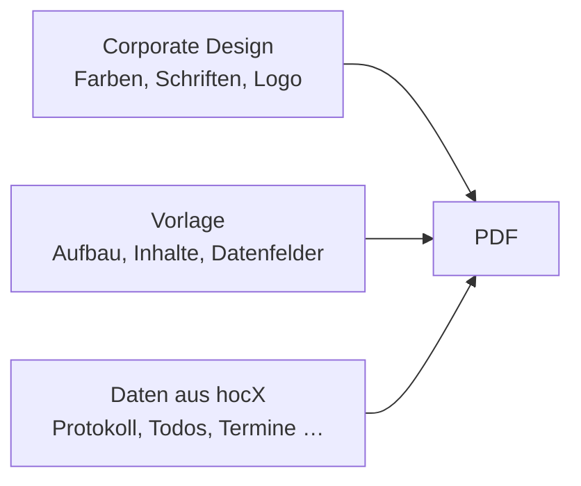

# Dokumente & Document Studio

Alle PDFs in hocX entstehen über denselben Weg: Daten aus hocX + eine **Vorlage** + das
**Corporate Design** des Vereins. Gestaltet wird im **Document Studio** (Navigation
**Dokumente**), exportiert wird überall mit demselben Dialog.

Das Document Studio hat fünf Bereiche:

| Bereich | Wofür | Wer |
|---|---|---|
| **Vorlagen** | Vorlagen ansehen, anpassen, neu anlegen, veröffentlichen | alle sehen; bearbeiten ab Rolle «Schreiben»; veröffentlichen Admins |
| **Corporate Design** (Brand Studio) | Farben, Schriften, Logos, Seitenaufbau, Angaben zum Verein | Admins |
| **Bilder und Schriften** | Logos, Grafiken und Schriftdateien hochladen | Admins |
| **Komponenten** | Wiederverwendbare Bausteine verwalten | ab Rolle «Schreiben» |
| **Export-Verlauf** | Alle erzeugten PDFs mit Vorlage und Prüf-ID | alle |

Das Document Studio ist für den Computer gedacht. Am Smartphone erscheint ein Hinweis mit einem
Link, den du dir zuschicken kannst. Exportieren funktioniert auch am Smartphone.

## Exportieren

Der Button **Export** bzw. **Exportieren** steht beim Protokoll, bei Todos, Terminen, Listen und
in der Statistik. Er öffnet den Export-Dialog:

1. **Vorlage wählen.** Vorgewählt ist die Standardvorlage für dieses Dokument. Es erscheinen nur
   veröffentlichte Vorlagen.
2. **Vorschau prüfen.** Rechts siehst du die ersten Seiten mit den echten Daten. Die aktiven
   Filter der Seite (z. B. «nur offene Todos») gelten auch im Dokument.
3. **Optionen** (falls nötig): Sprache des Dokuments, Corporate Design, eigener Titel,
   Wasserzeichen «Entwurf» (automatisch bei Entwürfen, immer oder nie).
4. **PDF erstellen.** Das PDF öffnet sich in einem neuen Tab. Je nach Dokument gibt es zusätzlich
   **CSV**, **Excel**, **Kalender (ICS)** oder **Text (Markdown)**. Diese Formate enthalten
   dieselben Daten, aber kein Layout.

Welche Vorlage vorgewählt ist, entscheidet hocX in dieser Reihenfolge:

1. die im Dialog gewählte Vorlage
2. die Vorlage, die einer **Protokollvorlage** zugewiesen ist (z. B. eine eigene Vorlage nur für
   Generalversammlungen)
3. die **Standardvorlage** des Vereins für diesen Dokumenttyp
4. die mitgelieferte Standardvorlage von hocX

Siehst du ein Datenfeld nicht (z. B. Finanzen), fehlt dir das Recht dazu. Der Export bricht dann
mit einem Hinweis ab, statt still Daten wegzulassen.

## Vorlagen

Unter **Dokumente → Vorlagen** stehen alle Vorlagen, gruppiert nach Dokumenttyp (Protokoll,
Einladung, Traktandenliste, Anwesenheitsliste, Präsenzliste, Mitgliederliste, Pendenzenliste,
Terminplan, Kalender, Finanzbericht, Buchungsliste, Bussenübersicht, Statistikbericht, Liste,
Formular, freies Dokument). Suche und Kategorien helfen beim Finden. Ein Klick auf das
Vorschaubild zeigt die Vorlage gross mit Beispieldaten.

Es gibt drei Arten:

- **Mitgeliefert:** Vorlagen von hocX, für jeden Dokumenttyp mindestens eine, für Protokolle
  mehrere (Standard, formell, kompakt, Kurzprotokoll, Beschlussprotokoll). Sie lassen sich nicht
  ändern, aber mit **Anpassen (Kopie erstellen)** als eigene Kopie übernehmen.
- **Eigene:** neu angelegte Vorlagen (**Neue Vorlage**, leer oder auf Basis einer bestehenden).
- **Kopie:** angepasste Kopie einer mitgelieferten Vorlage.

Im Menü (⋮) einer Vorlage: Vorschau, Bearbeiten, Duplizieren, Umbenennen, Versionen, **Als
Standard festlegen**, Archivieren, Löschen. Über **Standardvorlagen** legen Admins für jeden
Dokumenttyp und jede Protokollvorlage fest, welche Vorlage und welches Corporate Design gelten.

### Entwurf und Veröffentlichung

- Änderungen landen immer in einem **Entwurf**. Exporte verwenden weiterhin die zuletzt
  veröffentlichte Fassung.
- **Veröffentlichen** (Admins) prüft die Vorlage. Fehler (z. B. ein Datenfeld, das es nicht gibt)
  verhindern das Veröffentlichen, das betroffene Element wird markiert.
- Jede veröffentlichte Fassung bleibt unverändert erhalten. Unter **Versionen** lassen sich zwei
  Fassungen vergleichen und eine alte Fassung als neuer Entwurf wiederherstellen.
- **Archivierte** Vorlagen erscheinen nicht mehr im Export-Dialog, bleiben aber für bestehende
  Exporte erhalten.

## Visual Designer

Ein Klick auf **Bearbeiten** öffnet den Designer.

| Bereich | Inhalt |
|---|---|
| Oben | Zurück, Name, Speicherstatus, Rückgängig/Wiederholen, Modus, Ansicht, Seitenformat, Hoch/Quer, Zoom, Speichern, Veröffentlichen |
| Links | **Elemente** (Bibliothek), **Struktur** (alle Elemente als Baum), **Daten** (Datenfelder aus hocX), **Eigene** (wiederverwendbare Komponenten) |
| Mitte | **Arbeitsfläche** mit Kopfzeile, Inhalt und Fusszeile und/oder die **PDF-Vorschau** |
| Rechts | **Eigenschaften** des gewählten Elements, ohne Auswahl die Einstellungen des ganzen Dokuments |

**Ansichten:** «Gestalten» zeigt nur die Arbeitsfläche, «Geteilt» Arbeitsfläche und Vorschau
nebeneinander, «PDF-Vorschau» nur die Vorschau. Die Arbeitsfläche ist eine schnelle Annäherung.
Verbindlich ist die PDF-Vorschau, sie entsteht mit derselben Technik wie der echte Export. In der
Vorschau lässt sich zwischen **Beispieldaten** und **echten Daten** (z. B. eines bestimmten
Protokolls) wechseln. Hinweise wie «Unbekanntes Datenfeld» erscheinen in der Vorschau und am
Element. Ein Klick darauf wählt das Element aus.

**Elemente einfügen:** Element aus der Bibliothek auf die Arbeitsfläche ziehen (die blaue Linie
zeigt, wo es landet) oder anklicken: Es wird nach dem gewählten Element bzw. am Ende des
gewählten Bereichs eingefügt. Die Bereichsknöpfe links neben der Seite (Kopfzeile, Inhalt,
Fusszeile) wählen, wohin neue Elemente kommen.

**Datenfelder:** Im Tab **Daten** stehen alle Felder, die hocX füllen kann (Organisation,
Dokument, Protokoll, Pendenzen, Termine, Mitglieder, Finanzen, Statistik). Ein Feld einfügen
ergibt einen Text mit Platzhalter, eine Liste (z. B. «Aktive Mitglieder») eine Tabelle mit einer
Zeile pro Eintrag. In Texten lassen sich Datenfelder mit festem Text mischen, mit Format (z. B.
Datum lang oder kurz) und einem Ersatztext, falls das Feld leer ist.

**Fachkomponenten** wie Anwesenheit, Pendenzen, Kontostände, Diagramme oder
Unterschriftsfelder haben eigene Einstellungen (Zeitraum, Spalten, Filter, Gruppierung) im
Eigenschaftenbereich.

### Modi

| Modus | Was du einstellen kannst |
|---|---|
| **Einfach** | Inhalte, Bilder, Datenfelder, Schrift, Farben aus dem Corporate Design, Abschnitte ein-/ausschalten |
| **Erweitert** | zusätzlich Abstände, Rahmen, Hintergründe, Breiten, Spalten, Bedingungen («nur anzeigen, wenn …»), Wiederholen pro Eintrag, Seitenumbruch-Verhalten, eigene Komponenten |
| **Experte** | zusätzlich Übersetzungen pro Text und Sprache, Masse in Millimetern, freie Positionierung |

Alle Modi bearbeiten dieselbe Vorlage. Beim Wechseln geht nichts verloren, Einstellungen aus
einem höheren Modus bleiben erhalten und wirken weiter.

### Bedingungen und Wiederholen

- **Sichtbarkeit** (Erweitert): Ein Element erscheint nur, wenn eine Bedingung zutrifft, z. B.
  «Offene Pendenzen ist nicht leer» oder «Anzahl Abwesende grösser als 0». Mehrere Bedingungen
  lassen sich mit «alle» oder «mindestens eine» verknüpfen.
- **Wiederholen** (Erweitert): Ein Element wird für jeden Eintrag einer Liste wiederholt. Darin
  stehen die Felder des Eintrags zur Verfügung (z. B. Name und E-Mail jedes Mitglieds).

### Seiten

Ohne Auswahl zeigt der rechte Bereich das Dokument: Abschnitte ein- und ausschalten und
umsortieren, Corporate Design wählen und einzelne Farben, Logo oder Schriften nur für diese
Vorlage überschreiben, Seitenformat (A4, A5, A3, Letter, Legal oder eigenes), Ausrichtung, Ränder,
Textspalten, Titelseite, Seitenvorlagen (z. B. ein Anhang im Querformat, eine andere erste
Seite), Nummerierung der Überschriften, feste Sprache und Prüfvermerk.

Mit **Änderungen am Profil** legst du fest, ob eine veröffentlichte Vorlage spätere Änderungen am
Corporate Design übernimmt («Mitgehen») oder den Stand beim Veröffentlichen behält («Beim
Veröffentlichen festhalten»).

### Speichern und Tastatur

Der Designer speichert automatisch kurz nach jeder Änderung. Arbeiten zwei Personen gleichzeitig
an derselben Vorlage, erscheint ein Hinweis: **Neuen Stand laden** übernimmt die Änderungen der
anderen Person, **Meinen Stand speichern** überschreibt sie.

| Taste | Wirkung |
|---|---|
| Strg + Z / Strg + Y | Rückgängig / Wiederholen |
| Strg + S | Sofort speichern |
| Entf | Gewähltes Element löschen |
| Strg + D | Duplizieren |
| Alt + ↑ / ↓ | Element nach oben / unten verschieben |
| Esc | Auswahl aufheben |

Elemente einer mitgelieferten Struktur, die für die Vorlage nötig sind, sind gesperrt und lassen
sich nicht löschen.

## Corporate Design (Brand Studio)

Unter **Dokumente → Corporate Design** legen Admins fest, wie die Dokumente des Vereins aussehen.
Es kann mehrere **Profile** geben (z. B. «Verein» und «Jubiläum»), eines ist der **Standard**.

Pro Profil: Farben (Haupt-, Zweit- und Akzentfarbe, Text, Überschriften, Linien, Tabellen,
Statusfarben und eigene Farben), Schriften (mitgelieferte oder hochgeladene Schriftdateien, Grössen,
Zeilenabstand), Logos und Bilder (Logo, helles Logo, Briefkopf, Hintergrund, Wasserzeichen,
Fussbild), Seitenaufbau (Standardformat, Ränder, Abstände, Stil von Überschriften und Tabellen),
Standards für neue Dokumente, Kopf- und Fusszeile, Angaben zur Organisation (Name, Adresse,
Kontakt, Website, Ort) und welche Angaben der Prüfvermerk zeigt.

Rechts zeigt eine Vorschau sofort, wie eine Vorlage mit den ungespeicherten Werten aussieht.
**Speichern** erzeugt eine neue Version des Profils. Frühere Versionen lassen sich unter
**Versionen** wiederherstellen. Neue Profile starten von einem Ausgangspunkt (Klassisch Blau,
Graphit, Wald, Bordeaux, Kompakt).

Ebenfalls hier: die **Dokumentsprache des Vereins**, der Standard für alle Exporte (im
Export-Dialog pro Dokument änderbar). Datumsangaben erscheinen immer als `TT.MM.JJJJ`, Beträge mit
`'` als Tausendertrennzeichen.

## Bilder, Schriften und Komponenten

- **Bilder und Schriften:** PNG, JPG und SVG sowie Schriftdateien (TTF, OTF). Jede Datei wird auf
  Viren geprüft. **Verwendung anzeigen** listet, in welchen Profilen, Vorlagen und Komponenten
  eine Datei steckt. Verwendete Dateien lassen sich nicht löschen.
- **Komponenten:** Im Designer ein Element wählen und **Als wiederverwendbare Komponente
  speichern** (★). Die Komponente erscheint im Tab **Eigene** und lässt sich in jede Vorlage
  einfügen. Änderungen an einer Komponente wirken in allen Vorlagen, die sie verwenden.

## Versionen und Echtheit

- Protokoll-PDFs tragen eine Version: `v0.x` vor dem Abschluss, `v1.x` danach. Die Version
  steigt nur, wenn sich der **Inhalt** geändert hat. Eine andere Vorlage, ein anderes Corporate
  Design oder eine andere Sprache erzeugt keine neue Version.
- Jedes PDF ist ein PDF/A-Dokument (Langzeitarchiv) und wird bei hocX **registriert**. Der
  Prüfvermerk mit Prüfadresse, kurzer Dokument-ID und QR-Code steht am Ende des Dokuments, je nach
  Vorlage auch in der Fusszeile. Wer die Datei erhält, kann damit prüfen, ob sie unverändert aus
  hocX stammt, siehe [Echtheit prüfen](echtheit.md). Welche Angaben der Prüfvermerk zeigt, legt
  das Corporate Design fest (Abschnitt «Echtheitsprüfung»).
- Der **Export-Verlauf** zeigt jedes erzeugte PDF mit Vorlage, Dokument-ID und Prüfsumme der
  Gestaltung.
