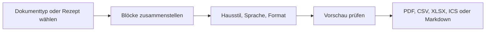

# Dokumente & Hausstile

Alle PDFs in hocX entstehen über denselben Weg: den Dialog **Exportieren …**. Er steht beim
Protokoll, bei den Todos, Terminen, Listen und in der Statistik zur Verfügung und öffnet sich
bildschirmfüllend mit einer Live-Vorschau.

## Dokument zusammenstellen

- **Dokumenttyp:** Vorlage für häufige Dokumente: Protokoll, Einladung, Pendenzenliste,
  Terminplan, Präsenzliste, Mitgliederliste, Finanzbericht, Jahresbericht oder Liste.
  «Dokument» startet leer.
- **Blöcke:** Ein Dokument besteht aus Blöcken (Überschrift, Text, Todo-Tabelle, Terminliste,
  Kalender, Anwesenheit, Kontostand, Diagramm, Kennzahlen, QR-Code, Unterschriftsfelder, …).
  Blöcke lassen sich hinzufügen, entfernen und per Ziehen oder mit den Pfeilen umsortieren.
  Jeder Block hat eigene Einstellungen (z. B. Zeitraum, Status, Spalten, Gruppierung).
- **Weglassen, wenn leer:** Standardmässig verschwinden Blöcke ohne Inhalt. Ist die Option
  aus, steht stattdessen ein kurzer Hinweis wie «Keine offenen Todos».
- **Darstellung:** Hausstil, Sprache des Dokuments, Titelseite, Inhaltsverzeichnis,
  Hoch-/Querformat und das Wasserzeichen «Entwurf» (automatisch bei nicht abgeschlossenen
  Protokollen).

Die Vorschau aktualisiert sich nach jeder Änderung. Fehler (z. B. ein Block, der sich nicht
darstellen lässt) werden mit dem Namen des Blocks angezeigt.

### Rezepte

Eine Zusammenstellung lässt sich als **Rezept** speichern (Schreibrechte nötig). Rezepte stehen
danach allen im Verein im Dialog zur Auswahl, etwa «Jahresbericht Vorstand» oder
«Präsenzliste Hauptversammlung».

### Weitere Formate

Tabellen-Blöcke lassen sich zusätzlich als **CSV** oder **XLSX** herunterladen, Termine als
**ICS** (Kalenderdatei) und Todos als **Markdown**. Diese Formate enthalten dieselben Daten wie
das PDF, aber kein Layout.

## Hausstile

Unter **Vorlagen → Hausstile** legen Administratorinnen und Administratoren fest, wie die PDFs
des Vereins aussehen. Es gibt drei Grundstile:

| Stil | Charakter |
|---|---|
| Modern | Serifenlose Schrift, Farbbalken, luftig |
| Klassisch | Serifenschrift, zurückhaltend, für formelle Dokumente |
| Kompakt | Kleine Abstände, viel Inhalt pro Seite (Listen, Tabellen) |

Pro Hausstil einstellbar: Haupt- und Akzentfarbe, Schrift (mitgelieferte oder eigene
Schriftdateien), Schriftgrösse, Zeilenabstand, Ränder, Format, Kopf- und Fusszeile,
Titelseite, Inhaltsverzeichnis, Nummerierung, Logo, Fussbild, Absender und Ort. Ein Hausstil
ist der **Standard**; Vorlagen können einen anderen Hausstil festlegen, und im Export-Dialog
lässt sich jeder Hausstil wählen.

Ebenfalls hier: die **Dokumentsprache** des Vereins (Standard für alle Exporte, im Dialog pro
Export änderbar). Datumsangaben erscheinen immer als `TT.MM.JJJJ`, Beträge mit `'` als
Tausendertrennzeichen.

## Versionen und Signatur

- Protokoll-PDFs tragen eine Version: `v0.x` vor dem Abschluss, `v1.x` danach. Die Version
  steigt nur, wenn sich der **Inhalt** geändert hat – ein anderer Hausstil oder eine andere
  Sprache erzeugt keine neue Version.
- Jedes PDF ist ein PDF/A-Dokument (Langzeitarchiv) und **digital signiert**. In der Fusszeile
  steht «Digital signiert von hocX · Dokument-ID · Version». Ein PDF-Reader (z. B. Adobe
  Acrobat) zeigt an, ob das Dokument seit dem Export verändert wurde.
