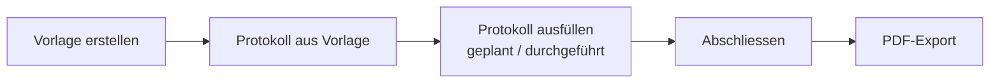

# Übersicht für Vereine

hocX begleitet einen Verein durch den kompletten Zyklus einer Sitzung/Vereinsperiode:

## Kernbereiche

| Bereich | Was damit geht |
|---|---|
| [Zyklen & Vorlagen](vorlagen.md) | Wiederkehrende Struktur einer Sitzungsart definieren (Traktanden, Blöcke, Tabellen) |
| [Protokolle](protokolle.md) | Konkrete Sitzung planen, durchführen, abschliessen, exportieren |
| [Termine](termine.md) | Sitzungstermine und weitere Events verwalten |
| [Mitglieder & Logins](mitglieder.md) | Wer ist im Verein, wer nimmt an welcher Sitzung teil, wer kann sich anmelden |
| [Konto & Anmeldung](konto.md) | Anmelden, Passwort, zweiter Faktor |
| [Benachrichtigungen](benachrichtigungen.md) | Welche E-Mails hocX schickt und wie man sie abbestellt |
| [Finanzen & Bussen](finanzen.md) | Vereinskonto, Buchungen, Bussenverwaltung |
| [Stammlisten](listen.md) | Frei konfigurierbare Listen (z. B. Vorstand, Inventar) |
| [Todos](todos.md) | Aufgaben aus Protokollen nachverfolgen |
| [Anliegen](anliegen.md) | Punkte für kommende Sitzungen sammeln |
| [Statistik und Dashboard](statistik.md) | Startseite, Kennzahlen, Gruppen und wer welche Zahlen sieht |
| [Abgabebox](abgabebox.md) | Öffentlicher, anmeldefreier Datei-Upload für Externe |
| [Word-Import](word-import.md) | Altprotokolle (.docx/.pdf) als neue Protokolle importieren |
| [Dokumente & Document Studio](dokumente.md) | PDFs exportieren, Vorlagen gestalten, Corporate Design festlegen |
| [Echtheit prüfen](echtheit.md) | Prüfen, ob ein PDF unverändert aus hocX stammt; Name, Logo und Verifizierung auf der Prüfseite |

## Rollen

Der Zugriff innerhalb eines Vereins (Mandant) ist rollenbasiert. Details siehe
[Rollen & Berechtigungen](rollen.md).
