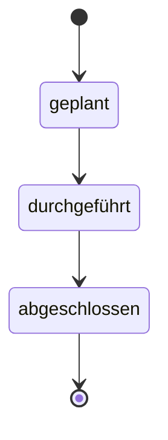

# Protokolle

Ein Protokoll entsteht aus einer Vorlage und durchläuft mehrere Status:

- **geplant** – Vorbereitungsmodus. Struktur-/Auswahldaten (Termine, Listenzeilen,
  Teilnehmer) werden über kleine Icons und dedizierte Popups gepflegt statt direkt
  inline im Text, damit die Vorbereitung übersichtlich bleibt.
- **durchgeführt** – Nachbearbeitungsmodus. Inline-Bearbeitung direkt im Protokolltext
  ist wieder möglich (z. B. während oder nach der Sitzung mitschreiben).
- **abgeschlossen** – Das Protokoll ist ein unveränderlicher Snapshot. Live-Werte (wie
  z. B. "Verantwortlich"-Namen aus einer Liste) werden beim Abschliessen endgültig
  eingefroren. Export als PDF ist möglich.

## Abgeschlossenes Protokoll korrigieren

Steht in einem abgeschlossenen Protokoll etwas Falsches (z. B. ein Name oder eine Angabe, die
entfernt werden muss), stufen Admins es auf **durchgeführt** zurück, korrigieren den Text und
schliessen es wieder ab. Beim erneuten Abschliessen

- verschwinden alle Änderungsmarkierungen samt der alten Fassung,
- werden die PDFs des früheren Abschlusses sofort gelöscht (nicht erst nach der
  Aufbewahrungsfrist),
- behält das Dokumentenregister für diese alten PDFs nur noch den Prüfwert, ohne Titel; die
  Prüfseite meldet sie als ersetzt, sobald das neue PDF erzeugt ist.

Danach das Protokoll neu als PDF exportieren. Bereits verschickte PDFs lassen sich so nicht
zurückholen – Empfänger bei Bedarf informieren. In die Dokumentenverwaltung übernommene
Fassungen bleiben dort, bis sie dort gelöscht werden.

## Elemente aus der Vorlage neu laden

Wurde die Vorlage geändert, nachdem ein Protokoll erstellt wurde (neue Elemente, andere
Texte, Filter oder Formularzeilen), lässt sich ein noch nicht abgeschlossenes Protokoll
nachziehen: in der Protokollliste im Drei-Punkte-Menü **Elemente aus Vorlage neu laden**.
Vorher zeigt eine Rückfrage, wie viele Elemente aktualisiert, neu angelegt oder entfernt
werden.

- Titel, Beschreibungen, Filter und Einstellungen kommen aus der aktuellen Vorlage.
- Erfasste Texte, Todos, Bilder, Formular- und Matrixwerte sowie Anwesenheiten bleiben
  erhalten. Unveränderte Vorgabetexte werden durch die neuen ersetzt.
- Elemente, die nicht mehr in der Vorlage sind, werden entfernt, wenn sie leer sind.
  Enthalten sie Daten, bleiben sie am Ende des Protokolls stehen.
- Wer das Protokoll gerade offen hat, bekommt einen Hinweis und die Ansicht lädt neu.

## Mehrbenutzer-Bearbeitung

Mehrere Personen können gleichzeitig am selben Protokoll arbeiten. Wer gerade welches
Feld bzw. welche Tabellenzelle bearbeitet, wird live angezeigt (Sperre mit Zeitlimit),
damit sich Bearbeitungen nicht gegenseitig überschreiben.

## PDF-Export

Aus einem Protokoll lässt sich jederzeit ein PDF erzeugen (auch vor dem Abschluss). Der
Export liest ausschliesslich die im Protokoll gespeicherten Snapshot-Daten. Vor dem Abschluss
trägt das PDF das Wasserzeichen «Entwurf» und eine Version `v0.x`, danach `v1.x`. Details zu
Export-Dialog, Vorlagen und Echtheitsprüfung: [Dokumente & Document Studio](dokumente.md).
