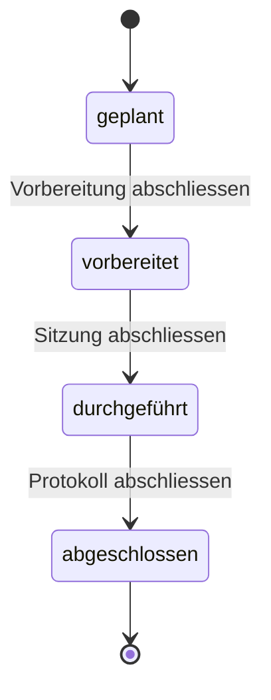

# Protokolle

Ein Protokoll entsteht aus einer [Vorlage](vorlagen.md) und begleitet einen Hock von der
Vorbereitung bis zum unterschriebenen PDF. Die Protokollliste zeigt alle Protokolle nach
Zyklus (Vereinsjahr) gruppiert, das aktuelle zuoberst.

## Protokoll erstellen {#erstellen}

In der Protokollliste **Neues Protokoll** wählen:

1. **Vorlage** auswählen. hocX merkt sich die zuletzt gewählte Vorlage für das nächste Mal.
   Ohne Vorlage lässt sich kein Protokoll erstellen – die Vorlage legt Traktanden, Bausteine
   und Nummerierung fest.
2. **Datum** setzen.
3. **Nummer** und **Titel**: Hat die Vorlage ein Muster dafür (z. B. `{cycle_year_start}-{n}`),
   berechnet hocX beides automatisch und zeigt es als Vorschau an. Die laufende Nummer ergibt
   sich aus dem Rang des Datums im Zyklus. Ohne Muster werden Nummer und Titel von Hand
   eingegeben.

Wird ein Protokoll mit einem früheren Datum nachträglich eingefügt (Rückdatierung), rücken die
Nummern der späteren, noch offenen Protokolle derselben Vorlage automatisch nach.
Abgeschlossene Protokolle werden nie umnummeriert.

Ältere Protokolle aus Word-Dateien übernimmt der [Word-Import](word-import.md).

## Status und Arbeitsmodi {#status}

Ein Protokoll durchläuft vier Status. Der Knopf oben rechts im Editor führt jeweils zum nächsten:

| Status | Arbeitsmodus | Wofür |
|---|---|---|
| **geplant** | Vorbereitungsmodus | Traktanden, Termine, Listen und Teilnehmende vorbereiten. Auf Wunsch mit Änderungsnachverfolgung. |
| **vorbereitet** | Sitzungsmodus | Während des Hocks mitschreiben: Anwesenheit, Notizen, Todos, Anliegen. |
| **durchgeführt** | Nachbearbeitungsmodus | Nach dem Hock ergänzen und bereinigen. |
| **abgeschlossen** | – | Eingefroren und schreibgeschützt, signiertes PDF. |

**Sitzung abschliessen** fragt nach. Wartende Anliegen für diesen Hock werden dabei fest ins
Protokoll übernommen.

**Protokoll abschliessen** fragt ebenfalls nach, denn der Schritt hat Folgen:

- Das Protokoll wird eingefroren. Live-Werte (z. B. «Verantwortlich»-Namen aus einer Liste,
  Mitgliedschaften, Listenzeilen) werden endgültig festgehalten.
- Der Stand aller Todos wird als Momentaufnahme gesichert. Die Todos selbst bleiben
  bearbeitbar, das Protokoll zeigt aber die Momentaufnahme.
- hocX erzeugt das signierte PDF (Version `v1.x`).
- Die Verantwortlichen offener Todos erhalten ihre E-Mail-Benachrichtigung.

Vor dem Statuswechsel speichert der Editor alle noch ausstehenden Eingaben und wartet auf die
Bestätigung des Servers. Gelingt das nicht (z. B. ohne Verbindung), bleibt der Status unverändert
und eine Meldung erscheint. Erst nach erfolgreicher Speicherung erneut versuchen.

## Abgeschlossenes Protokoll korrigieren {#korrigieren}

Steht in einem abgeschlossenen Protokoll etwas Falsches (z. B. ein Name oder eine Angabe, die
entfernt werden muss), stuft eine Person mit dem Recht «Sitzungen bearbeiten» es in der
Protokollliste über das Drei-Punkte-Menü (**Zurück auf «Durchgeführt»**) zurück, korrigiert
den Text und schliesst es wieder ab.

Beim Zurückstufen wird die Todo-Momentaufnahme verworfen: Das Protokoll zeigt danach die
aktuellen Todos, inklusive aller Änderungen seit dem Abschluss.

Beim erneuten Abschliessen

- verschwinden alle Änderungsmarkierungen samt der alten Fassung,
- werden die PDFs des früheren Abschlusses sofort gelöscht (nicht erst nach der
  Aufbewahrungsfrist),
- behält das Dokumentenregister für diese alten PDFs nur noch den Prüfwert, ohne Titel; die
  Prüfseite meldet sie als ersetzt, sobald das neue PDF erzeugt ist.

Bereits verschickte PDFs lassen sich so nicht zurückholen – Empfänger bei Bedarf informieren.
In die Dokumentenverwaltung übernommene Fassungen bleiben dort, bis sie dort gelöscht werden.

Solange ein Protokoll abgeschlossen ist, lassen sich weder Titel, Datum noch Sitzungsnotizen
ändern, und es kann nicht gelöscht werden. Dafür zuerst zurückstufen.

## Schreiben, Speichern und Entwürfe {#speichern}

- Texte werden beim Tippen automatisch gespeichert (kurz nach der letzten Eingabe). Die Anzeige
  «Gespeichert» bestätigt es.
- Zusätzlich hält der Browser jeden noch nicht bestätigten Text als **lokalen Entwurf** fest.
  Stürzt der Browser ab oder bricht die Verbindung ab, stellt der Editor den Entwurf beim
  nächsten Öffnen wieder her.
- Ohne Verbindung arbeitet der Editor weiter; die Änderungen werden gespeichert, sobald die
  Verbindung zurück ist.
- **Bearbeitungskonflikt:** Hat jemand anderes dieselbe Stelle inzwischen gespeichert, meldet
  der Editor einen Konflikt und lädt die aktuelle Fassung. Die eigene Eingabe bleibt als lokaler
  Entwurf erhalten. Beim nächsten Öffnen wird ein solcher Entwurf nicht stillschweigend
  übernommen: Eine Meldung bietet **Meinen Entwurf übernehmen** an – nur dann ersetzt er die
  fremde Fassung.
- **Sitzungsnotizen** (Schnellmenü) sind interne Notizen zum Hock. Sie werden ebenfalls
  automatisch gespeichert und erscheinen nie im PDF.

## Änderungen nachverfolgen {#nachverfolgen}

Im Status **geplant** lässt sich «Änderungen nachverfolgen» einschalten. Geänderte Texte und
Einträge gegenüber dem letzten abgeschlossenen Protokoll derselben Vorlage werden dann rot
markiert, damit in der Sitzung sichtbar ist, was neu ist. Eine Markierung lässt sich pro Text
mit **Ausblenden** annehmen. Ab dem Sitzungsmodus werden keine neuen Änderungen mehr markiert,
bestehende Markierungen bleiben sichtbar. Beim Abschliessen verschwinden alle Markierungen.

## Anwesenheit, Todos und Anliegen {#sitzung}

- **Anwesenheit:** Ein Klick auf eine Person schaltet zum nächsten Status, langes Drücken öffnet
  die Auswahl. Mit Tab zur Person springen und mit den Tasten **1–4** den Status direkt setzen.
  «Übrige auf anwesend» setzt alle noch offenen Personen. Ist für unentschuldigtes Fehlen eine
  Busse hinterlegt, entsteht sie automatisch (siehe [Todos](todos.md) und
  [Finanzen](finanzen.md)).
- **Todos:** In Todo-Bausteinen oder über das Schnellmenü **Todo erstellen** – mit
  Verantwortlichen und Fälligkeit. Offene Todos werden beim Abschliessen gemeldet.
- **Anliegen:** Über das Schnellmenü erfasst, landen sie beim passenden Traktandum. Details:
  [Anliegen](anliegen.md).

## Suche und Tastenkürzel {#tastatur}

- **Strg+F** öffnet die Suche im Protokoll und springt zum Treffer.
- **Strg+Enter** springt zum nächsten Punkt, **Strg+Umschalt+Enter** zum vorherigen. Beides
  wechselt nie den Status.
- **Strg+Alt+N** öffnet die Sitzungsnotizen, **Strg+Alt+T** ein neues Todo.
- Das Panel **Status & Zusammenarbeit** listet alle Tastenkürzel.
- Die Suche in der Protokollliste durchsucht Nummer und Titel aller Protokolle, auch solcher,
  die noch nicht nachgeladen sind.

## Elemente aus der Vorlage neu laden {#vorlage-neu-laden}

Wurde die Vorlage geändert, nachdem ein Protokoll erstellt wurde (neue Elemente, andere
Texte, Filter oder Formularzeilen), lässt sich ein noch nicht abgeschlossenes Protokoll
nachziehen: in der Protokollliste im Drei-Punkte-Menü **Elemente aus Vorlage neu laden**.
Vorher zeigt eine Rückfrage, wie viele Elemente aktualisiert, neu angelegt oder entfernt
werden.

- Titel, Beschreibungen, Filter und Einstellungen kommen aus der aktuellen Vorlage.
- Erfasste Texte, Todos, Bilder, Formular- und Matrixwerte sowie Anwesenheiten bleiben
  erhalten. Unveränderte Vorgabetexte werden durch die neuen ersetzt.
- Elemente, die nicht mehr in der Vorlage sind, werden entfernt, wenn sie leer sind.
  Enthalten sie Daten, bleiben sie am Ende des Protokolls stehen.
- Wer das Protokoll gerade offen hat, bekommt einen Hinweis und die Ansicht lädt neu.

## Mehrbenutzer-Bearbeitung {#mehrbenutzer}

Mehrere Personen können gleichzeitig am selben Protokoll arbeiten. Wer gerade welches
Feld bzw. welche Tabellenzelle bearbeitet, wird live angezeigt (Sperre mit Zeitlimit),
damit sich Bearbeitungen nicht gegenseitig überschreiben. Das Panel **Status &
Zusammenarbeit** zeigt, wer mitarbeitet, ob die Live-Verbindung steht und wie die Anwesenheit
aussieht. Ist die Live-Verbindung unterbrochen («Offline»), wird trotzdem weiter gespeichert.

Wechselt jemand den Status, während andere mitarbeiten, weist die Rückfrage darauf hin. Die
anderen sehen den neuen Status sofort.

## PDF-Export {#pdf}

Aus einem Protokoll lässt sich jederzeit ein PDF erzeugen (auch vor dem Abschluss). Der
Export liest ausschliesslich die im Protokoll gespeicherten Snapshot-Daten. Vor dem Abschluss
trägt das PDF das Wasserzeichen «Entwurf» und eine Version `v0.x`, danach `v1.x`. Details zu
Export-Dialog, Vorlagen und Echtheitsprüfung: [Dokumente & Document Studio](dokumente.md).

Was im Editor Inhalt hat, aber nicht ins PDF kommt, ist mit **Nicht im PDF** markiert, mit dem
Grund: Punkt oder Baustein in der Vorlage vom Export ausgenommen, Sitzungsnotizen, ein
Inhaltsfilter der PDF-Vorlage oder Bilder, die noch nicht geprüft sind.

## Historische Ansicht {#historisch}

Bausteine mit Listen oder Finanzdaten zeigen in Protokollen vergangener Zyklen den damals
eingefrorenen Stand (Snapshot). Fehlt ein Snapshot, füllt hocX ihn aus der aktuellen Liste vor
und bittet um Prüfung. **Bearbeitung freischalten** erlaubt Korrekturen an diesen historischen
Daten; die Änderung wird protokolliert.

## Löschen {#loeschen}

Nicht abgeschlossene Protokolle lassen sich im Drei-Punkte-Menü löschen. Im Löschdialog wird
gewählt, welche Bilder des Protokolls mitgelöscht werden; die übrigen bleiben in der Galerie.
Abgeschlossene Protokolle zuerst zurückstufen.

## Wer darf was? {#rechte}

| Aktion | Benötigtes Recht |
|---|---|
| Abgeschlossene Protokolle lesen | Sitzungen ansehen |
| Entwürfe (geplant bis durchgeführt) sehen | Entwürfe ansehen |
| Erstellen, bearbeiten, Status wechseln, zurückstufen, löschen | Sitzungen bearbeiten |

Personen, die nur bestimmten Vorlagen zugeordnet sind, sehen nur deren Protokolle. Rollen und
Rechte: [Rollen](rollen.md).
