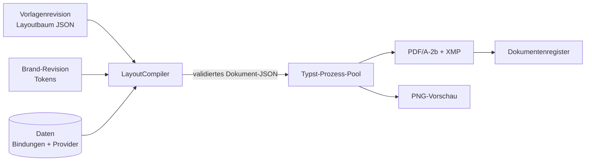

# Document Studio

Das Document Studio ersetzt das frühere System aus Hausstilen, Rezepten und Dokumentvorlagen.
Es besteht aus vier Teilen:

| Teil | Aufgabe | Frontend | Backend |
|---|---|---|---|
| **Brand Studio** | Corporate Design pro Mandant (mehrere Profile, ein Standard) | `components/documents/brand-studio.tsx` | `documents/brand.py`, `brand_service.py` |
| **Template Library** | Vorlagen je Dokumenttyp: System, eigene, angepasste Kopien | `template-library.tsx` | `template_service.py`, `system_templates.py` |
| **Visual Designer** | Vorlagen gestalten (Layoutbaum, Bindungen, Bedingungen) | `designer/*` | `layout.py`, `conditions.py`, `bindings.py`, `components.py` |
| **Export Center** | Einheitlicher Exportdialog für alle Dokumente | `export-dialog.tsx` | `service.py`, `compiler.py`, `renderer.py` |

Typst bleibt der einzige Renderer. Vorlagen sind **deklarative JSON-Daten**. Es gibt keinen
Typst-Code von Benutzern und kein `eval`. Die Dokument-Engine darunter (Provider,
Fachkomponenten, Register, Echtheitsprüfung) beschreibt [Dokument-Engine](dokument-engine.md).



## Datenmodell

| Tabelle | Inhalt |
|---|---|
| `document_brand` | Brand-Profil eines Mandanten: Name, Standard-Flag, archiviert, `lock_version` |
| `document_brand_revision` | Unveränderliche Fassungen der Tokens (`tokens_json`), fortlaufend nummeriert |
| `document_template` | Vorlage: Dokumenttyp, Variante, Kategorie, Herkunft (`system`/`tenant`/`copy`), `system_key`, Status `active`/`archived`, optionales Brand-Profil; `tenant_id NULL` = Systemvorlage |
| `document_template_revision` | Layoutbaum (`content_json`, `schema_version`), Status `draft`/`published`/`superseded`, `lock_version`, `brand_mode` (`follow`/`pinned`), festgehaltene `brand_revision_id` |
| `document_component` | Wiederverwendbare Komponenten (ein Knoten samt Kindern) eines Mandanten |
| `document_template_assignment` | Standardvorlage je Dokumenttyp, optional je Protokollvorlage, optional mit eigenem Brand-Profil |
| `document_asset` | Hochgeladene Bilder und Schriften (Virenprüfung, Prüfsumme, Kategorie) |
| `document_export` | Je Export: `template_id`, `template_revision_id`, `brand_revision_id`, `design_hash`, `options_json` (zusätzlich zu den bisherigen Feldern) |
| `document_registry` | Zusätzlich `design_hash` |

Regeln:

- Pro Vorlage gibt es höchstens einen Entwurf (partieller Unique-Index). Veröffentlichen macht
  die bisher gültige Revision zur abgelösten (`superseded`).
- Veröffentlichte und abgelöste Revisionen sind **unveränderlich**. Das prüft der Service, und
  zusätzlich verhindert ein PL/pgSQL-Trigger (`document_template_revision_immutable`,
  `BEFORE UPDATE`) jede Änderung. Löschen verhindert der Trigger **nicht**: Revisionen
  verschwinden mit ihrer Vorlage (Cascade), und `delete_template` lässt das nur für nie
  exportierte Vorlagen zu; exportierte Vorlagen werden archiviert.
- Speichern (Entwurf, Brand-Profil, Komponente) sperrt die betroffene Zeile
  (`SELECT … FOR UPDATE`, `documents/locking.py`) vor der Prüfung der `lock_version`. Parallele
  Anfragen mit derselben Version ergeben genau einmal HTTP 409.
- Alle JSONB-Inhalte werden vor dem Speichern mit Pydantic validiert (`layout.parse_content`,
  `BrandTokens`). Unbekannte Felder werden abgewiesen.
- Mandantenisolation: Jede Abfrage filtert auf `tenant_id`. Systemvorlagen sind für alle lesbar,
  aber nur für Plattform-Admins änderbar (`/api/admin/document-templates`).

Migration `0118_document_studio` legt die Tabellen an und übernimmt Hausstile als
Brand-Profile, Rezepte als Vorlagen und die Hausstil-Wahl von Protokollvorlagen als
Zuweisungen. Danach entfernt sie die alten Tabellen. Der Downgrade ist getestet
(`tests/test_document_studio_migration.py`).

!!! warning "Datenübernahme und Rückweg"
    - Rezepte, deren Blöcke das neue Schema nicht erfüllen (z. B. `generic_table` mit mehr als
      12 Spalten), übernimmt die Migration nicht. Sie protokolliert jedes übersprungene Rezept
      mit Mandant, Name und Fehler als Warnung und die Anzahl in der Zusammenfassung; danach
      wird `document_recipe` entfernt. Vor dem Upgrade muss deshalb ein Backup vorliegen
      (`deploy.sh` zieht es automatisch, siehe RUNBOOK) und das Migrationsprotokoll auf
      Warnungen geprüft werden.
    - Der Downgrade auf 0117 ist **destruktiv**: Er legt `document_style`/`document_recipe` leer
      an und entfernt Brand-Profile, Vorlagen, Revisionen, Komponenten, Zuweisungen sowie die
      Herkunftsangaben der Exporte (`template_id`, `design_hash` …). Ein Rollback mit Erhalt der
      Daten geht nur über das vor dem Update gezogene Backup.
    - Das Ergebnis der Migration auf bereits migrierten Systemen bleibt unverändert; Anpassungen
      an 0118 nach der Verteilung beschränken sich auf Protokollierung.

## Layoutbaum (`layout.py`)

Eine Vorlage ist ein `TemplateContent` (`LAYOUT_SCHEMA_VERSION = 1`):

```json
{
  "schema_version": 1,
  "page": {"size": "A4", "orientation": "portrait", "margins": {"top": 20, "right": 18, "bottom": 20, "left": 18}, "columns": 1},
  "masters": [{"id": "default", "header": {...}, "footer": {...}, "background": [...]}],
  "title_page": {"enabled": true, "visible_if": null, "children": [...]},
  "body": [...],
  "settings": {"default_master": "default", "first_page_master": null, "auto_verify_note": true, "brand_overrides": {...}}
}
```

**Knotentypen** (diskriminierte Union über `type`, jeder Knoten hat `id`, `name`, `enabled`,
`style`, `visible_if`, `repeat`, `keep_together`, `break_before`):

| Gruppe | Typen |
|---|---|
| Anordnung | `stack`, `row`, `column`, `grid`, `container`, `section`, `absolute_layer`, `header`, `footer` |
| Inhalt | `text`, `rich_text`, `image`, `table`, `list`, `divider`, `spacer`, `page_break`, `qr_code` |
| Dokument | `toc`, `page_number`, `metadata`, `verify_note`, `watermark` |
| Daten | `data_block` (Fachkomponente aus dem Katalog), `component_ref` (wiederverwendbare Komponente) |

Text besteht aus Inline-Teilen: `text`, `bind` (Datenbindung mit Format und Ersatztext),
`key` (fester Text aus `documentPdf`) und `br`. Übersetzungen pro Sprache liegen in
`translations`. Farben sind Referenzen (`$brand.primary`, `$brand.custom.<key>`) oder `#RRGGBB`.
Längen sind `auto`, `fill`, `<n>%`, `<n>fr` oder `<n>mm`.

`validate_structure` prüft unter anderem eindeutige IDs, die Verschachtelungstiefe (≤ 14), die
Knotenzahl (≤ 2000), dass Master-Knoten nur in Seitenvorlagen stehen und dass Verweise auf
Seitenvorlagen existieren. Fehler kommen als `LayoutValidationError` mit Knoten-ID
(`layout_error_of`). Spätere Schemaversionen migriert `layout_migrations.py` beim Laden.

### Bedingungen (`conditions.py`)

`visible_if` ist ein deklarativer Ausdruck ohne Code: `exists`, `empty`, `eq`, `ne`, `gt`, `gte`,
`lt`, `lte`, `contains`, `in`, `not_in`, `count` (mit `cmp`), verknüpft über `all`, `any` und `not`.
Pfade sind Bindungspfade. Unbekannte Pfade weist die Validierung ab. Zur Laufzeit gilt ein
fehlender Wert als leer.

## Datenbindungen (`bindings.py`)

Die Registry enthält 65 typisierte Pfade (`text`, `date`, `number`, `amount`, `percent`, `image`,
`bool`, `list`) in den Gruppen `organization`, `brand`, `document`, `protocol`, `todos`, `events`,
`members`, `finance` und `statistics`. Listen haben Elementfelder (`item.<feld>`). Diese stehen
in `repeat`-Knoten und datengebundenen Tabellen und Listen zur Verfügung.

Jede Bindung trägt eine Zugriffsstufe:

| Stufe | Wer darf exportieren |
|---|---|
| `reader` | alle mit Exportrecht |
| `writer` | Rollen `writer`, `admin` (Personendaten wie E-Mail) |
| `finance` | nur mit Feature `finance` |

Geprüft wird **beim Export mit den Rechten der exportierenden Person**, nicht beim Speichern der
Vorlage. Eine Vorlage mit Finanzfeldern lässt sich also von allen verwenden. Ohne Recht bricht
der Export mit einer verständlichen Meldung und der Knoten-ID ab (`bindingPermission`), Daten
werden nie still weggelassen. Die Vorschau im Designer verwendet standardmässig Beispieldaten
(`data_mode=sample`, Werte aus `documentPdf.sample.*`). Mit echten Daten gelten dieselben Rechte.

## Brand-Profile (`brand.py`, `brand_service.py`)

`BrandTokens`: Farben (18 feste plus eigene), Typografie (eingebaute Schriften oder hochgeladene
Schriftdateien, Grössen, Zeilenabstand, Überschriften), Assets (Logo, Logo hell, Briefkopf,
Hintergrund, Wasserzeichen, Fussbild, weitere Bilder), Seitenaufbau (Format, Ränder, Abstände,
Stil von Überschriften und Tabellen, Kopf-/Fusszeilen-Optionen, Dokument-Standards),
Organisation und Prüfvermerk. Fünf Vorlagen (`BRAND_PRESETS`) dienen als Ausgangspunkt.

Jedes Speichern erzeugt eine neue unveränderliche Revision (optimistische Sperre über
`lock_version`). Vorlagen wählen über `brand_mode`:

- `follow` (Standard): Die veröffentlichte Vorlage übernimmt spätere Änderungen am Profil.
- `pinned`: Beim Veröffentlichen wird die aktuelle Brand-Revision festgehalten.

Entwürfe zeigen immer den aktuellen Stand. Jeder Export speichert `brand_revision_id`, damit ist
er reproduzierbar. Vorlagen können einzelne Werte überschreiben (`settings.brand_overrides`:
Haupt-, Zweit-, Akzent- und Überschriftenfarbe, Logo, Schriften, Grundgrösse).

Auswahl beim Export: explizit gewähltes Profil > Profil der Zuweisung > Profil der Vorlage >
Standardprofil des Mandanten.

## Vorlagen und Auswahlregel (`template_service.py`)

Systemvorlagen (`system_templates.py`, 26 Stück) decken alle 16 Dokumenttypen ab, wichtige Typen
mit mehreren Varianten (Protokoll: Standard, formell, kompakt, Kurzprotokoll,
Beschlussprotokoll). `sync_system_templates` gleicht sie beim Start ab (`ensure_document_studio`):
Änderungen ergeben eine neue Revision, frühere bleiben für bestehende Exporte erhalten.

### Gestaltungsbeispiele (`examples.py`)

Sechs fertig gestaltete Protokolle (Farbband, Hell, Baustelle, Tech, Kanzlei, Corporate) sind
**keine** Systemvorlagen. Ein Admin holt sie im Studio über **Beispiele** in den Verein
(`POST /api/document-studio/examples/{key}/import`). Der Import legt an:

- die Beispielbilder aus `example_assets/` als Assets des Mandanten (mit Virenscan),
- ein Brand-Profil mit Farben, Schriften, Überschriften- und Tabellenstil und den
  Organisationsangaben des Mockups (nie als Standardprofil; fehlt eines, entsteht zuerst das
  Standardprofil),
- eine eigene Vorlage mit Entwurf, verknüpft mit diesem Profil (`document_template.brand_id`).

Der Verein sieht die Vorlage so zuerst wie im Mockup. Stellt er sie im Designer unter
**Dokument** auf sein eigenes Brand-Profil um, erscheint sie mit seinen Farben, seinem Logo
und seinen Angaben. Die Beispiele verwenden nur Bausteine und Brand-Referenzen, keine festen
Farben ausser Weiss. Die Vorschaubilder der Galerie liegen fertig unter
`example_assets/thumbnails/` (`GET /api/document-studio/examples/{key}/thumbnail`).

Neues Beispiel: Builder und `DesignExample` (CD-Tokens, Bilder) in `examples.py`, Namen und
Beschreibungen unter `documentStudio.examples.items.<key>` in allen Sprachen, Vorschaubild
erzeugen (Rendern mit Beispieldaten, erste Seite als PNG mit 48 ppi).

Priorität beim Export:

1. explizit gewählte Vorlage (Export-Dialog)
2. Zuweisung der Protokollvorlage
3. Standardvorlage des Mandanten für den Dokumenttyp
4. Plattform-Standard (Systemvorlage mit `platform_default`)
5. erste veröffentlichte Systemvorlage des Typs

Lebenszyklus: Entwurf (Autosave, HTTP 409 bei veralteter `lock_version`) → Veröffentlichen
(`validate_template`, Fehler blockieren, Warnungen nicht) → abgelöste Revisionen bleiben lesbar.
Sie lassen sich vergleichen (`compare_revisions`) und als neuer Entwurf wiederherstellen.

## Compiler (`compiler.py`)

`LayoutCompiler` übersetzt Vorlage + Brand + Daten in validiertes Dokument-JSON für Typst:

1. Inhalt laden und migrieren, Struktur validieren
2. Brand-Revision auflösen, Overrides anwenden, Farben und Schriften auflösen
3. Komponentenverweise einsetzen (Zyklen werden erkannt)
4. Bedingungen auswerten, `repeat` auflösen (Obergrenze gesamt), Bindungen auflösen und formatieren
5. Fachkomponenten über Katalog und Provider bauen (Parameter validiert, IDs mandantenbezogen)
6. Segmente pro Seitenvorlage, Titelseite, Prüfvermerk (automatisch, wenn keiner vorhanden)

Im **strikten Modus** (Export) bricht jeder Fehler mit `CompileError` (Code + Knoten-ID) ab. Im
**Vorschaumodus** sammelt er Diagnosen und rendert trotzdem. Das Frontend zeigt sie am Element
(Code → `documentStudio.diagnosticCode.*`). Scheitert der Typst-Compile selbst, sucht
`renderer._locate_failing_node` den verursachenden Knoten.

Typst-Seite: `typst/main.typ` (Seiten, Seitenvorlagen, Segmente), `typst/layout.typ`
(`render-node`), `typst/theme.typ` (Palette, Überschriften- und Tabellenstil aus den Tokens) und
`typst/base/*.typ` (Fachkomponenten). Limits (Prozess-Pool, Timeout, `RLIMIT_AS`, Schriften,
vendorte Pakete) sind unverändert, siehe [Dokument-Engine](dokument-engine.md#render-limits).

## Hashes und Versionierung

| Hash | Grundlage | Wirkung |
|---|---|---|
| Inhalts-Hash | Kanonischer Protokollinhalt (alle exportsichtbaren Elemente), unabhängig von Vorlage, Brand und Sprache | Steuert die Protokollversion (`v0.x`/`v1.x`). Eine Designänderung erzeugt keine neue Version |
| Design-Hash | Vorlagenrevision + Brand-Tokens + Asset-Prüfsummen + `COMPILER_VERSION` | In `document_export`, `document_registry` und XMP (`hocx:designHash`) |
| PDF-Hash | SHA-256 der ausgelieferten Bytes | Dokumentenregister und Echtheitsprüfung (unverändert) |

## Berechtigungen (`permissions.py`)

| Fähigkeit | Berechtigung (Standardrollen) |
|---|---|
| Exportieren, Vorlagen ansehen | `meetings.read` (alle) |
| Vorlagen bearbeiten (Entwürfe, Kopien, Komponenten) | `templates.edit` (writer, admin) |
| Veröffentlichen, archivieren, löschen, Zuweisungen | `settings.manage` (admin) |
| Brand-Profile und Bilder/Schriften verwalten | `settings.manage` (admin) |
| Personendaten in Dokumenten (Katalog-Zugriff `writer`) | `participants.manage` oder `meetings.edit` |
| Entwürfe ohne Wasserzeichen | `meetings.edit` |
| Systemvorlagen (archivieren, Plattform-Standard) | Plattform-Admin |

Siehe [Rollen & Berechtigungen](../benutzer/rollen.md).

`GET /api/document-studio/capabilities` liefert diese Fähigkeiten an das Frontend. Das blendet
damit nur aus, die Durchsetzung liegt immer im Backend.

## API

| Endpunkt | Zweck |
|---|---|
| `GET /api/document-studio/capabilities`, `GET /api/document-studio/catalog` | Rechte; Knotentypen, Bibliothek, Fachkomponenten (Parameter-Schemas), Bindungen, Dokumenttypen, Farben, Schriften |
| `GET/POST /api/document-templates`, `GET/PATCH/DELETE /api/document-templates/{id}` | Bibliothek und Vorlagen |
| `POST /api/document-templates/{id}/duplicate` | Kopie (auch von Systemvorlagen) |
| `PUT/DELETE /api/document-templates/{id}/draft` | Entwurf speichern (`lock_version`, 409) / verwerfen |
| `POST /api/document-templates/validate` | Prüfen ohne Speichern |
| `POST /api/document-templates/{id}/publish`, `/archive` | Veröffentlichen, archivieren |
| `GET .../revisions`, `GET .../revisions/{rev}`, `POST .../revisions/{rev}/restore`, `GET .../compare` | Revisionen |
| `GET /api/document-templates/{id}/thumbnail` | Vorschaubild (gecacht pro Revision) |
| `GET/PUT /api/document-template-assignments` | Standardvorlagen und Brand je Dokumenttyp/Protokollvorlage |
| `/api/document-brands[/{id}[/archive\|/revisions[/{rev}/restore]]]` | Brand-Profile |
| `/api/document-assets[/{id}[/content\|/references]]` | Bilder und Schriften (Upload mit Virenprüfung) |
| `/api/document-components[/{id}]` | Wiederverwendbare Komponenten |
| `POST /api/documents/render`, `/preview`, `/export`, `GET /api/documents/exports` | Export Center (siehe Dokument-Engine) |
| `/api/admin/document-templates[/{id}/archive\|/platform-default]` | Systemvorlagen (Plattform-Admin) |

Eine Exportanfrage (`DocumentRequest`) enthält `document_type`, `protocol_id`, `template_id` oder
`revision_id`, im Designer alternativ den ungespeicherten `content`, dazu `brand_id` bzw.
`brand_tokens` (nur Vorschau), `params` (Seitenfilter), `options` (Titel, Untertitel,
Wasserzeichen `auto`/`on`/`off`), `language` und `data_mode`.

## Frontend

- `lib/documents/layout.ts`: Typen und unveränderliche Baumoperationen (einfügen, verschieben,
  duplizieren, löschen, gesperrte Knoten bleiben erhalten). `history.ts`: Undo/Redo mit
  Zusammenfassung schneller Eingaben.
- Designer: links Bibliothek, Struktur, Datenfelder und eigene Komponenten. In der Mitte die
  Arbeitsfläche (angenäherte HTML-Darstellung, Drag-and-drop mit dnd-kit) und/oder die
  verbindliche Typst-Vorschau (PNG, entprellt, abbrechbar, gecacht). Rechts die Eigenschaften
  oder, ohne Auswahl, die Dokumenteinstellungen.
- Modi: **Einfach** (Inhalte, Bilder, Daten, Grundgestaltung), **Erweitert** (Abstände, Rahmen,
  Bedingungen, Wiederholen, eigene Komponenten), **Experte** (Übersetzungen pro Text, freie
  Masse in mm). Alle Modi bearbeiten denselben Baum, ein Wechsel ist verlustfrei.
- Tastatur: Entf (löschen), Strg+D (duplizieren), Alt+↑/↓ (verschieben), Strg+Z/Y, Strg+S, Esc.
- Texte: Namespace `documentStudio`. Labels für Katalogeinträge setzt das Frontend dynamisch
  zusammen (`nodeType.*`, `library.entry.*`, `binding.*` …). `scripts/check-document-catalog.py`
  prüft, dass zu jedem Backend-Eintrag die Labels existieren.

## Erweitern

**Neuer Knotentyp**

1. Modell in `layout.py` (Union `Node`, `NODE_MODELS`), Validierungsregeln in `validate_structure`.
2. Editor-Metadaten in `components.py` (`NODE_TYPES`: Kategorie, Modus, Eigenschaftsgruppen),
   Bibliothekseintrag in `LIBRARY`.
3. Übersetzung im Compiler (`LayoutCompiler`) und Darstellung in `typst/layout.typ`.
4. Arbeitsfläche (`designer/canvas.tsx`) und Eigenschaften (`designer/properties-panel.tsx`).
5. Labels `nodeType.<typ>`, `library.entry/help.<key>` in allen Locales.
6. Golden-Szenario in `tests/documents/fixtures/scenarios.py`, `scripts/update-document-goldens.sh`.

**Neue Datenbindung**: Eintrag in `bindings.py` (`_DEFINITIONS` mit Typ, Gruppe, Zugriffsstufe,
Beispielwert) und Loader. Dazu das Label `binding.<pfad mit _>` und gegebenenfalls
`bindingField.<feld>`.

**Neue Fachkomponente**: wie bisher (Modell, Katalog, Provider, Typst-Komponente, siehe
[Dokument-Engine](dokument-engine.md#neuen-block-typ-hinzufugen)), zusätzlich
`component.<typ>`/`componentHelp.<typ>` und ein Bibliothekseintrag.

**Neue Systemvorlage**: Builder in `system_templates.py`, Eintrag in `SYSTEM_TEMPLATES`, Labels
`system.<key>.name/description`. Der Abgleich beim Start legt sie an.

**Neues Brand-Token**: Feld in `BrandTokens` (mit Standardwert, damit alte Revisionen gültig
bleiben), Auswertung in `typst/theme.typ`, Formular in `brand-studio.tsx`, Labels.

Nach Katalogänderungen: `./scripts/update-document-studio-fixtures.sh` erzeugt die Testdaten der
Frontend-Tests neu (`frontend/lib/documents/test/studio-catalog.generated.json`).

## Tests

- Backend `tests/documents/`: Schema und Validierung, Bedingungen, Bindungen inkl. Rechte,
  Compiler (strikt/Vorschau, Diagnosen), Brand (Revisionen, Overrides, Pinning), Systemvorlagen
  (alle rendern ohne Warnungen), Studio-API (Lebenszyklus, 409, Unveränderlichkeit, Mandanten),
  Export-API, Hashes und Versionierung, Register, Galerie. 23 Golden-Szenarien
  (`test_goldens.py`) vergleichen gerenderte Seiten pixelgenau.
- Migration: `tests/test_document_studio_migration.py` (Upgrade mit Altdaten, Downgrade).
- Frontend: Designer (Einfügen, Autosave mit Sperrversion, Konflikt, Tastatur, Undo, Bindungen,
  Rechte, Veröffentlichen, Systemvorlagen), Bibliothek, Brand Studio, Export-Dialog, Baumoperationen,
  Verlauf.
- E2E `create-and-export.spec.ts`: Export-Dialog, Bibliothek, Brand Studio und Designer mit echter
  Vorschau in Light/Dark.

## Bekannte Einschränkungen

- Die Arbeitsfläche ist eine Annäherung (HTML). Verbindlich ist die Typst-Vorschau. Die
  Frame-Deckkraft freier Ebenen wird im PDF nicht dargestellt.
- Bei 1440 px Breite mit App-Navigation startet der Designer in der Ansicht «Gestalten». Die
  geteilte Ansicht ist dort eng.
- Am Smartphone zeigt das Studio nur den Hinweis «am Computer bearbeiten». Exporte funktionieren
  weiterhin.
- Beschlüsse sind kein eigenes Datenobjekt: Das Beschlussprotokoll zeigt die Textinhalte der
  Traktanden.
- Mandanten-Import: Exporte behalten `brand_revision_id` (über die importierten Brand-Revisionen)
  und den Bezug zu Systemvorlagen (über `system_key`, ab Format 7 mitexportiert). Die Revision
  einer Systemvorlage ist installationsabhängig, `template_revision_id` bleibt dafür leer.
  Studio-Inhalte werden beim Import gegen das Schema geprüft: ungültige Revisionen und
  Komponenten werden mit Warnung weggelassen, ungültige Brand-Tokens durch Standardwerte ersetzt.
- Drag-and-drop mit der Maus ist nur über E2E- und manuelle Prüfung abgedeckt (jsdom kann keine
  Zeigerbewegungen). Die Logik dahinter (Ablageziele, Verschieben) ist unit-getestet.
