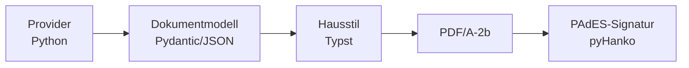

# Dokument-Engine (Typst)

Diese Seite beschreibt die Dokument-Engine, die seit Version 1.2 alle PDF- und Datei-Exporte
erzeugt und den früheren TeX-basierten Export vollständig ersetzt. Die Abschnitte
«Bestandsaufnahme» und «Umsetzungsplan» halten fest, wovon der Umbau ausging; alle übrigen
Abschnitte beschreiben den umgesetzten Stand. Für Anwenderinnen und Anwender:
[Dokumente & Hausstile](../benutzer/dokumente.md).



**Grundidee:** Es gibt nicht mehr verschiedene Exporte, sondern eine Engine. Jedes Dokument
ist eine Zusammenstellung von Blöcken aus einem gemeinsamen Block-Katalog. Provider füllen die
Blöcke mit Daten (ohne Layout), ein Hausstil rendert sie (ohne Datenzugriff).

## Bestandsaufnahme (Ausgangslage)

### Element-Typen (`element-types/registry.json`)

| id | Code | Bisheriger PDF-Inhalt | Neuer Katalog-Block |
|---|---|---|---|
| 1 | `text` | Markdown → LaTeX | `richtext` |
| 2 | `todo` | Tabelle Status/Aufgabe/Zuständig/Fällig | `todo_table` |
| 3 | `image` | `figure` pro Bild | `image_gallery` (ein Bild: `image`) |
| 4 | `display` | Beschreibungstext | `static_text` |
| 5 | `static_text` | Beschreibungstext | `static_text` |
| 6 | `form` | Schlüssel/Wert-Tabelle oder verknüpfte Liste | `form` bzw. `list_table` |
| 7 | `event_list` | Terminliste mit konfigurierbaren Spalten | `event_table` |
| 8 | `bullet_list` | `itemize` | `bullet_list` |
| 9 | `attendance` | Namen + Status, Zählzeile | `attendance` |
| 10 | `session_date` | «Nächste Sitzung: Datum» | `session_date` |
| 11 | `matrix` | Tabellen in 3er-Spaltengruppen, eingebettete Blöcke | `matrix` |
| 12 | `finance_balance` | Kontostand | `finance_balance` |
| 13 | `finance_transactions` | Buchungen mit Saldo | `finance_transactions` |
| 14 | `fine_list` | Bussenliste | `fines` |
| 15 | `chart` | matplotlib-PNG | `chart` (Typst-Vektor) |
| 16 | `entry_exit` | Ein-/Austritte | `entry_exit` |
| 17 | `session_notes` | Freitext der Sitzungsnotizen | `session_notes` |

Dazu kamen die dynamischen «Sitzungs-Todos» pro Abschnitt (Todos mit dem Abschnittsnamen als
Tag) und ein Block «Protocol Metadata».

### Kennzahlen und Diagramme

`statistics_common.py` liefert Anwesenheit (pro Monat und Person, vier Status), Todos
(offen/erledigt), Bussen (pro Person, pro Typ), Finanzen (pro Monat, pro Konto und Monat),
Gruppen-Sitzungen (Termine, Termine mit Teilnehmenden, Durchschnitt). `chart_service.py`
zeichnete daraus acht Diagramme: `attendance_over_time`, `attendance_by_participant`,
`finance_by_month`, `fines_by_participant`, `fines_by_type`, `todos`, `groups_sessions`,
`groups_avg`. Alle acht gibt es weiter, nun als Datenreihen im Block `chart`.

### Export-Aufrufer

- Backend: `routes/exports.py` (Protokoll-PDF/-LaTeX, Todo-, Termin-, Listen-Export,
  Todo-Markdown), `routes/protocols.py` (PDF beim Abschliessen), `main.py`
  (Retention-Job, Standardvorlagen beim Start), `routes/document_templates.py`.
- Frontend: `use-pdf-export.ts` (Protokoll-Builder, Editor, Mobile), `todo-list-view.tsx`,
  `event-manager.tsx`, `list-manager.tsx`, Vorlagen-Builder und Mobile-Vorlagen
  (Auswahl Dokumentvorlage), Einstellungen (`document-template-manager.tsx`).
- Mandanten-Transfer: `tenant_export_service` (Tabellen `document_template`,
  `document_template_part`, `protocol_export_cache`, Part-Dateien), `tenant_import_service`,
  `tenant_clone_service`, `tenant_transfer_common.remap_document_template_config`,
  `admin_tenant_service` (Löschpfade).
- Betrieb: `backend/Dockerfile*` (texlive), CI-Schritt «Install LaTeX toolchain»,
  `LATEX_TEMPLATE_ROOT` in den Compose-Dateien, `scripts/cleanup_storage.sh`.

### Bibliotheken (geprüft in `python:3.13-slim`)

- `typst==0.15.0` (Python-Bindings): `typst.Compiler(input, root, font_paths, ignore_system_fonts,
  sys_inputs, package_path, package_cache_path)`, `compile(format="pdf"|"png", ppi,
  pdf_standards=["a-2b"], timestamp)`; mehrseitiges PNG liefert eine Liste von Bytes.
  `typst.Fonts(include_system_fonts, include_embedded_fonts, font_paths)` lässt sich
  wiederverwenden. Fehler kommen als `typst.TypstError` (`message`, `hints`, `trace`),
  Warnungen über `compile_with_warnings` als `TypstWarning`.
- `pyHanko==0.37.0` mit `pyhanko-certvalidator==0.32.1`: `PdfSigner`,
  `PdfSignatureMetadata(subfilter=PADES)`, `HTTPTimeStamper` für B-T,
  `validate_pdf_signature` für die Tests.

## Architektur

### Module

```
backend/app/documents/
  model.py              Dokumentmodell (Pydantic, schema_version), Rich-Text-Baum, Blöcke
  richtext.py           Tiptap-Markdown/Klartext → Rich-Text-Baum (nie Typst-Code)
  catalog.py            Block-Katalog: Parameter-Modelle, Gruppen, Provider-Zuordnung
  doc_types.py          Dokumenttypen (Standard-Zusammenstellungen)
  style_tokens.py       Hausstil-Tokens (Pydantic, Schnittstelle für den Designer)
  strings.py            Feste PDF-Texte je Sprache (generiert aus frontend/messages/*/documentPdf.json)
  context.py            Render-Kontext (db, Mandant, Benutzer, Sprache, Stichtag)
  builder.py            Rezept/Typ/Protokoll → Dokument (ruft Provider auf)
  hashing.py            Kanonische Serialisierung, Inhalts-Hash
  renderer.py           Typst-Prozess-Pool, Compile-Root, PDF/PNG, Fehlerzuordnung
  signing.py            PAdES-Signatur, XMP-Metadaten
  service.py            Orchestrierung: bauen → versionieren → rendern → signieren → speichern
  exports.py            CSV/XLSX/ICS/Markdown aus demselben Modell
  providers/            ein Modul pro Datenquelle (protocol, todos, events, lists,
                        participants, finance, statistics, structure)
  styles/               Typst: _tokens.typ (generiert), base/ (gemeinsame Komponenten),
                        modern.typ, classic.typ, compact.typ, main.typ
  fonts/                mitgelieferte Schriften inkl. Lizenzen
  typst_packages/       vendorte Typst-Pakete (derzeit keine nötig, siehe unten)
  i18n/                 generierte Kopie der Dokumenttexte (sync-document-i18n.py)
```

### Dokumentmodell

`Document` (`schema_version = 1`):

- `meta`: Titel, Untertitel, Nummer, Datum (ISO), Status-Code, Version (Label), Mandant,
  Sprache, Dokumenttyp.
- `options`: Titelseite, TOC, Nummerierung, Format (A4 hoch/quer), Wasserzeichen.
- `style`: Stil-Schlüssel (`modern`/`classic`/`compact`) und validierte Tokens.
- `strings`: alle festen Texte der gewählten Sprache (Typst schlägt nur nach).
- `render`: Dokument-ID, Signaturzeile ja/nein, Erstellzeitpunkt (nicht im Inhalts-Hash).
- `blocks`: diskriminierte Union über `type`; jeder Block hat `title`, `hide_if_empty`
  (Standard an) und `level`.

Status, Spaltenköpfe und Leertexte stehen im Modell als **Codes**, nicht als übersetzte
Texte. Der Hausstil übersetzt sie über `strings`. Dadurch ist der Inhalt sprachneutral: ein
Sprachwechsel allein ändert den Inhalts-Hash nicht.

Fliesstext ist ein Rich-Text-Baum (`p`, `h`, `ul`, `ol`, `li`, `quote`, `code`, `br`, Text mit
`bold`/`italic`/`strike`/`code`, `link`). Typst rendert Strings aus dem JSON ausschliesslich
als Text; es gibt kein `eval` von Benutzerinhalt. Links sind auf `http(s)`/`mailto` beschränkt.
Bilder liegen unter generierten Namen im Compile-Root; Pfade kommen nie vom Benutzer.

### Hausstile und Tokens

Ein Hausstil ist ein Typst-Modul mit Seitenaufbau, Titelseiten-, Kopf- und Fussvarianten,
TOC und einer Komponente pro Block-Typ. Fehlt eine Komponente, gilt die Basis-Komponente.
Angepasst wird **nur über Daten** (`DocumentStyleTokens`, siehe Abschnitt «Token-Schema»).
Neutral- und Statusfarben, Abstände und Radien stammen aus `design/tokens.css` und werden per
`scripts/sync-document-tokens.py` nach `styles/_tokens.typ` generiert.

### Rendering

- Compile-Root: frisches Temp-Verzeichnis mit Stil-Dateien, `document.json` und Bildern;
  Schriften über einen pro Worker einmal geladenen `typst.Fonts` (keine Systemschriften).
- Prozess-Pool (`concurrent.futures.ProcessPoolExecutor`) mit Parallelitätslimit,
  Wall-Clock-Timeout (bei Überschreitung wird der Pool beendet und neu gestartet) und
  Speicherlimit (`RLIMIT_AS`) pro Worker. Ein CPU-Limit pro Prozess entfällt bewusst: es
  summiert sich über die Lebensdauer eines Workers.
- PDF als PDF/A-2b; Vorschau als PNG (erste N Seiten), ohne Signatur und Speicherung.
- Fehler: Schlägt der Compile fehl, wird blockweise nachkompiliert, um den verursachenden
  Block zu finden. Der Benutzer sieht eine übersetzte Meldung mit Blockname, Details gehen
  per `record_system_error` ins Admin-Log.

### Versionierung

- Schema bleibt `v0.x` (Entwurf) und `v1.x` (abgeschlossen) mit getrennten Zählern
  (`protocol.version_minor`, `protocol.version_final_minor`).
- Inhalts-Hash: SHA-256 über die kanonische JSON-Serialisierung von `meta` (ohne Version,
  Sprache), `blocks` und `schema_version`; ohne `style`, `options`, `strings`, `render`.
- Weicht der Hash vom letzten Protokoll-Export ab, steigt der passende Zähler **vor** dem
  Rendern. Pro Export ein Datensatz in `document_export`.

### Signatur

PAdES B-B (mit `DOCUMENT_SIGNING_TSA_URL` B-T) per pyHanko als inkrementelles Update nach der
PDF/A-Erzeugung. Vorher werden in einem ersten inkrementellen Update die XMP-Metadaten um
den Namespace `https://hocx.ch/ns/document/1.0/` (Präfix `hocx`, inkl. PDF/A-Extension-Schema)
ergänzt: Dokument-ID, Mandant, Dokumenttyp, Version, Inhalts-Hash.

### Signatur-Konfiguration

| Variable | Bedeutung |
|---|---|
| `DOCUMENT_SIGNING_KEY_PATH` | Privater Schlüssel (PEM, optional verschlüsselt) |
| `DOCUMENT_SIGNING_CERT_PATH` | Signaturzertifikat (PEM) |
| `DOCUMENT_SIGNING_KEY_PASSWORD` (`_FILE`) | Passwort des Schlüssels; in Prod als Docker-Secret `document_signing_key_password` |
| `DOCUMENT_SIGNING_CHAIN_PATH` | Optional: Zwischenzertifikate (PEM) |
| `DOCUMENT_SIGNING_TSA_URL` | Optional: Zeitstempeldienst (RFC 3161) → PAdES B-T |
| `DOCUMENT_SIGNING_DIR` | Nur Compose: Host-Verzeichnis, das nach `/run/hocx-signing` (read-only) gemountet wird |

Schlüssel und Zertifikate liegen nie im Repository. In Produktion (`HOCX_ENVIRONMENT=production`)
startet das Backend ohne lesbare Konfiguration nicht; in Dev/Test gibt es eine Warnung und die
PDFs bleiben unsigniert (ohne Signaturzeile). Dev-Zertifikat: `scripts/generate-dev-signing-cert.sh`
(das E2E-Skript erzeugt eines automatisch). Einrichten, Erneuern und Rotieren: RUNBOOK
«Dokumentsignatur».

Der Systemcheck `document_signing` (`/admin/system`, ntfy) meldet: fehlt (in Prod kritisch),
nicht lesbar (kritisch), läuft in weniger als 30 Tagen ab (Warnung), abgelaufen (kritisch).

### Render-Limits

| Variable | Standard | Bedeutung |
|---|---|---|
| `DOCUMENT_RENDER_CONCURRENCY` | 4 | Worker-Prozesse (gleichzeitige Compiles) |
| `DOCUMENT_RENDER_TIMEOUT_SECONDS` | 60 | Wall-Clock-Limit pro Compile |
| `DOCUMENT_RENDER_MEMORY_LIMIT_MB` | 3072 | `RLIMIT_AS` pro Worker |
| `DOCUMENT_PREVIEW_MAX_PAGES` | 4 | Seiten in der PNG-Vorschau |

## Block-Katalog

Jeder Block-Typ besteht aus Pydantic-Modell (`model.py`), Katalog-Eintrag mit Parameter-Modell
(`catalog.py`), Provider (`providers/`) und Basis-Komponente (`styles/base/blocks.typ`).
`scripts/check-document-catalog.py` prüft in der CI, dass nichts davon fehlt.

| Gruppe | Blöcke |
|---|---|
| Struktur | `heading`, `richtext`, `static_text`, `page_break`, `toc`, `spacer`, `divider` |
| Protokoll | `protocol_element`, `session_date`, `session_notes`, `form`, `bullet_list`, `matrix`, `entry_exit`, `image`, `image_gallery` |
| Personen | `attendance`, `attendance_matrix`, `member_list`, `signature_fields`, `attendance_sheet` |
| Aufgaben | `todo_table` |
| Termine | `event_table`, `event_calendar_month`, `event_agenda` |
| Listen | `list_table` |
| Finanzen | `finance_balance`, `finance_transactions`, `fines` |
| Statistik | `kpi_tiles`, `chart`, `stat_table` |
| Weitere | `qr_link`, `generic_table` |

`protocol_element` ist ein Container: der Provider löst ihn in die Blöcke eines Protokoll-Elements
auf (Überschrift, Text, Todos, …), deshalb hat er keine eigene Typst-Komponente.

Dokumenttypen (`doc_types.py`) sind Standard-Zusammenstellungen: `protocol`, `invitation`, `todos`,
`events`, `attendance_sheet`, `members`, `finance`, `statistics`, `list`, `custom`. Rezepte
(`document_recipe`) speichern eigene Zusammenstellungen pro Mandant.

### Provider und Berechtigungen

Provider bekommen einen `BuildContext` (DB, Mandant, Benutzer, Sprache, Stichtag) und liefern
reine Daten. Jede ID aus Parametern wird über `context.entity_by_ref` mandantenbezogen
aufgelöst; fremde oder unbekannte IDs ergeben `DocumentNotFoundError` (404), fehlende Rechte
`DocumentPermissionError` (403). Das gilt auch für Referenzen in
`configuration_snapshot_json` abgeschlossener Protokolle.

### Neuen Block-Typ hinzufügen

1. Modell in `model.py` (`class FooBlock(BlockBase)`, `type: Literal["foo"]`) und in die Union
   `Block` aufnehmen.
2. Parameter-Modell und Katalog-Eintrag (`BlockSpec`-Gruppe, Provider-Name) in `catalog.py`.
   Felder mit `json_schema_extra={"x-widget": ...}` steuern das Formular im Export-Dialog.
3. Provider-Funktion in `providers/<quelle>.py`, in `providers/__init__.py` registrieren.
   IDs immer über `entity_by_ref` auflösen, nie direkt per `db.get`.
4. Komponente `foo: (b, ctx) => ...` in `styles/base/blocks.typ` (`base-components`);
   Hausstile können sie in ihrem eigenen Dictionary überschreiben.
5. Texte: `blockType.foo` und `empty.foo` in `frontend/messages/<locale>/documentPdf.json`,
   Parameter-Labels `params.<name>`/`enum.<wert>` in `documents.json`, für alle Locales.
   Danach `python3 scripts/sync-document-i18n.py`.
6. Fixture in `backend/tests/documents/fixtures/generate.py` ergänzen (Block in `all_blocks`),
   Goldens mit `scripts/update-document-goldens.sh` aktualisieren und die Bilder prüfen.
7. `scripts/check-document-catalog.py` muss «ok» melden.

## Token-Schema (Designer-Schnittstelle)

Ein Hausstil ist **nur über Daten** anpassbar: `DocumentStyleTokens` (`style_tokens.py`,
gespeichert in `document_style.tokens_json`, unbekannte Felder werden abgewiesen). Wer einen
neuen Grundstil gestaltet, schreibt ein Typst-Modul unter `styles/` und liest ausschliesslich
diese Tokens sowie `_tokens.typ`.

| Token | Werte | Standard |
|---|---|---|
| `primary_color`, `secondary_color` | `#RRGGBB` | `#174B7A`, `#4F6D7A` |
| `font` | `style`, `inter`, `liberation_sans`, `liberation_serif`, `noto_sans`, `custom` | `style` (Hausschrift des Stils) |
| `custom_fonts` | Asset-IDs für `regular`, `bold`, `italic`, `bold_italic` | – |
| `base_size` | `10`, `11`, `12` (pt) | `11` |
| `line_spacing` | `tight`, `normal`, `relaxed` | `normal` |
| `margins` | `narrow`, `normal`, `wide` | `normal` |
| `orientation` | `portrait`, `landscape` | `portrait` |
| `logo_asset_id`, `footer_image_asset_id` | Asset-ID (Bild) | – |
| `sender` (≤ 600), `place` (≤ 120) | Text | leer |
| `header` | `none`, `minimal`, `standard`, `bar`, `logo` | `standard` |
| `footer` | `none`, `minimal`, `standard`, `with_version`, `date_page` | `standard` |
| `title_page` | `none`, `minimal`, `modern`, `bold`, `cover` | `none` |
| `toc` | `off`, `on`, `compact` | `off` |
| `numbering`, `toc_block_titles`, `watermark_draft` | bool | `false`, `true`, `true` |

Neutral- und Statusfarben, Abstände und Radien kommen aus `design/tokens.css`
(`scripts/sync-document-tokens.py`, CI prüft mit `--check`). Schriften liegen mit Lizenzen
unter `backend/app/documents/fonts/`; Zeichen ohne Glyphe in den geladenen Schriften werden
durch `�` ersetzt (PDF/A verbietet fehlende Glyphen).

## API

| Endpunkt | Zweck | Rolle |
|---|---|---|
| `POST /api/documents/render` | PDF erzeugen (versionieren, signieren, speichern) | reader |
| `POST /api/documents/preview` | PNG-Vorschau der ersten Seiten, nichts wird gespeichert | reader |
| `POST /api/documents/export` | CSV, XLSX, ICS, Markdown aus demselben Modell | reader |
| `GET /api/documents/exports` | Export-Historie (`document_export`) | reader |
| `GET /api/documents/catalog` | Blöcke, Parameter-Schemas, Dokumenttypen, Stile | reader |
| `GET/PATCH /api/document-settings` | Dokumentsprache des Mandanten | reader / admin |
| `/api/document-styles` | Hausstile (CRUD) | reader / admin |
| `/api/document-style-assets` | Logos, Fussbilder, Schriften (Upload mit Virenprüfung) | reader / admin |
| `/api/document-recipes` | Rezepte (CRUD) | reader / writer |
| `GET /api/documents/sources/{source}` | Auswahllisten für Parameter (Listen, Konten, …) | reader |

Alle schreibenden Aufrufe und jeder Export landen im Audit-Log (`document.render`,
`document.export_<format>`, `document_style.*`, `document_recipe.*`, …).

## Tests und CI

- `backend/tests/documents/`: Modell, Rich-Text (Escaping), Renderer, Provider inkl.
  Mandanten-Isolation, Signatur (Validierung, Manipulation erkannt), Versionierung, API,
  Altdaten-Übernahme.
- Matrix Hausstil × Fixture × Format ohne Typst-Warnungen; Vollständigkeit per `pdftotext`.
- Goldens (`goldens/*.png`): bei Abweichung landen Ist- und Differenzbild im CI-Artefakt
  `document-golden-diffs`. Bewusste Änderungen: `scripts/update-document-goldens.sh`.
- Galerie: jeder Hausstil × jeder Dokumenttyp als ein PDF (CI-Artefakt `document-gallery`).
- CI prüft zusätzlich `sync-document-tokens.py --check`, `sync-document-i18n.py --check` und
  `check-document-catalog.py`.

## Datenbank

| Tabelle | Zweck |
|---|---|
| `document_style` | Hausstil-Konfiguration pro Mandant: Name, Basis-Stil, Tokens (JSONB), Standard-Flag, Version |
| `document_style_asset` | Hochgeladene Schriften und Bilder (Logo, Fussbild) eines Mandanten |
| `document_recipe` | Gespeicherte Zusammenstellung: Name, Dokumenttyp, Blöcke mit Parametern, Stil, Optionen, Sprache |
| `document_export` | Ein Datensatz pro erzeugtem PDF: Dokument-ID, Typ, Protokoll, Version, Inhalts-Hash, SHA-256 des signierten PDFs, Stil und Stil-Version, Sprache, Benutzer, StoredFile |

`template.document_style_id` und `protocol.document_style_id` ersetzen die alten Verweise auf
`document_template` und die Snapshot-Pfade.

## Umsetzungsplan

Umgesetzt in dieser Reihenfolge, jeweils mit Tests grün und einzeln committet:

1. Plan (diese Seite).
2. Dokumentmodell und Rich-Text-Konvertierung.
3. Renderer, Schriften, Paketverzeichnis, Token-Sync.
4. Basis-Komponenten und Hausstil «Modern».
5. Provider und Block-Katalog, Dokumenttypen.
6. Versionierung und Signatur.
7. API (`/api/documents/*`), Zusatzformate.
8. Hausstile «Klassisch» und «Kompakt».
9. Frontend: Export-Dialog, Rezepte, Hausstil-Einstellungen.
10. Migration (`0114_document_engine`) und Mandanten-Transfer.
11. Aufräumen: alter Export, LaTeX, Dockerfiles, CI.
12. CI: Katalogprüfung, Token-Check, Goldens, Galerie.
13. Dokumentation, Changelog.

### Migration

Migrationen `0114_document_engine` (Tabellen) und `0115_document_engine_migrate` (Daten, nicht
umkehrbar):

1. Neue Tabellen anlegen.
2. Jede `document_template` wird ein `document_style`: Farben, Schriftgrösse, Schriftfamilie,
   Format, Kopf-/Fuss-/Titelseiten-/TOC-Variante, Nummerierung, Ort und Absender
   (`title_text`). Bild- und Schrift-Parts werden `document_style_asset` (Datei bleibt am
   selben Speicherort, keine Kopie, kein Verlust). `.tex`-Slots werden verworfen und im
   Migrationsprotokoll gezählt.
3. `template.document_style_id`/`protocol.document_style_id` aus den alten Verweisen setzen.
4. `protocol_export_cache` (PDF) wird nach `document_export` übernommen (ohne Hash), damit
   Speicherstatistik und Historie erhalten bleiben.
5. Alte Spalten und Tabellen entfernen (`document_template*`, `protocol_export_cache`,
   `document_template_*`-Spalten, `latex_*`-Spalten).
6. Dateien: `scripts/cleanup-legacy-document-templates.sh` entfernt nach dem Update
   `document_templates/`, `document_template_snapshots/`, `latex_templates/` und die
   `.tex`-Parts; hochgeladene Schriften und Bilder bleiben.

## Offene Punkte und Annahmen

- **Kein Halt nach dem Plan:** Auf Anweisung wurde ohne Freigabe-Stopp weitergearbeitet.
- **Diagramme ohne externes Paket:** lilaq/cetz-plot würden mehrere transitive Pakete
  mitbringen. Die vier Diagrammarten (Balken, gestapelt, Linie, Donut) sind als eigene, kleine
  Typst-Komponenten umgesetzt. Das Paketverzeichnis `typst_packages/` ist trotzdem verdrahtet;
  der Compile bekommt ein leeres Cache-Verzeichnis und kann nie nachladen.
- **QR-Codes** werden in Python (segno) als Modulmatrix erzeugt und in Typst als Vektor
  gezeichnet; dafür ist kein Typst-Paket nötig.
- **Inhalts-Hash über das ganze Dokument:** Angehängte Zusatzblöcke beim Protokoll zählen zum
  Inhalt. Wer zwischen Exporten mit und ohne Zusatzblöcke wechselt, erhöht die Version.
- **Hinweis für Mandanten mit eigenen LaTeX-Slots:** Es gibt keinen Mechanismus für
  Admin-Hinweise pro Mandant; der Hinweis steht in den Release-Notes und die Migration schreibt
  die betroffenen Mandanten ins Log.
- **Schriftabdeckung:** Mitgeliefert sind lateinische, griechische und kyrillische Schriften
  sowie Emoji. Zeichen ausserhalb (z. B. CJK) erscheinen als `�`; bei Bedarf eine passende
  Schrift als eigene Schrift im Hausstil hochladen.
- **Historische Audit-Dokumente** unter `security-audit/` erwähnen den alten TeX-Export weiterhin;
  sie dokumentieren damalige Befunde und werden nicht umgeschrieben.
- **PDF/A-Prüfung:** Ohne veraPDF in der CI prüfen die Tests die PDF/A-Kennung im XMP, eingebettete
  Schriften und dass die Signatur als inkrementelles Update angehängt ist.
