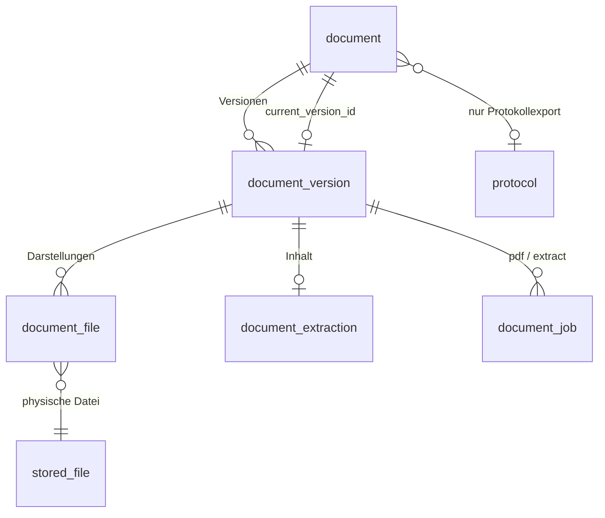

# Dokumentverwaltung (logische Dokumente)

Stand: Branch `feature/document-management` (baut auf dem S3-Umbau
`feature/s3-storage-maintenance` auf).

Diese Seite beschreibt die logische Dokumentebene oberhalb von `stored_file`: ein
hochgeladenes oder erzeugtes Dokument ist **ein** Eintrag im Dateien-Tab, auch wenn dahinter
Originaldatei, PDF-Darstellung, extrahierter Inhalt und mehrere Versionen liegen.

## 1. Bestandsaufnahme (vor der Umsetzung)

### Speicherung

- `stored_file` ist die einzige physische Dateiverwaltung. Seit dem S3-Umbau liegen die Bytes
  im Objektspeicher (`app/core/storage.py`, `objstore_client.py`), Namespaces `main` und
  `abgabebox`. Welcher Namespace gilt, entscheidet `stored_file_location.namespace_for_stored_file`
  (Abgabebox-Uploads = Zeile in `submission_upload_file`).
- Jede Schreib-/Löschoperation läuft über das Objekt-Journal (`ObjectStore.put_*`/`delete`
  mit DB-Session), damit eine laufende Speichermigration sie mitbekommt.

### Uploadwege, die im Dateien-Tab sichtbar werden

| Weg | Code | Herkunftstabelle | Namespace |
|---|---|---|---|
| Dateien-Tab, Dokument-Upload | `POST /files/document-uploads` → `FileService.save_document_uploads` | `gallery_image` (mit optionalem Bezug Termin/Zyklus/Abgabe-Element) | main |
| Word-/PDF-Import | `WordImportQueueService.ingest` → `FileService.save_word_import_document` | `word_import_document` | main |
| Öffentliche Abgabebox | `abgabebox-backend` `routes/public.py::upload` → `repository.insert_full_upload` (eingeschränkte DB-Rolle, nur INSERT) | `submission_upload` + `submission_upload_file` | abgabebox |
| Fotos / Protokollbilder | Galerie-Upload-Job, `protocol_image` | `gallery_image`, `protocol_image` | main |

Der Dateien-Tab (`StoredFileRepository._files_overview_branches`) ist eine UNION über diese
Herkunftstabellen. Protokollexporte (`protocol_export_cache`) sind bisher bewusst **nicht**
sichtbar.

### Abgabebox-Zuordnungen

Die Zuordnung Datei → Abgabe → Element steckt vollständig in
`submission_upload_file → submission_upload (assignment_id, event_id | list_entry_id,
submitted_at) → submission_assignment (tenant_id)`. Ein Dokument-Upload im Dateien-Tab mit
Abgabe-Bezug speichert ihn in `gallery_image.submission_assignment_id/submission_element_ref`.
Einreicher: `stored_file.created_by` (interne Uploads); die Abgabebox ist anonym.
Uploadzeitpunkt: `stored_file.created_at` / `submission_upload.submitted_at`.
→ Diese Daten werden **nicht** in die neue Dokumentebene kopiert, sondern über die
Originaldatei weiter genutzt.

### Protokollexporte

`ExportService.export_pdf` erzeugt bei jedem Export eine neue `stored_file` (Präfix
`exports/generated/…`) und eine Zeile `protocol_export_cache (protocol_id, export_format,
latex_source = Body, generated_file_id)`. Die fachlich stabile Identität ist `protocol_id` +
Exportart. `export_pdf` erkennt inhaltliche Änderungen bereits über den Body-Vergleich und
zählt `protocol.version_minor/version_final_minor` hoch. `cleanup_old_generated_exports`
löscht Exportobjekte nach `EXPORT_RETENTION_DAYS` – das würde ältere Versionen zerstören.

### Hintergrundverarbeitung und Sicherheit

- Muster vorhanden: DB-Job-Tabellen mit `FOR UPDATE SKIP LOCKED` (`photo_analysis_job`),
  Lease/Heartbeat (`storage_migration`), periodische Loops mit Advisory-Lock
  (`run_advisory_locked_loop`, Pflicht-Registrierung in `job_registry.py`), eigener
  Worker-Prozess mit Backend-Code (`storage-worker`).
- Isolierte Verarbeitung nicht vertrauenswürdiger Dokumente: `isolated_parse.py`
  (Kindprozess, `RLIMIT_AS`, Timeout, bereinigte Umgebung).
- Virenscan: `stored_file.scan_status` (`clean`/`pending`/`infected`/`error`), nachgelagerte
  Rescan-Loops.
- Zugriff: `access_service.ensure_can_read_stored_file` (Protokollbezug → Protokollrechte,
  sonst gleicher Mandant + Rolle admin/writer/kassier).

### Bibliotheken

Vorhanden: `python-docx`, `pdfplumber` (pdfminer), `lxml` (über python-docx), `Pillow`.
Nicht vorhanden: LibreOffice, Tesseract, ODT-/RTF-Parser. Der bestehende
`word_import_service.parse_document` ist protokollspezifisch und wird **nicht**
wiederverwendet.

## 2. Datenmodell



- **document** – logisches Dokument: `tenant_id`, `public_id`, `display_name`, `source_kind`
  (`upload` | `protocol_export`), `current_version_id` (explizite Zuordnung, nicht „neuester
  Zeitstempel“), für Exporte `protocol_id` + `export_kind` (eindeutig).
- **document_version** – inhaltliche Version: `version_number`, optional `label` (z. B.
  `v0.3`), `content_fingerprint` (Body-Hash beim Export bzw. Prüfsumme des Originals).
- **document_file** – verknüpft `stored_file` mit einer Version, Rolle `original` | `pdf`,
  `is_generated` (von der Dokumentverarbeitung erzeugt und damit Eigentum des Dokuments).
  Original-DOCX und erzeugtes PDF sind zwei Darstellungen **derselben** Version. Bei
  hochgeladenen PDFs zeigen beide Rollen auf dieselbe Datei (keine Neukonvertierung).
- **document_extraction** – Ergebnis der Textextraktion je Version: Status, Parser,
  Parser-Version, Schema-Version, strukturierte Blöcke (JSONB) und Klartext. Markdown wird
  deterministisch aus den Blöcken erzeugt und nicht zusätzlich gespeichert.
- **document_job** – persistente Verarbeitungsaufträge (`pdf`, `extract`) je Version, genau
  einer je Art (idempotent über Unique-Constraint).

Der Gesamtstatus eines Dokuments (verarbeitet / bereit / teilweise / fehlgeschlagen) wird aus
den Jobs der aktuellen Version abgeleitet und nicht redundant gespeichert.

Welche Dateien bekommen ein Dokument? Nur Dokumentformate (siehe Abschnitt 4). Bilder, ZIPs,
Videos und sonstige Dateien bleiben unverändert normale Einträge ohne Dokumentebene.

## 3. Ablauf

1. **Upload** (Dateien-Tab, Word-Import): in derselben Transaktion wie `stored_file` entstehen
   `document`, `document_version`, `document_file(original)` und die beiden Jobs. Kein Job geht
   zwischen Commit und Worker verloren, weil der Worker die Datenbank pollt.
2. **Abgabebox**: der öffentliche Dienst darf (Isolationsgrenze) nur INSERT auf seine Tabellen.
   Der Backend-Loop `document_sync` legt für neue Abgabebox-Dateien Dokument und Jobs an
   (gleiche Funktion wie der Backfill).
3. **Worker** (`document-worker`, Backend-Image, eigener Container): holt Jobs per
   `FOR UPDATE SKIP LOCKED` mit Lease; abgestürzte/hängende Jobs werden nach Ablauf der Lease
   erneut übernommen. Verarbeitung nur bei `scan_status = clean` (`pending`/`error` → später
   erneut, `infected` → gesperrt). Wiederholungen mit exponentiellem Backoff, Fehler werden
   ohne Dokumentinhalt protokolliert.
4. **PDF-Konvertierung** und **Extraktion** sind getrennte Jobs; ein Fehler in einem blockiert
   den anderen nicht. Die Extraktion liest die Originaldatei mit formatspezifischen Parsern,
   nicht das erzeugte PDF.
5. **Protokollexport**: jeder Export mit geändertem Inhalt erzeugt eine neue Version des
   Dokuments `(protocol_id, export_kind)`, unveränderter Inhalt ersetzt nur die PDF-Darstellung
   der aktuellen Version. Exportdateien, die zu einer Version gehören, nimmt die
   Export-Aufbewahrung aus.

## 4. Formate

| Format | PDF | Extraktion |
|---|---|---|
| PDF | ist bereits PDF | pdfplumber (Text, Tabellen, Seiten, Überschriften per Schriftgrösse); bei Scans OCR (Tesseract) oder Status `ocr_required` |
| DOCX | LibreOffice | python-docx (Überschriften, Absätze, Listen, Tabellen, Bildverweise) |
| ODT | LibreOffice | content.xml mit lxml (sicherer Parser) |
| RTF | LibreOffice | eigener RTF-Tokenizer (Absätze, Tabellen) |
| DOC | LibreOffice | LibreOffice → DOCX im Sandbox-Prozess, dann DOCX-Parser |
| TXT, MD, CSV | LibreOffice (Text-Import UTF-8) | direkt (Markdown-Struktur, CSV als Tabelle) |
| XLSX, XLS, ODS, PPTX, PPT, ODP | LibreOffice | nicht unterstützt (Status `unsupported`) |
| Pages/Keynote/Numbers, ZIP, Bilder, Video | – | kein Dokument |

## 5. Inhaltsformat (`hocx.document-content`, Schema-Version 1)

```json
{
  "schema": "hocx.document-content",
  "schema_version": 1,
  "source": {"mime_type": "…", "parser": "docx", "parser_version": "1", "encoding": null},
  "page_count": null,
  "blocks": [
    {"type": "heading", "level": 1, "text": "Titel", "page": null},
    {"type": "paragraph", "text": "…"},
    {"type": "list", "items": [{"text": "…", "level": 0, "ordered": false}]},
    {"type": "table", "rows": [["A", "B"], ["1", "2"]], "header_rows": 1},
    {"type": "media", "media_type": "image", "ref": "word/media/image1.png", "content_type": "image/png", "alt": null}
  ],
  "warnings": []
}
```

Normalisierung (deterministisch): Unicode NFC, Zeilenenden `\n`, Entfernen von BOM,
weichen Trennstrichen und Steuerzeichen (ausser Tab/Zeilenumbruch), Leerzeichen am
Zeilenende. Inhalte werden weder ergänzt noch umformuliert; es kommt keine KI zum Einsatz.

## 6. Sicherheit

- Dokument-Endpunkte prüfen wie bisher über die Originaldatei
  (`ensure_can_read_stored_file`) bzw. über das Protokoll (Exporte) und zusätzlich den
  Mandanten. Abgabebox-Uploads erzeugen keine öffentlichen Leserechte.
- LibreOffice/Parser laufen im Worker als Kindprozess mit CPU-, Speicher-, Dateigrössen- und
  Zeitlimit, eigenem temporären Profil, bereinigter Umgebung, deaktivierten Makros und
  Link-Updates. Eingaben werden nur über Objekt-Keys aus der Datenbank gelesen.
- Löschen: `document_file` hängt per `ON DELETE CASCADE` an `stored_file`; beim Löschen der
  Originaldatei entfernt `DocumentService` das Dokument samt erzeugter Dateien, der
  `document_sync`-Loop räumt verwaiste Reste auf.

## 7. Implementierungsplan (Commits)

1. Bestandsaufnahme/Plan (diese Seite).
2. Datenmodell, Migration `0115_documents`, ORM-Modelle.
3. Inhaltsformat, Normalisierung, Parser (TXT/MD/CSV, PDF, DOCX, ODT, RTF) mit Tests.
4. Sandbox, LibreOffice-Konvertierung, OCR-Fallback, Image-Anpassungen.
5. Job-Queue, Worker, Loop `document_sync` (Backfill + Abgabebox + Aufräumen), Registrierung.
6. Anbindung der Uploadwege, Löschpfade, Mandanten-Bereinigung.
7. Versionierung der Protokollexporte, Schutz vor Export-Aufbewahrung.
8. API für Dokumentdetails, Dateien, extrahierten Text, Versionen, erneute Verarbeitung.
9. Dateien-Tab: Statusanzeige, PDF-Ansicht, Untermenü, i18n.
10. Betriebsdoku, Deployment, Changelog.
