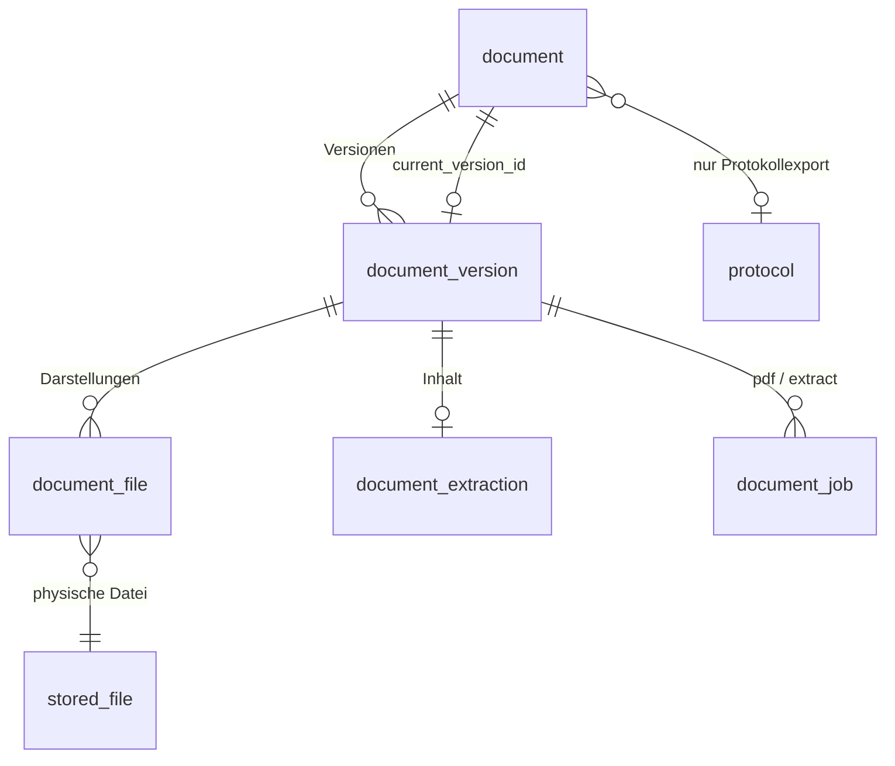

# Dokumentverwaltung (logische Dokumente)

Stand: Release 1.2.0 (entwickelt auf `feature/document-management`, zusammengeführt mit dem
Objektspeicher und der Dokument-Engine). Betrieb und Update: RUNBOOK Abschnitt 16.

Nicht zu verwechseln mit der **Dokument-Engine / dem Document Studio** (`app/documents/`,
[Dokument-Engine](dokument-engine.md)), die PDFs *erzeugt*: diese Seite beschreibt die
Verwaltung von Dateien als logische Dokumente (`app/services/document_*`, Tabellen `document`,
`document_version`, `document_file`, …). Beide teilen sich den URL-Präfix `/api/documents/`;
die Routen der Engine (`render`, `preview`, `export`, `exports`, `sources/…`) sind vor denen der
Verwaltung (`/api/documents/{uuid}…`, `app/api/routes/managed_documents.py`) registriert.

Diese Seite beschreibt die logische Dokumentebene oberhalb von `stored_file`: ein
hochgeladenes oder erzeugtes Dokument ist **ein** Eintrag im Dateien-Tab, auch wenn dahinter
Originaldatei, PDF-Darstellung, extrahierter Inhalt und mehrere Versionen liegen.

## 1. Bestandsaufnahme (vor der Umsetzung)

### Speicherung

- `stored_file` ist die einzige physische Dateiverwaltung. Seit dem S3-Umbau liegen die Bytes
  im Objektspeicher (`app/core/storage.py`, `objstore_client.py`), Namespaces `main` und
  `abgabebox`. Welcher Namespace gilt, entscheidet `stored_file_location.namespace_for_stored_file`
  (Abgabebox-Uploads = Zeile in `submission_upload_file`).
- Jede Schreib-/Löschoperation läuft über das Objekt-Journal (`ObjectStore.put_*`/`delete`
  mit DB-Session), damit eine laufende Speichermigration sie mitbekommt.

### Uploadwege, die im Dateien-Tab sichtbar werden

| Weg | Code | Herkunftstabelle | Namespace |
|---|---|---|---|
| Dateien-Tab, Dokument-Upload | `POST /files/document-uploads` → `FileService.save_document_uploads` | `gallery_image` (mit optionalem Bezug Termin/Zyklus/Abgabe-Element) | main |
| Word-/PDF-Import | `WordImportQueueService.ingest` → `FileService.save_word_import_document` | `word_import_document` | main |
| Öffentliche Abgabebox | `abgabebox-backend` `routes/public.py::upload` → `repository.insert_full_upload` (eingeschränkte DB-Rolle, nur INSERT) | `submission_upload` + `submission_upload_file` | abgabebox |
| Fotos / Protokollbilder | Galerie-Upload-Job, `protocol_image` | `gallery_image`, `protocol_image` | main |

Der Dateien-Tab (`StoredFileRepository._files_overview_branches`) ist eine UNION über diese
Herkunftstabellen. Protokollexporte (`protocol_export_cache`) sind bisher bewusst **nicht**
sichtbar.

### Abgabebox-Zuordnungen

Die Zuordnung Datei → Abgabe → Element steckt vollständig in
`submission_upload_file → submission_upload (assignment_id, event_id | list_entry_id,
submitted_at) → submission_assignment (tenant_id)`. Ein Dokument-Upload im Dateien-Tab mit
Abgabe-Bezug speichert ihn in `gallery_image.submission_assignment_id/submission_element_ref`.
Einreicher: `stored_file.created_by` (interne Uploads); die Abgabebox ist anonym.
Uploadzeitpunkt: `stored_file.created_at` / `submission_upload.submitted_at`.
→ Diese Daten werden **nicht** in die neue Dokumentebene kopiert, sondern über die
Originaldatei weiter genutzt.

### Protokollexporte

> Seit Release 1.2.0 überholt: Protokoll-PDFs erzeugt die Dokument-Engine
> (`app/documents/service.py`, Tabelle `document_export`); die Exportart ist ihr Dokumenttyp, der
> Fingerabdruck ihr Inhalts-Hash (siehe Abschnitt 3, Punkt 5). Der folgende Absatz beschreibt
> den Stand vor der Umsetzung.

`ExportService.export_pdf` erzeugt bei jedem Export eine neue `stored_file` (Präfix
`exports/generated/…`) und eine Zeile `protocol_export_cache (protocol_id, export_format,
latex_source = Body, generated_file_id)`. Die fachlich stabile Identität ist `protocol_id` +
Exportart. `export_pdf` erkennt inhaltliche Änderungen bereits über den Body-Vergleich und
zählt `protocol.version_minor/version_final_minor` hoch. `cleanup_old_generated_exports`
löscht Exportobjekte nach `EXPORT_RETENTION_DAYS` – das würde ältere Versionen zerstören.

### Hintergrundverarbeitung und Sicherheit

- Muster vorhanden: DB-Job-Tabellen mit `FOR UPDATE SKIP LOCKED` (`photo_analysis_job`),
  Lease/Heartbeat (`storage_migration`), periodische Loops mit Advisory-Lock
  (`run_advisory_locked_loop`, Pflicht-Registrierung in `job_registry.py`), eigener
  Worker-Prozess mit Backend-Code (`storage-worker`).
- Isolierte Verarbeitung nicht vertrauenswürdiger Dokumente: `isolated_parse.py`
  (Kindprozess, `RLIMIT_AS`, Timeout, bereinigte Umgebung).
- Virenscan: `stored_file.scan_status` (`clean`/`pending`/`infected`/`error`), nachgelagerte
  Rescan-Loops.
- Zugriff: `access_service.ensure_can_read_stored_file` (Protokollbezug → Protokollrechte,
  sonst gleicher Mandant + Rolle admin/writer/kassier).

### Bibliotheken

Vorhanden: `python-docx`, `pdfplumber` (pdfminer), `lxml` (über python-docx), `Pillow`.
Nicht vorhanden: LibreOffice, Tesseract, ODT-/RTF-Parser. Der bestehende
`word_import_service.parse_document` ist protokollspezifisch und wird **nicht**
wiederverwendet.

## 2. Datenmodell



- **document** – logisches Dokument: `tenant_id`, `public_id`, `display_name`, `source_kind`
  (`upload` | `protocol_export`), `current_version_id` (explizite Zuordnung, nicht „neuester
  Zeitstempel“), für Exporte `protocol_id` + `export_kind` (eindeutig).
- **document_version** – inhaltliche Version: `version_number`, optional `label` (z. B.
  `v0.3`), `content_fingerprint` (Body-Hash beim Export bzw. Prüfsumme des Originals).
- **document_file** – verknüpft `stored_file` mit einer Version, Rolle `original` | `pdf` |
  `preview` (PNG der ersten PDF-Seite, technische Rolle für die Vorschau), `is_generated` (von
  der Dokumentverarbeitung erzeugt und damit Eigentum des Dokuments).
  Original-DOCX und erzeugtes PDF sind zwei Darstellungen **derselben** Version. Bei
  hochgeladenen PDFs zeigen beide Rollen auf dieselbe Datei (keine Neukonvertierung).
- **document_extraction** – Ergebnis der Textextraktion je Version: Status, Parser,
  Parser-Version, Schema-Version, strukturierte Blöcke (JSONB) und Klartext. Markdown wird
  deterministisch aus den Blöcken erzeugt und nicht zusätzlich gespeichert.
- **document_job** – persistente Verarbeitungsaufträge (`pdf`, `extract`) je Version, genau
  einer je Art (idempotent über Unique-Constraint).

Der Gesamtstatus eines Dokuments (verarbeitet / bereit / teilweise / fehlgeschlagen) wird aus
den Jobs der aktuellen Version abgeleitet und nicht redundant gespeichert.

Welche Dateien bekommen ein Dokument? Nur Dokumentformate (siehe Abschnitt 4). Bilder, ZIPs,
Videos und sonstige Dateien bleiben unverändert normale Einträge ohne Dokumentebene.

## 3. Ablauf

1. **Upload** (Dateien-Tab, Word-Import): in derselben Transaktion wie `stored_file` entstehen
   `document`, `document_version`, `document_file(original)` und die beiden Jobs. Kein Job geht
   zwischen Commit und Worker verloren, weil der Worker die Datenbank pollt.
2. **Abgabebox**: der öffentliche Dienst darf (Isolationsgrenze) nur INSERT auf seine Tabellen.
   Der Backend-Loop `document_sync` legt für neue Abgabebox-Dateien Dokument und Jobs an
   (gleiche Funktion wie der Backfill).
3. **Worker** (`document-worker`, Backend-Image, eigener Container): holt Jobs per
   `FOR UPDATE SKIP LOCKED` mit Lease; abgestürzte/hängende Jobs werden nach Ablauf der Lease
   erneut übernommen. Verarbeitung nur bei `scan_status = clean` (`pending` → später erneut,
   `infected`/`error` → gesperrt, «Erneut verarbeiten» nach Klärung). Wiederholungen mit exponentiellem Backoff, Fehler werden
   ohne Dokumentinhalt protokolliert.
4. **PDF-Konvertierung** (inkl. Vorschaubild der ersten Seite) und **Extraktion** sind getrennte Jobs; ein Fehler in einem blockiert
   den anderen nicht. Die Extraktion liest die Originaldatei mit formatspezifischen Parsern,
   nicht das erzeugte PDF.
5. **Protokollexport**: jeder PDF-Export der Dokument-Engine mit Protokollbezug
   (`documents.service.render` → `protocol_export_document_service.record_export`) gehört zum
   Dokument `(protocol_id, export_kind = document_export.document_type)`. Geänderter Inhalt
   (`document_export.content_hash`, für Protokolle unabhängig von Vorlage, Brand-Profil und
   Sprache) erzeugt eine neue Version, unveränderter Inhalt ersetzt nur die PDF-Darstellung der
   aktuellen Version. Exportdateien, die zu einer Version gehören, nehmen die
   Export-Aufbewahrung und MAIN-BE-004 (nur neueste Datei je Protokoll) aus
   (`documents.service._without_document_versions`). Die Versionsbezeichnung (`v0.1`, `v1.0`)
   ist die der Engine.

## 4. Formate

| Format | PDF | Extraktion |
|---|---|---|
| PDF | ist bereits PDF | pdfplumber (Text, Tabellen, Seiten, Überschriften per Schriftgrösse); bei Scans OCR (Tesseract) oder Status `ocr_required` |
| DOCX | LibreOffice | python-docx (Überschriften, Absätze, Listen, Tabellen, Bildverweise) |
| ODT | LibreOffice | content.xml mit lxml (sicherer Parser) |
| RTF | LibreOffice | eigener RTF-Tokenizer (Absätze, Tabellen) |
| DOC | LibreOffice | LibreOffice → DOCX im Sandbox-Prozess, dann DOCX-Parser |
| TXT, MD, CSV | LibreOffice (Text-Import UTF-8) | direkt (Markdown-Struktur, CSV als Tabelle) |
| XLSX, XLS, ODS, PPTX, PPT, ODP | LibreOffice | nicht unterstützt (Status `unsupported`) |
| Pages/Keynote/Numbers, ZIP, Bilder, Video | – | kein Dokument |

## 5. Inhaltsformat (`hocx.document-content`, Schema-Version 1)

```json
{
  "schema": "hocx.document-content",
  "schema_version": 1,
  "source": {"mime_type": "…", "parser": "docx", "parser_version": "1", "encoding": null},
  "page_count": null,
  "blocks": [
    {"type": "heading", "level": 1, "text": "Titel", "page": null},
    {"type": "paragraph", "text": "…"},
    {"type": "list", "items": [{"text": "…", "level": 0, "ordered": false}]},
    {"type": "table", "rows": [["A", "B"], ["1", "2"]], "header_rows": 1},
    {"type": "media", "media_type": "image", "ref": "word/media/image1.png", "content_type": "image/png", "alt": null}
  ],
  "warnings": []
}
```

Normalisierung (deterministisch): Unicode NFC, Zeilenenden `\n`, Entfernen von BOM,
weichen Trennstrichen und Steuerzeichen (ausser Tab/Zeilenumbruch), Leerzeichen am
Zeilenende. Inhalte werden weder ergänzt noch umformuliert; es kommt keine KI zum Einsatz.

## 6. Sicherheit

- Dokument-Endpunkte prüfen wie bisher über die Originaldatei
  (`ensure_can_read_stored_file`) bzw. über das Protokoll (Exporte) und zusätzlich den
  Mandanten. Abgabebox-Uploads erzeugen keine öffentlichen Leserechte.
- LibreOffice/Parser laufen im Worker als Kindprozess mit CPU-, Speicher-, Dateigrössen- und
  Zeitlimit, eigenem temporären Profil, bereinigter Umgebung, deaktivierten Makros und
  Link-Updates. Eingaben werden nur über Objekt-Keys aus der Datenbank gelesen.
- Löschen: `document_file` hängt per `ON DELETE CASCADE` an `stored_file`; beim Löschen der
  Originaldatei entfernt `DocumentService` das Dokument samt erzeugter Dateien, der
  `document_sync`-Loop räumt verwaiste Reste auf.

## 7. API

| Methode | Pfad | Zweck |
|---|---|---|
| GET | `/api/documents/{id}` | Details, Versionshistorie, Dateien, Auftrags- und Extraktionsstatus |
| GET | `/api/documents/{id}/versions/{v}/files/pdf` | PDF-Darstellung (inline, `?download=1` als Download) |
| GET | `/api/documents/{id}/versions/{v}/files/original` | Originaldatei (Download, PDFs inline) |
| GET | `/api/documents/{id}/versions/{v}/files/preview` | Vorschaubild der ersten Seite (PNG) |
| GET | `/api/documents/{id}/versions/{v}/text?format=plain\|markdown\|json` | Extrahierter Inhalt |
| POST | `/api/documents/{id}/reprocess` | Fehlgeschlagene Verarbeitung neu einreihen (writer/admin) |

`GET /api/files` liefert pro Eintrag zusätzlich `document` (Kurzstatus, PDF-URL, Versionen) und
für Protokollexporte die Quelle `protocol_export` (nur aktuelle Version).

Zugriff: wie auf die Originaldatei (`ensure_can_read_stored_file`, Abgabebox-Dokumente zusätzlich
nur mit gebuchter Abgabebox) bzw. das Protokoll (Exporte); immer nur im eigenen Mandanten.
Dateien und Text nur bei sauberer Virenprüfung (`pending` 425, `error` 422, `infected` 403).

## 8. Betrieb

| Komponente | Wo | Überwachung |
|---|---|---|
| `document-worker` | eigener Container, Backend-Image, `python -m app.workers.document_worker` | `/admin/jobs` → `document_worker` (Heartbeat) |
| `document_sync` | Backend-Loop, alle `DOCUMENT_SYNC_INTERVAL_MINUTES` (2) | `/admin/jobs` → `document_sync` |
| Werkzeug | `python -m app.workers.document_admin status\|backfill\|requeue\|reprocess` | – |

Konfiguration (Umgebungsvariablen, alle optional):

| Variable | Standard | Bedeutung |
|---|---|---|
| `DOCUMENT_MAX_INPUT_MB` | 50 | grössere Originale werden nicht verarbeitet (bleiben verfügbar) |
| `DOCUMENT_CONVERT_TIMEOUT_SECONDS` / `_MEMORY_MB` | 120 / 3072 | Limits LibreOffice |
| `DOCUMENT_EXTRACT_TIMEOUT_SECONDS` / `_MEMORY_MB` | 90 / 1024 | Limits Parser |
| `DOCUMENT_OCR_TIMEOUT_SECONDS` / `DOCUMENT_OCR_MAX_PAGES` | 300 / 50 | OCR; mehr Seiten → `ocr_required` |
| `DOCUMENT_MAX_TEXT_CHARS` | 5 000 000 | grösserer Text → Extraktion `failed` (`text_too_large`) |
| `DOCUMENT_JOB_MAX_ATTEMPTS` | 5 | danach Auftrag `failed` |
| `DOCUMENT_JOB_LEASE_SECONDS` | 600 | Lease; wird während der Arbeit verlängert |
| `DOCUMENT_WORKER_POLL_SECONDS` | 5 | Abfrageintervall des Workers |
| `DOCUMENT_SYNC_BATCH_SIZE` | 200 | Dateien bzw. Exportgruppen je Durchlauf |
| `DOCUMENT_BACKFILL_ENABLED` | true | `false` pausiert die Anlage (auch für neue Abgabebox-Uploads) |

Container-Budget (Compose): 1,5 GB RAM, 1 CPU, 256 Prozesse; Release: `read_only`, keine
Capabilities, `no-new-privileges`. Mehrere Worker-Instanzen sind möglich.

## 9. Entscheidungen

- **Keine zweite Dateiverwaltung:** erzeugte PDFs sind normale `stored_file`-Zeilen unter dem
  Präfix `documents/…` im Namespace `main`; nur die Verknüpfung ist neu.
- **Abgabebox-Metadaten nicht dupliziert:** Abgabe, Element, Einreicher und Zeitpunkt bleiben in
  `submission_upload(_file)`/`gallery_image`/`stored_file` und werden über die Originaldatei gelesen.
- **Status nicht redundant gespeichert:** der Gesamtstatus eines Dokuments ergibt sich aus den
  Aufträgen und der Extraktion der aktuellen Version.
- **Markdown nicht gespeichert:** wird deterministisch aus den Blöcken erzeugt.
- **Vorschau als Bild statt eingebettetem PDF:** die App verbietet Frames bewusst (CSP
  `frame-src 'none'`, `X-Frame-Options: DENY` in Next.js und Traefik). Statt diese Sperre
  aufzuweichen, rendert der PDF-Auftrag die erste Seite als PNG (`pdftoppm`, Sandbox); ein Klick
  öffnet das vollständige PDF im eigenen Tab. Vorschaubilder sind von Bildanalyse und
  Qualitäts-Backfill ausgenommen und zählen im Speicher zu den Dateien.
- **LibreOffice im Backend-Image** statt eigenem Image: keine Änderung an CI/Release-Matrix und
  `deploy.sh`; aufgerufen wird es nur im `document-worker`.
- **Minimale Secrets im `document-worker`:** er verarbeitet nicht vertrauenswürdige Dateien und
  bekommt nur die eingeschränkte App-Datenbank-URL und den Speicherschlüssel – weder die
  Owner-URL noch `AUTH_SECRET`/`ADMIN_AUTH_SECRET`. `HOCX_PROCESS_KIND=document-worker` nimmt
  ihn von der Produktionsprüfung dieser beiden aus; er erhält zufällige Werte je Prozess, kann
  also keine Sitzung signieren, die das Backend anerkennt (`app/core/config.py`,
  `SECRETLESS_PROCESS_KINDS`, geprüft in `scripts/tests/test_release_config.sh`).
- **Automatischer Backfill** in kleinen Batches statt einer Datenmigration in Alembic: braucht
  Speicherzugriffe (Existenzprüfung der Exportdateien) und darf beliebig oft laufen.
- **Gleicher Exportinhalt ersetzt die Darstellung:** eine neue Version entsteht nur bei neuem
  Inhalt (gleicher Fingerabdruck wie die bestehende Protokollversionierung).

## 10. Bekannte Einschränkungen

- Tabellen ohne Rahmenlinien in PDFs werden als Textzeilen extrahiert (pdfplumber erkennt nur
  linierte Tabellen); Kopf-/Fusszeilen und Fussnoten von DOCX werden nicht übernommen (Warnung
  `header_footer_not_extracted`).
- Tabellenkalkulationen und Präsentationen bekommen eine PDF-Ansicht, aber keine Extraktion.
- Apple-iWork-Dateien (Pages/Keynote/Numbers) bleiben ohne Dokumentebene.
- OCR-Text ist unkorrigiert (Warnung `ocr_text_unverified`).
- Exporte ohne Protokollbezug (mandantenweite Listen, Statistik, eigene Dokumente) und die
  Zusatzformate (CSV, XLSX, ICS, Markdown) sind keine Dokumente (keine stabile
  Protokollidentität). Exporte, deren Datei vor der Einführung bereits
  durch die Aufbewahrung gelöscht war, fehlen in der Versionshistorie.
- Netzwerkisolation: LibreOffice lädt keine externen Inhalte (Links nie aktualisieren, toter
  Proxy). Eine vollständige Netztrennung des Workers ist nur möglich, wenn kein externes
  S3-Profil verwendet wird (dann kann `document-worker` aus dem Netz `default` in ein internes
  Netz mit nur Datenbank und lokalem S3 verlegt werden).
- Mandanten-Export/-Import und -Klon übernehmen die Dokumentebene nicht; `document_sync` legt
  sie im Zielmandanten neu an (inkl. erneuter Verarbeitung).
