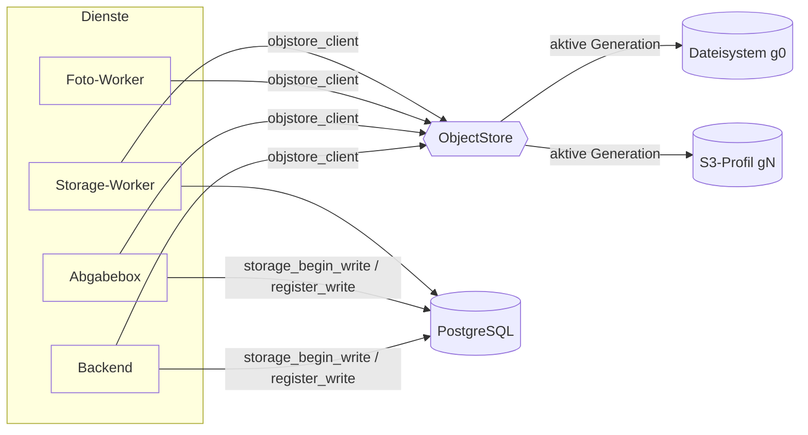

# Architektur des Dateispeichers

## Überblick

- **Ein Client für alle Dienste**: `backend/app/core/objstore_client.py` ist die einzige Quelle.
  `scripts/sync-objstore-client.sh` kopiert ihn nach `abgabebox-backend/app/` und
  `photo-analysis-worker/app/` (die Abgabebox darf aus Isolationsgründen keinen Backend-Code
  importieren). `--check` prüft in CI, dass die Kopien aktuell sind.
- **Backends**: `FilesystemBackend` (bisheriger Bestand, Generation 0) und `S3Backend` (boto3,
  Path- oder Virtual-Host-Adressierung, eigene CA, Timeouts, adaptive Retries, Multipart ab
  16 MiB, Bandbreitenbegrenzung).
- **Operationen**: `put_bytes`/`put_file`, `get_bytes`/`iter_bytes` (Streaming, Byte-Ranges),
  `delete`, `exists`/`head`, `list`, `copy`/`move`, `verify` (Grösse + SHA-256, optional
  vollständiges Nachlesen), `local_copy` (temporäre Datei für Bibliotheken, die Pfade brauchen).
- **Fassade im Backend**: `backend/app/core/storage.py` (Range-fähige Downloads
  `object_response`, Verzeichnisse materialisieren/hochladen, Namespaces).

## Keys und Namespaces

Ein Objekt heisst `(namespace, key)`:

| Namespace | Inhalt | Key-Beispiel |
|---|---|---|
| `main` | alles, was das Backend schreibt | `uploads/tenant-3/gallery/<uuid>.jpg`, `exports/generated/<uuid>.pdf`, `document_template_parts/…`, `document_template_snapshots/…` |
| `abgabebox` | öffentliche Abgabebox inkl. Quarantäne | `tenant-3/assignment-7/<uuid>.pdf`, `quarantine/tenant-3/…` |

Keys sind relative POSIX-Pfade ohne `..`, `.`, leere Segmente, Backslashes oder Steuerzeichen –
geprüft im Client (`validate_key`) **und** in der Datenbank (`storage_register_write`). Neue Keys
entstehen nur aus Code (`tenant-<id>`, UUID) plus einer geprüften Endung (`safe_suffix`); der
Dateiname des Clients wird nie Teil des Pfads. Die Mandantentrennung bleibt wie bisher in den
Zugriffsprüfungen der Routen; die Keys enthalten zusätzlich `tenant-<id>`.

Physischer Ort: Dateisystem `<root>/<key>`, S3 `<prefix>/g<generation>/<namespace>/<key>` im
Bucket des Profils (Namespace `abgabebox` optional in einem eigenen Bucket).

## Was persistent ist (Migrationsmatrix)

| Daten | Vorher | Jetzt | Art |
|---|---|---|---|
| Galerie-, Dokument-, Protokollbild-Uploads, Live-Photo-Clips | `uploads/` | Objekt `main` | persistent |
| Word-Import-Quellen | `uploads/word-imports/` | Objekt `main` | persistent |
| Mandantenlogos | `uploads/tenant-profiles/` | Objekt `main` | persistent |
| Erzeugte PDF-Exporte | `exports/generated/` | Objekt `main` (Aufbewahrung `EXPORT_RETENTION_DAYS`) | persistent, mit Frist |
| Dokumentvorlagen-Bauteile | `document_template_parts/` | Objekt `main` | persistent |
| Vorlagen-Snapshots abgeschlossener Protokolle | `document_template_snapshots/` | Objekte `main` (lokal als Cache materialisiert) | persistent |
| Mandanten-Klon/-Import-Dateien | `tenant_clones/`, `tenant_imports/` | Objekt im jeweiligen Namespace | persistent |
| Abgabebox-Uploads und Quarantäne | `abgabebox-uploads/` | Objekt `abgabebox` | persistent |
| Materialisierte Dokumentvorlagen | `document_templates/` | lokaler Cache, bei Bedarf neu erzeugt | regenerierbar |
| Thumbnails | `storage-local/thumbnails` | lokaler Cache | regenerierbar |
| Upload-Staging, Multipart-Puffer, Export-Arbeitsordner, ZIP-Downloads | lokal | lokal (temporär) | temporär |

Unbekannte Ordner werden bei der Erstmigration **mitgenommen** und im Prüfbericht als
unreferenziert ausgewiesen, nie still ignoriert oder gelöscht.

## Aktiver Speicher, Generationen und Fencing

`storage_state` (eine Zeile) hält aktives Profil, aktive Generation und das Schreib-Fence.
Jede Migration schreibt in eine **neue Generation** (`storage_generation`). Dadurch:

- können alte Daten eines früher genutzten Ziels nie unbemerkt wieder aktiv werden,
- bleibt die abgelöste Generation während der Rückfallfrist (`STORAGE_FALLBACK_DAYS`) unberührt,
- ist das Löschen alter Daten immer ein eigener, bestätigter Schritt.

**Schreibprotokoll** (in der Transaktion des Aufrufers):

1. `storage_begin_write()` – `SELECT … FOR SHARE` auf `storage_state`. Viele Schreiber parallel,
   aber ein Cutover (`UPDATE`) wartet auf alle offenen Schreibtransaktionen, und Schreiber
   danach sehen das Fence (`StorageWriteFenced` → HTTP 503 mit `Retry-After`).
2. Objekt schreiben (S3: Inhalt wird vorab gegen SHA-256 geprüft, falscher Inhalt verlässt den
   Host nie).
3. `storage_register_write()` – Objektregister (`storage_object`: Grösse, SHA-256, Version,
   Status, Generation) und Änderungsjournal (`storage_change_outbox`) in derselben Transaktion.
   Stimmt die Generation nicht mehr (Cutover dazwischen), schlägt die Transaktion fehl.

Leser cachen die aktive Konfiguration höchstens 2 s; ein Fehltreffer lädt sie sofort neu und
versucht es genau einmal mit der dann aktiven Generation – ein Rückgriff auf eine möglicherweise
veraltete Quelle findet nie statt.

## Sicherheitsmodell

- **Zugangsdaten**: in `storage_profile` nur Fernet-verschlüsselt (`STORAGE_CREDENTIALS_KEY`),
  nie im Klartext an das Frontend, nie in Logs oder Audit-Einträgen (nur geänderte Feldnamen).
  Fehlertexte von Verbindungstests werden von Signaturen und Schlüsseln bereinigt.
- **Abgabebox**: eigener Bucket mit eigenen, eingeschränkten Zugangsdaten. Beim lokalen S3 legt
  `storage-init` dafür einen Schlüssel an, der nur den Abgabebox-Bucket lesen/schreiben darf
  (getestet: Zugriff auf den Haupt-Bucket → `AccessDenied`). Ohne eingeschränkte Zugangsdaten
  zeigt das Adminportal eine Warnung.
- **Rollen**: eingeschränkte DB-Rollen bekommen nur `EXECUTE` auf SECURITY-DEFINER-Funktionen
  (`storage_begin_write`, `storage_register_write`, `storage_active_config`,
  `storage_usage_bytes`, `maintenance_effective_state`). Seit Migration 0115 entscheidet die
  angemeldete Rolle, nicht der Parameter: `hocx_abgabebox` bekommt nur die Abgabebox-Konfiguration
  und registriert nur im Namespace `abgabebox`, `hocx_photo_worker` nur die eigene Konfiguration.
  Der Foto-Worker nutzt (noch) die vollen Zugangsdaten des Profils - eigene Read-only-Schlüssel
  je Profil sind nicht umgesetzt.
- **Endpoints über das Admin-API**: das lokale Garage-Profil (Klartext-HTTP im internen Netz) ist
  nicht wählbar, es entsteht nur aus `LOCAL_S3_*`. Externe Endpoints müssen HTTPS nutzen und dürfen
  nicht auf Loopback-, Link-Local- (Cloud-Metadaten), Multicast- oder reservierte Adressen zeigen
  (auch nicht per DNS); private Netze (eigenes S3 im LAN) bleiben erlaubt.
- **Kein Docker-Socket** im Backend: den lokalen S3-Container steuert ausschliesslich der
  Host-Controller (`scripts/storage_controller.sh`).
- **Netz**: das lokale S3 hängt nur im internen Netz `storage`, ohne veröffentlichte Ports.
- **Admin-Aktionen**: `require_admin_write` (Lesen: jeder Admin), Prüfbericht-Download und
  Bereinigung nur für Owner; alles im Audit-Log; Zeilensperren gegen Doppelausführung.
