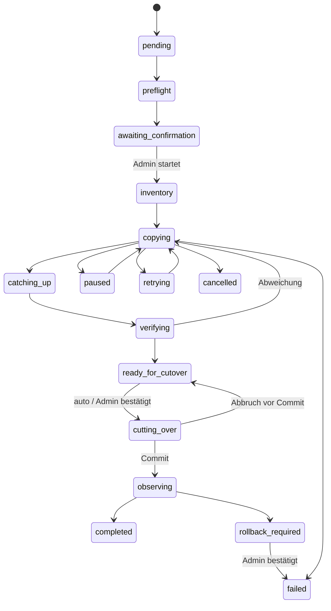

# Storage-Migrationen

Migrationen führt der Dienst `storage-worker` aus (`backend/app/workers/storage_worker.py`). Das
Adminportal (System → Storage) legt sie an, zeigt den Fortschritt live (Polling, auch nach einem
Reload vollständig aus der Datenbank) und löst die Aktionen aus.

## Zustände



Die vollständige Tabelle steht in `storage_migration_service.MIGRATION_TRANSITIONS`; jeder
Wechsel wird dagegen geprüft und mit Zeitstempel in `storage_migration_event` protokolliert.
Höchstens eine Migration ist gleichzeitig offen (eindeutiger Teilindex
`uq_storage_migration_open` plus Advisory-Lock beim Anlegen).

## Robustheit

- **Lease + Fencing-Token**: ein Worker übernimmt eine Migration per
  `UPDATE … FOR UPDATE SKIP LOCKED`, das Token erhöht sich bei jeder Übernahme. Jede Änderung
  prüft das Token; ein Worker mit verlorener Lease bricht ab (auch vor jedem Lesevorgang eines
  Objekts). Ein Heartbeat-Thread verlängert die Lease alle 15 s, sie läuft nach 60 s ab.
- **Eine Phase je Durchlauf**, alle Fortschritte in der DB (Objektstatus, Journal-Position,
  Checkpoints). Absturz, Neustart von Backend oder Worker und kurze DB-Ausfälle führen zu
  `retrying` mit exponentiellem Backoff und Jitter, nie zu Datenverlust.
- **Pro Objekt**: bereits korrekt kopierte Objekte (Grösse + SHA-256 im Ziel) werden übersprungen;
  Fehler → Backoff, Rate-Limits (SlowDown/429/503) bremsen den ganzen Worker; nach
  `max_object_attempts` gilt ein Objekt als `dead` und blockiert den Cutover.
- **Parallelität** (1–16) und **Bandbreite** (Mbit/s) je Migration einstellbar; liegengebliebene
  Multipart-Uploads im Ziel werden vor dem Kopieren abgebrochen.

## Ablauf

1. **Preflight**: Profile unverändert? Verbindungstest zum Ziel (schreiben/lesen/löschen),
   Zielgeneration leer, Quelle erreichbar, schnelle Inventur für die Schätzung, ungültige
   Dateinamen werden gemeldet. Danach wartet die Migration auf die Startbestätigung.
2. **Inventur**: Journal-Position merken; Objektregister plus Listing der Quelle (unregistrierte
   Objekte werden mitgenommen). Registrierte, aber fehlende Objekte
   werden als eigene Einträge aufgenommen und später als `source_missing` sichtbar.
3. **Kopieren** mit Integritätsprüfung vor dem Upload.
4. **Nachführen**: Journal seit der Inventur, je Key gewinnt der jüngste Eintrag; Löschungen
   werden im Ziel ausgeführt – gelöschte Dateien tauchen nicht wieder auf, ältere Versionen
   überschreiben nie neuere.
5. **Prüfen** (voll: Inhalt neu lesen und SHA-256 vergleichen; schnell: Grösse + Metadaten).
   Danach Referenzprüfung gegen die Datenbank.
6. **Cutover** (nur wenn alles kopiert und geprüft ist):
    1. kurzes Wartungsfenster `partial/writes` (neue Schreibanfragen → 503),
    2. Fence setzen – wartet auf offene Schreibtransaktionen (max. 20 s, sonst neuer Versuch),
    3. Journal vollständig nachziehen, frisch Kopiertes prüfen,
    4. Endabgleich: Register (Wahrheit) gegen Ziel; fehlende Objekte → Abbruch, Quelle bleibt aktiv,
    5. in **einer** Transaktion: aktives Profil + Generation umschalten, Fence lösen, alte
       Generation `retained` mit Rückfallfrist, neue `active`, Migration `observing`.
7. **Beobachtung**: Stichprobe über den regulären Lesepfad und Verbindungstest. Fehler →
   `rollback_required` (kein automatischer Rückfall); sonst `completed`, Prüfbericht mit
   `final_integrity_ok`, ggf. Freigabe der Wartung.

## Live-Migration (S3 → S3)

Jede Migration ist eine Live-Migration: hocX bleibt nutzbar, Änderungen werden nachgeführt, nur der
Cutover sperrt Schreibvorgänge kurz (Schätzung zeigt diese Unterbrechung getrennt). Ohne
«automatisch umschalten» wartet die Migration in `ready_for_cutover` auf «Umschalten
bestätigen» und hält das Ziel bis dahin aktuell.

## Aktionen

| Aktion | Wann | Wirkung |
|---|---|---|
| Starten | `awaiting_confirmation` | Inventur beginnt |
| Pausieren / Fortsetzen | vor dem Cutover | Worker stoppt am nächsten sicheren Punkt |
| Abbrechen | vor dem Cutover | Fence lösen, Quelle aktiv, Zielgeneration `abandoned`, Wartung frei |
| Fehlgeschlagene erneut versuchen | `failed`/`dead` Objekte | zurück auf `pending` |
| Fehlende bestätigen | `dead` mit `source_missing` | im Bericht ausgewiesen, Cutover möglich |
| Umschalten bestätigen | `ready_for_cutover` | Cutover startet |
| Rollback zur Kenntnis nehmen | `rollback_required` | `failed`; zurück nur per neuer Migration |
| Prüfbericht | jederzeit | JSON: Zählungen, Fehler, Inventur, Referenzen, Endprüfung |

## Upgrade auf S3-only

Ab 1.2.3 speichert hocX Dateien nur noch in S3. Den Dateisystem-Speicher
(Provider `filesystem`, Generation 0), die Erstmigration Dateisystem → lokales S3 und die
Rückfallfrist der Dateisystem-Generation gibt es nicht mehr. Das Upgrade-Tor besteht aus zwei
Prüfungen mit denselben Bedingungen: `scripts/deploy.sh` (`scripts/lib/storage_gate.sh`) prüft vor
dem Update, solange das bisherige Release noch läuft; die Datenbankmigration `0168_s3_only` prüft
beim Update noch einmal und bricht mit einer Erklärung ab, ohne die Datenbank zu verändern.

### Voraussetzungen

- Die Instanz läuft auf **1.2.0 bis 1.2.2**, und die **Erstmigration** auf S3 ist dort abgeschlossen. Eine
  Instanz vor 1.2 (ohne Objektspeicher) zuerst auf 1.2.2 aktualisieren und die Erstmigration
  ausführen (Adminportal → System → Storage → Migration vorbereiten, Ziel «Lokales S3»).
- **Keine Storage-Migration offen** – eine laufende Migration im Adminportal abschliessen oder
  abbrechen.
- Die Dateisystem-Generation ist **bereinigt** oder wird beim Deploy bereinigt (siehe unten).

Ist eine Bedingung nicht erfüllt, bricht `deploy.sh` mit «Upgrade gesperrt: …» ab, und das
bisherige Release läuft unverändert weiter.

### Ablauf in deploy.sh

1. Läuft die Datenbank noch nicht (erster Deploy) oder hat die Instanz noch keine einzige Datei,
   stellt die Migration direkt auf das lokale S3 um (siehe Neuinstallation).
2. Ist die Dateisystem-Generation noch in der Rückfallfrist, warnt `deploy.sh` und fragt:

    ```text
    Rückfallfrist jetzt beenden und den Dateisystem-Bestand bereinigen? [j/N]
    ```

    Ohne «j» bricht das Update ab; nach Ablauf der Frist erneut deployen. Ist die Frist bereits
    abgelaufen, bereinigt `deploy.sh` ohne Rückfrage.
3. Nicht interaktiv (CI, Cron, `ssh` ohne Terminal) wird nie gefragt: zum Beenden der Frist
   `HOCX_SKIP_STORAGE_FALLBACK=1` setzen, sonst bricht das Update ab.

    ```bash
    HOCX_SKIP_STORAGE_FALLBACK=1 ./scripts/deploy.sh prod
    ```

4. `deploy.sh` fordert die Bereinigung an und wartet, bis der `storage-worker` des **bisherigen**
   Releases sie erledigt hat (nur er kann noch Dateisystem-Dateien löschen). Die Wartezeit begrenzt
   `HOCX_STORAGE_PURGE_TIMEOUT` (Sekunden, Default `3600`); danach bricht das Update ab, der
   Fortschritt steht unter System → Storage, und ein erneuter Deploy wartet weiter.
5. Erst dann folgt das eigentliche Update mit der Migration `0168_s3_only`.

### Was bereinigt wird

Bereinigt werden nur Dateien im bisherigen Dateisystem-Bestand, deren Kopie in S3 die
Erstmigration verifiziert hat (Grösse und SHA-256). Alles andere bleibt im Dateisystem liegen.
Die Daten im aktiven S3-Profil sind nicht betroffen.

### Kein Weg zurück

- Eine Rückkehr auf das Dateisystem gibt es nicht – weder per Migration noch durch ein
  Zurückgehen auf 1.2.2, denn der Dateisystem-Bestand ist bereinigt. Nach dem Update läuft hocX
  nur noch mit S3; ein anderer Speicherort ist immer ein anderes S3-Profil.
- Das bisherige Dateisystem-Profil bleibt als deaktivierte Historie stehen: System → Storage zeigt
  es als «Dateisystem (bis 1.2.2, nicht mehr unterstützt)» ohne Aktionen, seine Generationen als
  bereinigt bzw. verworfen und die Erstmigration im Verlauf als «Erstmigration (bis 1.2.2)».
- **Backups von vor der S3-Migration** (Dateien noch im Dateisystem) lassen sich nur mit einem
  Release bis **1.2.2** wiederherstellen; die Wiederherstellung lehnt sie mit `backup_pre_s3` ab.
  Für einen solchen Restore 1.2.2 installieren, das Backup
  dort zurückspielen, die Erstmigration ausführen und danach wie oben aktualisieren.

### Neuinstallation

Eine neue Instanz startet direkt auf dem lokalen S3: die Migration `0168_s3_only` legt das
Profil «Lokales S3 (Garage)» aus `LOCAL_S3_*` an (von `deploy.sh` erzeugt, siehe
[Installation](betrieb.md#installation)) und aktiviert Generation 1. Fehlen die `LOCAL_S3_*`-Werte,
bricht die Migration ab.

!!! note "Erstmigration (bis 1.2.2)"
    Die einmalige Erstmigration Dateisystem → lokales S3 mit voller Wartung ist in der
    Dokumentation von 1.2.2 beschrieben (Git-Tag `v1.2.2`,
    `docs-site/docs/technik/storage/migration.md`, Abschnitt «Erstmigration»).
