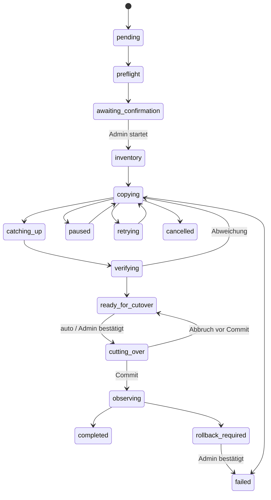

# Storage-Migrationen

Migrationen führt der Dienst `storage-worker` aus (`backend/app/workers/storage_worker.py`). Das
Adminportal (System → Storage) legt sie an, zeigt den Fortschritt live (Polling, auch nach einem
Reload vollständig aus der Datenbank) und löst die Aktionen aus.

## Zustände

Die vollständige Tabelle steht in `storage_migration_service.MIGRATION_TRANSITIONS`; jeder
Wechsel wird dagegen geprüft und mit Zeitstempel in `storage_migration_event` protokolliert.
Höchstens eine Migration ist gleichzeitig offen (eindeutiger Teilindex
`uq_storage_migration_open` plus Advisory-Lock beim Anlegen).

## Robustheit

- **Lease + Fencing-Token**: ein Worker übernimmt eine Migration per
  `UPDATE … FOR UPDATE SKIP LOCKED`, das Token erhöht sich bei jeder Übernahme. Jede Änderung
  prüft das Token; ein Worker mit verlorener Lease bricht ab (auch vor jedem Lesevorgang eines
  Objekts). Ein Heartbeat-Thread verlängert die Lease alle 15 s, sie läuft nach 60 s ab.
- **Eine Phase je Durchlauf**, alle Fortschritte in der DB (Objektstatus, Journal-Position,
  Checkpoints). Absturz, Neustart von Backend oder Worker und kurze DB-Ausfälle führen zu
  `retrying` mit exponentiellem Backoff und Jitter, nie zu Datenverlust.
- **Pro Objekt**: bereits korrekt kopierte Objekte (Grösse + SHA-256 im Ziel) werden übersprungen;
  Fehler → Backoff, Rate-Limits (SlowDown/429/503) bremsen den ganzen Worker; nach
  `max_object_attempts` gilt ein Objekt als `dead` und blockiert den Cutover.
- **Parallelität** (1–16) und **Bandbreite** (Mbit/s) je Migration einstellbar; liegengebliebene
  Multipart-Uploads im Ziel werden vor dem Kopieren abgebrochen.

## Ablauf

1. **Preflight**: Profile unverändert? Verbindungstest zum Ziel (schreiben/lesen/löschen),
   Zielgeneration leer, Quelle erreichbar, schnelle Inventur für die Schätzung, ungültige
   Dateinamen werden gemeldet. Danach wartet die Migration auf die Startbestätigung.
2. **Inventur**: Journal-Position merken; Erstmigration: Dateisystem durchlaufen, SHA-256 und
   Grösse jeder Datei erfassen und im Objektregister registrieren; Live: Register plus Listing
   der Quelle (unregistrierte Objekte werden mitgenommen). Registrierte, aber fehlende Objekte
   werden als eigene Einträge aufgenommen und später als `source_missing` sichtbar.
3. **Kopieren** mit Integritätsprüfung vor dem Upload.
4. **Nachführen**: Journal seit der Inventur, je Key gewinnt der jüngste Eintrag; Löschungen
   werden im Ziel ausgeführt – gelöschte Dateien tauchen nicht wieder auf, ältere Versionen
   überschreiben nie neuere.
5. **Prüfen** (voll: Inhalt neu lesen und SHA-256 vergleichen; schnell: Grösse + Metadaten).
   Danach Referenzprüfung gegen die Datenbank.
6. **Cutover** (nur wenn alles kopiert und geprüft ist):
    1. bei Live-Migrationen kurzes Wartungsfenster `partial/writes` (neue Schreibanfragen → 503),
    2. Fence setzen – wartet auf offene Schreibtransaktionen (max. 20 s, sonst neuer Versuch),
    3. Journal vollständig nachziehen, frisch Kopiertes prüfen,
    4. Endabgleich: Register (Wahrheit) gegen Ziel; fehlende Objekte → Abbruch, Quelle bleibt aktiv,
    5. in **einer** Transaktion: aktives Profil + Generation umschalten, Fence lösen, alte
       Generation `retained` mit Rückfallfrist, neue `active`, Migration `observing`.
7. **Beobachtung**: Stichprobe über den regulären Lesepfad und Verbindungstest. Fehler →
   `rollback_required` (kein automatischer Rückfall); sonst `completed`, Prüfbericht mit
   `final_integrity_ok`, ggf. Freigabe der Wartung.

## Erstmigration (Dateisystem → lokales S3)

1. System → Storage → **Migration vorbereiten**, Ziel «Lokales S3 (Garage)».
2. Preflight abwarten; das Portal zeigt die erwartete Wartungsdauer als Spanne.
3. **Migration starten** → volle Wartung (`preparing`): neue Anfragen erhalten 503, die
   Anmeldeseite zeigt die Wartungsmeldung, laufende Anfragen bekommen Zeit, laufende
   Galerie-Importe werden abgewartet, Hintergrundjobs pausieren; dann Fence → `active`.
4. Inventur, Kopie, Prüfung; die Restdauer wird laufend neu geschätzt.
5. Verweisen Datenbankeinträge auf fehlende Dateien, wartet der Cutover auf eine Bestätigung
   (die Liste steht im Prüfbericht).
6. Nach Cutover und Beobachtung gibt der Worker die Wartung frei – nur wenn alle
   Freigabebedingungen erfüllt sind. Bei Fehlern bleibt die Wartung `failed` (gesperrt), die
   Quelle aktiv und das Fence gelöst; ein Admin gibt erst frei, wenn der konsistente Zustand
   nachgewiesen ist (System → Wartung zeigt die Bedingungen).

Die Dateien im bisherigen Dateisystem bleiben unverändert erhalten (Generation 0, Rückfallfrist).

## Live-Migration (S3 → S3)

Gleicher Ablauf ohne volle Wartung: hocX bleibt nutzbar, Änderungen werden nachgeführt, nur der
Cutover sperrt Schreibvorgänge kurz (Schätzung zeigt diese Unterbrechung getrennt). Ohne
«automatisch umschalten» wartet die Migration in `ready_for_cutover` auf «Umschalten
bestätigen» und hält das Ziel bis dahin aktuell.

## Aktionen

| Aktion | Wann | Wirkung |
|---|---|---|
| Starten | `awaiting_confirmation` | Inventur beginnt (Erstmigration: volle Wartung) |
| Pausieren / Fortsetzen | vor dem Cutover | Worker stoppt am nächsten sicheren Punkt |
| Abbrechen | vor dem Cutover | Fence lösen, Quelle aktiv, Zielgeneration `abandoned`, Wartung frei |
| Fehlgeschlagene erneut versuchen | `failed`/`dead` Objekte | zurück auf `pending` |
| Fehlende bestätigen | `dead` mit `source_missing` | im Bericht ausgewiesen, Cutover möglich |
| Umschalten bestätigen | `ready_for_cutover` | Cutover startet |
| Rollback zur Kenntnis nehmen | `rollback_required` | `failed`; zurück nur per neuer Migration |
| Prüfbericht | jederzeit | JSON: Zählungen, Fehler, Inventur, Referenzen, Endprüfung |
